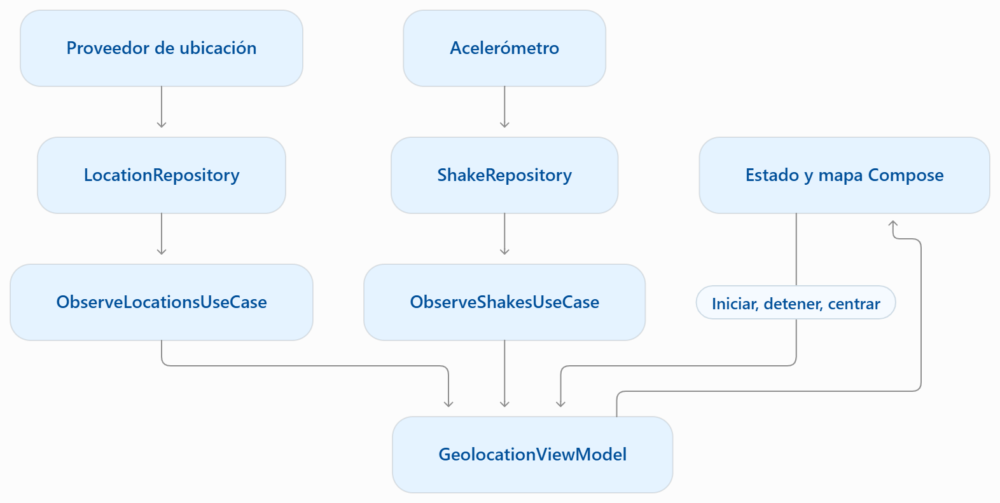

# Laboratorio 6.1. Geolocalización, mapas y acelerómetro

<br/><br/>

## Descripción general

Continúa sobre **TelemetryTracker** después de completar el laboratorio 5.1, incluidos los pasos 15 y 16. La base Room está en **versión 3**, con las migraciones y sus pruebas implementadas. Agrega una pantalla de geolocalización a la variante `debug`: solicita permisos, consume ubicación con Google Play Services, dibuja una trayectoria en Google Maps Compose y permite centrar la cámara mediante un botón o un gesto de agitación.

**Alcance:** captura con la actividad visible, trayectoria en memoria, distancia aproximada y pruebas unitarias. La captura se detiene al enviar la actividad a segundo plano, bloquear el dispositivo, abrir otra actividad o rotar. No se implementan seguimiento en segundo plano, un servicio foreground, sincronización ni guardado de puntos GPS en Room.

La pantalla anterior, GET/POST, autenticación, Room y DataStore se conservan. `MainActivity`, `TrackerApplication`, el manifiesto principal y el modelo `domain.model.tracking.TelemetryData` no se sustituyen.

<br/><br/>

## Objetivos

Al finalizar, podrás:

- Solicitar permisos de ubicación precisa y aproximada, explicar su propósito y reevaluarlos al regresar de Ajustes.
- Convertir callbacks de ubicación y acelerómetro a flujos cancelables, liberando los listeners correspondientes.
- Aplicar contratos y casos de uso de dominio, Hilt y un ViewModel con estado observable y eventos de cámara.
- Dibujar una ruta en Compose y calcular su distancia aproximada sin sustituir el modelo ni el almacenamiento anteriores.
- Probar validación de datos, inicio, cancelación, reinicio y recentrado mediante dobles de prueba.

<br/><br/>

## Prerrequisitos

- Laboratorio 5.1 completado hasta el paso 16: migración manual 1 → 2, migración automática 2 → 3 y pruebas unitarias e instrumentadas implementadas y verificadas.
- Base Room instalada en versión 3, con los datos conservados y las columnas técnicas `cached_at` y `cache_source`.
- Esquemas `1.json`, `2.json` y `3.json` conservados y disponibles para las pruebas instrumentadas de migración.
- Proyecto compilando, Hilt configurado y pantallas de telemetría, red y persistencia operativas.
- Android Studio y emulador o dispositivo con API 31 o superior y Google Play Services.
- Cuenta de Google Cloud y permiso para configurar Maps SDK for Android.
- PowerShell/CMD en Windows, ubicado en la raíz de TelemetryTracker.

<br/><br/>

## Configuración que se conserva

| Elemento | Configuración |
|---|---|
| AGP | 9.3.3 |
| Gradle wrapper | 9.5.0 |
| Plugin Kotlin Compose y serialización | 2.2.10 |
| Compose BOM | 2026.02.01 |
| compileSdk / targetSdk | 37 / 37 |
| minSdk | **31** |
| Bytecode Java | 11 |
| Hilt / KSP | 2.60.1 / 2.3.6 |
| Room / DataStore | 2.8.4 / 1.1.2 |
| Base Room | Clase de base definida en 5.1, versión **3** |
| Archivo de base | `telemetry_lab51_tracking_db` |
| Esquemas Room | `1.json`, `2.json` y `3.json` bajo el directorio de la misma clase de base |

La versión 3 de Room contiene los seis campos de telemetría y los metadatos locales `cached_at` y `cache_source`. Conserva la migración manual `MIGRATION_1_2`, la migración automática 2 → 3 y la configuración de exportación y assets de esquemas establecidas en 5.1.

<br/><br/>

**En 6.1 no se necesita otra migración:** el esquema, el nombre de la clase de base, el archivo `telemetry_lab51_tracking_db`, la entidad, el DAO, los mappers y los módulos de persistencia permanecen como quedaron al finalizar 5.1. El módulo de geolocalización no crea otra instancia de Room ni escribe puntos en la base.

Conserva `PersistenceLabActivity` en la ubicación donde ya funciona y su registro en el manifiesto `debug`. La nueva `GeolocationLabActivity` se crea en `src/debug/java`.

Conserva el JDK que ya utiliza Android Studio para ejecutar Gradle. No lo cambies por el hecho de que el bytecode de la aplicación sea Java 11.

<br/><br/>

## Archivos que se incorporan

Crea los archivos nuevos siguiendo las rutas y los bloques completos de esta guía. Integra las adiciones en las configuraciones existentes:

| Archivo existente | Adición de 6.1 |
|---|---|
| `gradle/libs.versions.toml` | Dos versiones y dos aliases nuevos |
| `app/build.gradle.kts` | Dos dependencias nuevas |
| `app/src/debug/AndroidManifest.xml` | Permisos de ubicación, API key, acelerómetro opcional y actividad de geolocalización |

Conserva el resto de cada archivo, especialmente el plugin Room, `room { schemaDirectory(...) }`, la configuración de assets de pruebas instrumentadas y las dependencias de `room-testing`. No sustituyas el archivo completo de Gradle ni el manifiesto para añadir esta funcionalidad.

La credencial del mapa utiliza un marcador de posición que debes configurar localmente.

<br/><br/>

## Instruccioens

### Paso 1. Verificar y respaldar la línea base

El punto de partida es el estado final funcional del Laboratorio 5.1. Guarda un respaldo o commit que incluya la versión 3 de Room, las migraciones, los tres esquemas y las pruebas.

Desde la raíz de TelemetryTracker, en CMD:

```cmd
.\gradlew.bat :app:assembleDebug :app:testDebugUnitTest
```

Ejecuta la aplicación y comprueba su funcionalidad. Abre también la actividad de persistencia:

```cmd
.\gradlew.bat :app:installDebug

adb shell am start -n com.example.advancedtracker/com.example.advancedtracker.ui.persistence.PersistenceLabActivity
```

En la pantalla de persistencia, activa **Solo local** para realizar la comparación sin que una nueva consulta HTTP actualice la caché. Abre Database Inspector y ejecuta:

```sql
PRAGMA user_version;

SELECT id, latitude, longitude, speed_kmh, timestamp, is_mocked,
       cached_at, cache_source
FROM telemetry_table
ORDER BY timestamp DESC, id ASC;
```

<br/>

**Resultado esperado:** `user_version = 3`, registros disponibles y las dos columnas técnicas presentes. Guarda una captura o exportación para compararla al terminar 6.1. Los registros migrados pueden conservar `cached_at = 0`; no tienen que recibir una nueva fecha únicamente por abrir la pantalla.

Comprueba que los tres JSON de esquema continúan bajo el directorio correspondiente a tu clase de base y conserva los resultados satisfactorios de las pruebas del paso 16 de 5.1. Si falla esta línea base, resuelve ese problema antes de incorporar geolocalización.

<br/><br/>

## Paso 2. Agregar únicamente las dependencias faltantes

En `gradle/libs.versions.toml`, añade a la sección `[versions]` existente:

```toml
# Cap06
playServicesLocation = "21.4.0"
mapsCompose = "4.3.3"
```

Añade a `[libraries]`, sin repetir el encabezado:

```toml
play-services-location = { module = "com.google.android.gms:play-services-location", version.ref = "playServicesLocation" }
maps-compose = { module = "com.google.maps.android:maps-compose", version.ref = "mapsCompose" }
```

En el bloque `dependencies` existente de `app/build.gradle.kts`:

```kotlin
// Cap06
implementation(libs.play.services.location)
implementation(libs.maps.compose)
```

Las versiones siguientes se fijan para las dos bibliotecas nuevas de esta práctica. Conserva las versiones funcionales del resto de las dependencias. Maps Compose aporta sus dependencias de mapas de manera transitiva; no agregues además otra versión de `play-services-maps`.

No añadas plugins Kotlin Android, otros procesadores, Hilt ni una segunda BOM. El proyecto ya contiene Lifecycle Compose, corrutinas, JUnit y kotlinx-coroutines-test. No agregues duplicados para ejecutar estas pruebas.

Ejecuta **Sync Project with Gradle Files** y revisa las versiones efectivamente resueltas:

```powershell
.\gradlew.bat :app:dependencies --configuration debugRuntimeClasspath |
    Select-String -Pattern "play-services-location|maps-compose|play-services-maps"
```

**Verificación:** aliases resueltos, sin cambios de SDK ni de Java y sin reemplazar las dependencias anteriores.

<br/><br/>


### Paso 3. Preparar Google Maps

1. Usa un proyecto de Google Cloud con facturación habilitada y activa **Maps SDK for Android**.

2. Crea una API key para ese servicio.

3. Obtén el SHA-1 del certificado de depuración utilizado por tu instalación:

```cmd
.\gradlew.bat :app:signingReport
```

4. Restringe la credencial a la aplicación Android `com.example.advancedtracker` y al SHA-1 de `debug`. Restringe también su uso a Maps SDK for Android. En equipos distintos puede variar el certificado de depuración.

5. Crea el recurso siguiente y reemplaza el marcador por tu credencial local. No deshabilites restricciones para resolver un mapa gris: verifica paquete, firma y API habilitada.

Archivo: `app/src/debug/res/values/maps_api_key.xml`.

```xml
<?xml version="1.0" encoding="utf-8"?>
<resources>
    <!-- Sustituye el valor localmente antes de ejecutar el mapa. No contiene una credencial real. -->
    <string name="maps_api_key" translatable="false">REPLACE_WITH_YOUR_API_KEY</string>
</resources>
```

La clave incluida en un APK no se vuelve secreta por colocarla en un recurso. Las restricciones de aplicación y API son parte de su configuración. El ejemplo utiliza un marcador de posición, no una credencial real.

<br/><br/>


### Paso 4. Crear los contratos y la lógica de dominio

Cada archivo siguiente vive bajo `app/src/main/java`. El dominio no importa Android, Google Maps, Room, Retrofit ni Hilt. `LocationSample` representa una lectura temporal del proveedor; no reemplaza `TelemetryData`, no incorpora un nuevo DTO de red y no modifica los seis campos de telemetría del dominio ni las columnas técnicas `cached_at` y `cache_source` de Room.

La precisión reportada se mantiene como metadato de la lectura. Por defecto no se aplica un límite de 40 metros: eso descartaría muchas ubicaciones aproximadas válidas. Un límite explícito se demuestra únicamente en las pruebas de política.

Archivo: `app/src/main/java/com/example/advancedtracker/domain/geolocation/GeoModels.kt`.

```kotlin
package com.example.advancedtracker.domain.geolocation

data class GeoCoordinate(val latitude: Double, val longitude: Double)

/** Lectura del proveedor de ubicación; no sustituye TelemetryData ni el DTO de red. */
data class LocationSample(
    val coordinate: GeoCoordinate,
    val timestampMs: Long,
    val speedKmh: Double,
    val accuracyMeters: Double?,
    val isMocked: Boolean
)

data class RouteSnapshot(
    val points: List<GeoCoordinate> = emptyList(),
    val lastSample: LocationSample? = null,
    val firstTimestampMs: Long? = null,
    val distanceMeters: Double = 0.0,
    val acceptedCount: Int = 0,
    val rejectedCount: Int = 0
)
```

<br/>

Archivo: `app/src/main/java/com/example/advancedtracker/domain/geolocation/GeolocationRepositories.kt`.

```kotlin
package com.example.advancedtracker.domain.geolocation

import kotlinx.coroutines.flow.Flow

interface LocationRepository {
    fun observeLocations(): Flow<LocationSample>
}

interface ShakeRepository {
    val available: Boolean
    fun observeShakes(): Flow<Unit>
}
```

<br/>

Archivo: `app/src/main/java/com/example/advancedtracker/domain/geolocation/GeolocationUseCases.kt`.

```kotlin
package com.example.advancedtracker.domain.geolocation

import kotlinx.coroutines.flow.Flow

class ObserveLocationsUseCase(private val repository: LocationRepository) {
    operator fun invoke(): Flow<LocationSample> = repository.observeLocations()
}

class ObserveShakesUseCase(private val repository: ShakeRepository) {
    val available: Boolean get() = repository.available
    operator fun invoke(): Flow<Unit> = repository.observeShakes()
}
```

<br/>

Archivo: `app/src/main/java/com/example/advancedtracker/domain/geolocation/RouteReducer.kt`.

```kotlin
package com.example.advancedtracker.domain.geolocation

import kotlin.math.asin
import kotlin.math.cos
import kotlin.math.sin
import kotlin.math.sqrt

/** Validación estructural. El límite de precisión es opcional, no se impone a ubicación aproximada. */
class LocationSampleValidator(private val maxAccuracyMeters: Double? = null) {
    init {
        require(maxAccuracyMeters == null ||
            (maxAccuracyMeters.isFinite() && maxAccuracyMeters >= 0.0))
    }

    fun accepts(sample: LocationSample): Boolean {
        val point = sample.coordinate
        if (!point.latitude.isFinite() || point.latitude !in -90.0..90.0) return false
        if (!point.longitude.isFinite() || point.longitude !in -180.0..180.0) return false
        if (sample.timestampMs <= 0L || !sample.speedKmh.isFinite() || sample.speedKmh < 0.0) return false
        val accuracy = sample.accuracyMeters
        if (accuracy != null && (!accuracy.isFinite() || accuracy < 0.0)) return false
        return maxAccuracyMeters == null || (accuracy != null && accuracy <= maxAccuracyMeters)
    }
}

/** Conserva hasta 500 puntos para dibujar; la distancia y el contador acumulan toda la sesión. */
class RouteReducer(
    private val validator: LocationSampleValidator = LocationSampleValidator(),
    private val maxVisiblePoints: Int = 500
) {
    init { require(maxVisiblePoints >= 2) }

    fun append(route: RouteSnapshot, sample: LocationSample): RouteSnapshot {
        val previous = route.lastSample
        if (!validator.accepts(sample) ||
            (previous != null && sample.timestampMs <= previous.timestampMs)) {
            return route.copy(rejectedCount = route.rejectedCount + 1)
        }
        val increment = previous?.let { distance(it.coordinate, sample.coordinate) } ?: 0.0
        return route.copy(
            points = (route.points + sample.coordinate).takeLast(maxVisiblePoints),
            lastSample = sample,
            firstTimestampMs = route.firstTimestampMs ?: sample.timestampMs,
            distanceMeters = route.distanceMeters + increment,
            acceptedCount = route.acceptedCount + 1
        )
    }

    /** Haversine sobre una Tierra esférica: distancia aproximada, no distancia vial. */
    private fun distance(from: GeoCoordinate, to: GeoCoordinate): Double {
        val factor = Math.PI / 180.0
        val latitudeDelta = (to.latitude - from.latitude) * factor
        val longitudeDelta = (to.longitude - from.longitude) * factor
        val a = sin(latitudeDelta / 2).let { it * it } +
            cos(from.latitude * factor) * cos(to.latitude * factor) *
            sin(longitudeDelta / 2).let { it * it }
        return 6_371_000.0 * 2.0 * asin(sqrt(a.coerceIn(0.0, 1.0)))
    }
}
```

<br/>


Archivo: `app/src/main/java/com/example/advancedtracker/domain/geolocation/ShakeGate.kt`.

```kotlin
package com.example.advancedtracker.domain.geolocation

/** Decide si una lectura supera el umbral y respeta el intervalo entre gestos. */
class ShakeGate(
    private val thresholdG: Double = 2.7,
    private val intervalMs: Long = 500L
) {
    private var lastAcceptedMs: Long? = null

    init {
        require(thresholdG.isFinite() && thresholdG > 0.0)
        require(intervalMs >= 0L)
    }

    fun accepts(forceG: Double, elapsedMs: Long): Boolean {
        if (!forceG.isFinite() || forceG <= thresholdG || elapsedMs < 0L) return false
        val last = lastAcceptedMs
        if (last != null && elapsedMs - last < intervalMs) return false
        lastAcceptedMs = elapsedMs
        return true
    }
}
```

<br/>

**Resultado esperado:** contratos de flujos, validación de lecturas, cálculo de distancia y control del intervalo de agitación independientes del framework.

La ruta rechaza coordenadas fuera de rango, valores no finitos, velocidad negativa y timestamps repetidos o anteriores al último aceptado. Estos controles no prueban que una ubicación sea auténtica ni corrigen todas las formas de ruido GPS. Una lectura `isMocked=true` es aceptada: el laboratorio debe funcionar con el emulador.

El cálculo Haversine estima distancia geográfica entre puntos, no recorrido vial. Ruido, saltos y ubicación aproximada pueden alterar el total. Se dibujan los últimos 500 puntos; el contador y la distancia acumulan toda la sesión.

<br/><br/>


### Paso 5. Adaptar ubicación y acelerómetro y configurar Hilt

La ubicación se solicita con un intervalo deseado de 4 segundos y mínimo de 2 segundos. No se garantiza una emisión exacta cada 4 segundos: depende del proveedor, permisos y condiciones del dispositivo. Alta precisión tampoco significa precisión milimétrica.

El repositorio comprueba permisos, Google Play Services y ubicación habilitada al comenzar cada recolección. Maneja fallos del `Task` de registro y libera las actualizaciones cuando se cancela el flujo. Un registro que termina después de la cancelación también se libera.

<br/>

Archivo: `app/src/main/java/com/example/advancedtracker/data/geolocation/FusedLocationRepository.kt`.

```kotlin
package com.example.advancedtracker.data.geolocation

import android.Manifest
import android.annotation.SuppressLint
import android.content.Context
import android.content.pm.PackageManager
import android.location.LocationManager
import android.os.Looper
import androidx.core.content.ContextCompat
import androidx.core.location.LocationCompat
import com.example.advancedtracker.domain.geolocation.GeoCoordinate
import com.example.advancedtracker.domain.geolocation.LocationRepository
import com.example.advancedtracker.domain.geolocation.LocationSample
import com.google.android.gms.common.ConnectionResult
import com.google.android.gms.common.GoogleApiAvailability
import com.google.android.gms.location.LocationCallback
import com.google.android.gms.location.LocationRequest
import com.google.android.gms.location.LocationResult
import com.google.android.gms.location.LocationServices
import com.google.android.gms.location.Priority
import dagger.hilt.android.qualifiers.ApplicationContext
import kotlinx.coroutines.channels.awaitClose
import kotlinx.coroutines.flow.Flow
import kotlinx.coroutines.flow.callbackFlow
import kotlinx.coroutines.isActive
import javax.inject.Inject
import javax.inject.Singleton

@Singleton
class FusedLocationRepository @Inject constructor(
    @ApplicationContext private val context: Context
) : LocationRepository {
    private val client = LocationServices.getFusedLocationProviderClient(context)

    @SuppressLint("MissingPermission") // Los permisos se comprueban al iniciar cada recolección.
    override fun observeLocations(): Flow<LocationSample> = callbackFlow {
        fun granted(permission: String) = ContextCompat.checkSelfPermission(
            context, permission
        ) == PackageManager.PERMISSION_GRANTED

        val precise = granted(Manifest.permission.ACCESS_FINE_LOCATION)
        if (!precise && !granted(Manifest.permission.ACCESS_COARSE_LOCATION)) {
            close(SecurityException("No hay permiso de ubicación. Autorízalo antes de iniciar."))
            return@callbackFlow
        }
        if (GoogleApiAvailability.getInstance().isGooglePlayServicesAvailable(context) !=
            ConnectionResult.SUCCESS) {
            close(IllegalStateException("Google Play Services no está disponible o necesita actualizarse."))
            return@callbackFlow
        }
        val manager = context.getSystemService(LocationManager::class.java)
        if (manager == null || !manager.isLocationEnabled) {
            close(IllegalStateException("La ubicación del dispositivo está desactivada. Actívala en Ajustes."))
            return@callbackFlow
        }

        val priority = if (precise) Priority.PRIORITY_HIGH_ACCURACY
                       else Priority.PRIORITY_BALANCED_POWER_ACCURACY
        val request = LocationRequest.Builder(priority, 4_000L)
            .setMinUpdateIntervalMillis(2_000L)
            .build()
        val callback = object : LocationCallback() {
            override fun onLocationResult(result: LocationResult) {
                result.locations.forEach { location ->
                    trySend(LocationSample(
                        coordinate = GeoCoordinate(location.latitude, location.longitude),
                        timestampMs = location.time,
                        speedKmh = if (location.hasSpeed()) location.speed.toDouble() * 3.6 else 0.0,
                        accuracyMeters = if (location.hasAccuracy()) location.accuracy.toDouble() else null,
                        isMocked = LocationCompat.isMock(location)
                    ))
                }
            }
        }

        try {
            client.requestLocationUpdates(request, callback, Looper.getMainLooper())
                .addOnFailureListener { error -> close(error) }
                .addOnSuccessListener {
                    // Si el registro termina después de la cancelación, también se libera.
                    if (!isActive) client.removeLocationUpdates(callback)
                }
        } catch (error: SecurityException) {
            close(error)
        } catch (error: IllegalStateException) {
            close(error)
        }
        awaitClose { client.removeLocationUpdates(callback) }
    }
}
```

<br/>

El acelerómetro es opcional. El intervalo de agitación utiliza `SystemClock.elapsedRealtime()`, que es monotónico. Cancelar la recolección libera su listener. Sin sensor, el botón Centrar sigue funcionando.

<br/>

Archivo: `app/src/main/java/com/example/advancedtracker/data/geolocation/AndroidShakeRepository.kt`.

```kotlin
package com.example.advancedtracker.data.geolocation

import android.content.Context
import android.hardware.Sensor
import android.hardware.SensorEvent
import android.hardware.SensorEventListener
import android.hardware.SensorManager
import android.os.SystemClock
import com.example.advancedtracker.domain.geolocation.ShakeGate
import com.example.advancedtracker.domain.geolocation.ShakeRepository
import dagger.hilt.android.qualifiers.ApplicationContext
import kotlinx.coroutines.channels.awaitClose
import kotlinx.coroutines.flow.Flow
import kotlinx.coroutines.flow.callbackFlow
import javax.inject.Inject
import javax.inject.Singleton
import kotlin.math.sqrt

@Singleton
class AndroidShakeRepository @Inject constructor(
    @ApplicationContext context: Context
) : ShakeRepository {
    private val manager = context.getSystemService(SensorManager::class.java)
    private val accelerometer = manager?.getDefaultSensor(Sensor.TYPE_ACCELEROMETER)
    override val available: Boolean get() = manager != null && accelerometer != null

    override fun observeShakes(): Flow<Unit> = callbackFlow {
        val sensorManager = manager
        val sensor = accelerometer
        if (sensorManager == null || sensor == null) {
            close() // El gesto es opcional; el botón Centrar sigue disponible.
            return@callbackFlow
        }
        val gate = ShakeGate()
        val listener = object : SensorEventListener {
            override fun onSensorChanged(event: SensorEvent) {
                if (event.sensor.type != Sensor.TYPE_ACCELEROMETER) return
                val x = event.values[0].toDouble() / SensorManager.GRAVITY_EARTH
                val y = event.values[1].toDouble() / SensorManager.GRAVITY_EARTH
                val z = event.values[2].toDouble() / SensorManager.GRAVITY_EARTH
                if (gate.accepts(sqrt(x * x + y * y + z * z), SystemClock.elapsedRealtime())) {
                    trySend(Unit)
                }
            }
            override fun onAccuracyChanged(sensor: Sensor?, accuracy: Int) = Unit
        }
        if (!sensorManager.registerListener(listener, sensor, SensorManager.SENSOR_DELAY_UI)) {
            close(IllegalStateException("No fue posible registrar el acelerómetro."))
        }
        awaitClose { sensorManager.unregisterListener(listener) }
    }
}
```

<br/>

Crea los módulos nuevos. No sustituyas los módulos existentes de Repository, Retrofit, Hilt ni persistencia.

Archivo: `app/src/main/java/com/example/advancedtracker/di/geolocation/GeolocationModule.kt`.

```kotlin
package com.example.advancedtracker.di.geolocation

import com.example.advancedtracker.data.geolocation.AndroidShakeRepository
import com.example.advancedtracker.data.geolocation.FusedLocationRepository
import com.example.advancedtracker.domain.geolocation.LocationRepository
import com.example.advancedtracker.domain.geolocation.ObserveLocationsUseCase
import com.example.advancedtracker.domain.geolocation.ObserveShakesUseCase
import com.example.advancedtracker.domain.geolocation.RouteReducer
import com.example.advancedtracker.domain.geolocation.ShakeRepository
import dagger.Binds
import dagger.Module
import dagger.Provides
import dagger.hilt.InstallIn
import dagger.hilt.components.SingletonComponent

@Module
@InstallIn(SingletonComponent::class)
abstract class GeolocationBindings {
    @Binds
    abstract fun bindLocation(impl: FusedLocationRepository): LocationRepository
    @Binds
    abstract fun bindShake(impl: AndroidShakeRepository): ShakeRepository
}

@Module
@InstallIn(SingletonComponent::class)
object GeolocationModule {
    @Provides
    fun provideLocations(repository: LocationRepository) = ObserveLocationsUseCase(repository)
    @Provides
    fun provideShakes(repository: ShakeRepository) = ObserveShakesUseCase(repository)
    @Provides
    fun provideReducer() = RouteReducer()
}
```

<br/>

La infraestructura implementa contratos de dominio; presentación consume casos de uso. Las anotaciones Hilt quedan fuera del dominio.



<br/><br/>


### Paso 6. Crear el estado y el ViewModel

`startTracking()` inicia una ruta nueva. Un segundo toque durante el seguimiento no crea otro colector. `stopTracking()` cancela ambos flujos y conserva lo dibujado. Al iniciar otra ruta se reinician puntos y métricas.

Un identificador de sesión evita que la finalización tardía de un trabajo cancelado cambie el estado de una sesión recién iniciada. Los eventos de cámara usan `SharedFlow` sin replay: un gesto no debe reproducirse como evento antiguo después de recrear la pantalla.

<br/>

Archivo: `app/src/main/java/com/example/advancedtracker/ui/geolocation/GeolocationUiState.kt`.

```kotlin
package com.example.advancedtracker.ui.geolocation

import com.example.advancedtracker.domain.geolocation.RouteSnapshot

data class GeolocationUiState(
    val route: RouteSnapshot = RouteSnapshot(),
    val isTracking: Boolean = false,
    val sensorAvailable: Boolean = false,
    val error: String? = null,
    val sensorWarning: String? = null
)
```

<br/>

Archivo: `app/src/main/java/com/example/advancedtracker/ui/geolocation/GeolocationViewModel.kt`.

```kotlin
package com.example.advancedtracker.ui.geolocation

import androidx.lifecycle.ViewModel
import androidx.lifecycle.viewModelScope
import com.example.advancedtracker.domain.geolocation.GeoCoordinate
import com.example.advancedtracker.domain.geolocation.ObserveLocationsUseCase
import com.example.advancedtracker.domain.geolocation.ObserveShakesUseCase
import com.example.advancedtracker.domain.geolocation.RouteReducer
import dagger.hilt.android.lifecycle.HiltViewModel
import kotlinx.coroutines.CancellationException
import kotlinx.coroutines.Job
import kotlinx.coroutines.channels.BufferOverflow
import kotlinx.coroutines.flow.MutableSharedFlow
import kotlinx.coroutines.flow.MutableStateFlow
import kotlinx.coroutines.flow.asSharedFlow
import kotlinx.coroutines.flow.collect
import kotlinx.coroutines.flow.asStateFlow
import kotlinx.coroutines.flow.update
import kotlinx.coroutines.launch
import javax.inject.Inject

@HiltViewModel
class GeolocationViewModel @Inject constructor(
    private val observeLocations: ObserveLocationsUseCase,
    private val observeShakes: ObserveShakesUseCase,
    private val reducer: RouteReducer
) : ViewModel() {
    private val _state = MutableStateFlow(GeolocationUiState(sensorAvailable = observeShakes.available))
    val state = _state.asStateFlow()
    private val _cameraEvents = MutableSharedFlow<GeoCoordinate>(
        replay = 0, extraBufferCapacity = 1, onBufferOverflow = BufferOverflow.DROP_OLDEST
    )
    val cameraEvents = _cameraEvents.asSharedFlow()
    private var locationJob: Job? = null
    private var shakeJob: Job? = null
    private var sessionId = 0L

    /** Cada inicio crea una ruta nueva. Un segundo toque durante el rastreo no duplica colectores. */
    fun startTracking() {
        if (_state.value.isTracking) return
        val session = ++sessionId
        _state.value = GeolocationUiState(isTracking = true, sensorAvailable = observeShakes.available)
        if (observeShakes.available) {
            shakeJob = viewModelScope.launch {
                try {
                    observeShakes().collect { if (session == sessionId) recenter() }
                } catch (cancelled: CancellationException) {
                    throw cancelled
                } catch (error: Exception) {
                    if (session == sessionId) _state.update {
                        it.copy(sensorWarning = "El gesto no está disponible. Puedes utilizar Centrar.")
                    }
                }
            }
        }
        locationJob = viewModelScope.launch {
            try {
                observeLocations().collect { sample ->
                    if (session == sessionId) _state.update {
                        it.copy(route = reducer.append(it.route, sample))
                    }
                }
            } catch (cancelled: CancellationException) {
                throw cancelled
            } catch (error: Exception) {
                if (session == sessionId) _state.update {
                    it.copy(error = error.message ?: "No fue posible obtener la ubicación.")
                }
            } finally {
                // Una sesión cancelada no puede cambiar el estado de una sesión posterior.
                if (session == sessionId) {
                    shakeJob?.cancel()
                    shakeJob = null
                    _state.update { it.copy(isTracking = false) }
                }
            }
        }
    }

    fun stopTracking() {
        ++sessionId
        locationJob?.cancel()
        shakeJob?.cancel()
        locationJob = null
        shakeJob = null
        _state.update { it.copy(isTracking = false) }
    }

    fun recenter() {
        _state.value.route.lastSample?.coordinate?.let { _cameraEvents.tryEmit(it) }
    }
}
```

<br/>

**Verificación:** errores de ubicación aparecen en el estado; un fallo del acelerómetro solo deshabilita el gesto. La cancelación se vuelve a lanzar y no se presenta como fallo de negocio.

<br/><br/>


### Paso 7. Solicitar y reevaluar los permisos

Se solicitan FINE y COARSE juntos. COARSE basta para ingresar al mapa; FINE permite pedir mayor precisión. Al regresar de Ajustes se consulta nuevamente el estado real del sistema.

Una respuesta negativa no se clasifica automáticamente como denegación permanente. Tras una solicitud terminada, si ambos permisos siguen denegados y el sistema ya no indica que deba mostrarse una explicación, la pantalla ofrece Ajustes. Ese estado puede depender de políticas o decisiones del sistema y no se etiqueta como certeza universal de denegación permanente.

No se declara ni solicita `ACCESS_BACKGROUND_LOCATION`, porque el alcance es captura con la actividad visible.

<br/>

Archivo: `app/src/main/java/com/example/advancedtracker/ui/geolocation/LocationPermissionGate.kt`.

```kotlin
package com.example.advancedtracker.ui.geolocation

import android.Manifest
import android.content.Intent
import android.content.pm.PackageManager
import android.net.Uri
import android.provider.Settings
import androidx.activity.ComponentActivity
import androidx.activity.compose.rememberLauncherForActivityResult
import androidx.activity.result.contract.ActivityResultContracts
import androidx.compose.foundation.layout.Arrangement
import androidx.compose.foundation.layout.Column
import androidx.compose.foundation.layout.fillMaxSize
import androidx.compose.foundation.layout.padding
import androidx.compose.foundation.rememberScrollState
import androidx.compose.foundation.verticalScroll
import androidx.compose.material3.AlertDialog
import androidx.compose.material3.Button
import androidx.compose.material3.MaterialTheme
import androidx.compose.material3.Text
import androidx.compose.material3.TextButton
import androidx.compose.runtime.Composable
import androidx.compose.runtime.DisposableEffect
import androidx.compose.runtime.getValue
import androidx.compose.runtime.mutableStateOf
import androidx.compose.runtime.remember
import androidx.compose.runtime.rememberUpdatedState
import androidx.compose.runtime.saveable.rememberSaveable
import androidx.compose.runtime.setValue
import androidx.compose.ui.Alignment
import androidx.compose.ui.Modifier
import androidx.compose.ui.unit.dp
import androidx.core.app.ActivityCompat
import androidx.core.content.ContextCompat
import androidx.lifecycle.Lifecycle
import androidx.lifecycle.LifecycleEventObserver

private data class PermissionSnapshot(val allowed: Boolean, val precise: Boolean)

private fun permissionSnapshot(activity: ComponentActivity): PermissionSnapshot {
    fun granted(permission: String) = ContextCompat.checkSelfPermission(
        activity, permission
    ) == PackageManager.PERMISSION_GRANTED
    val fine = granted(Manifest.permission.ACCESS_FINE_LOCATION)
    return PermissionSnapshot(fine || granted(Manifest.permission.ACCESS_COARSE_LOCATION), fine)
}

@Composable
fun LocationPermissionGate(
    activity: ComponentActivity,
    onPermissionLost: () -> Unit,
    content: @Composable (precise: Boolean) -> Unit
) {
    var permissions by remember { mutableStateOf(permissionSnapshot(activity)) }
    var showRationale by rememberSaveable { mutableStateOf(false) }
    var requestFinished by rememberSaveable { mutableStateOf(false) }
    val onLost by rememberUpdatedState(onPermissionLost)
    fun shouldExplain() = ActivityCompat.shouldShowRequestPermissionRationale(
        activity, Manifest.permission.ACCESS_FINE_LOCATION
    ) || ActivityCompat.shouldShowRequestPermissionRationale(
        activity, Manifest.permission.ACCESS_COARSE_LOCATION
    )

    val launcher = rememberLauncherForActivityResult(
        ActivityResultContracts.RequestMultiplePermissions()
    ) {
        requestFinished = true
        permissions = permissionSnapshot(activity)
        if (!permissions.allowed) onLost()
    }
    val request: () -> Unit = {
        launcher.launch(arrayOf(
            Manifest.permission.ACCESS_FINE_LOCATION,
            Manifest.permission.ACCESS_COARSE_LOCATION
        ))
    }

    DisposableEffect(activity) {
        val observer = LifecycleEventObserver { _, event ->
            if (event == Lifecycle.Event.ON_RESUME) {
                permissions = permissionSnapshot(activity)
                if (!permissions.allowed) onLost()
            }
        }
        activity.lifecycle.addObserver(observer)
        onDispose { activity.lifecycle.removeObserver(observer) }
    }

    if (permissions.allowed) {
        content(permissions.precise)
    } else {
        val settingsSuggested = requestFinished && !shouldExplain()
        Column(
            modifier = Modifier.fillMaxSize().verticalScroll(rememberScrollState()).padding(24.dp),
            verticalArrangement = Arrangement.spacedBy(16.dp, Alignment.CenterVertically),
            horizontalAlignment = Alignment.CenterHorizontally
        ) {
            Text("Ubicación para esta práctica", style = MaterialTheme.typography.titleLarge)
            Text("Autoriza ubicación para capturar una ruta mientras esta pantalla está visible. También puedes usar ubicación aproximada.")
            if (settingsSuggested) {
                Text("El sistema no muestra una explicación para volver a solicitar el permiso. Revisa los permisos de la aplicación en Ajustes.")
                Button(onClick = {
                    activity.startActivity(Intent(Settings.ACTION_APPLICATION_DETAILS_SETTINGS).apply {
                        data = Uri.fromParts("package", activity.packageName, null)
                    })
                }) { Text("Abrir ajustes de la aplicación") }
            } else {
                Button(onClick = { if (shouldExplain()) showRationale = true else request() }) {
                    Text("Solicitar ubicación")
                }
            }
            TextButton(onClick = { activity.finish() }) { Text("Salir del laboratorio") }
        }
    }

    if (showRationale) {
        AlertDialog(
            onDismissRequest = { showRationale = false },
            title = { Text("¿Para qué usamos la ubicación?") },
            text = { Text("Se utiliza para dibujar la posición y calcular una distancia aproximada durante la sesión. La ruta de esta práctica permanece en memoria. Google Maps utiliza sus servicios para cargar el mapa.") },
            confirmButton = {
                TextButton(onClick = { showRationale = false; request() }) { Text("Continuar") }
            },
            dismissButton = {
                TextButton(onClick = { showRationale = false }) { Text("Ahora no") }
            }
        )
    }
}
```

<br/><br/>

### Paso 8. Dibujar el mapa y agregar la actividad debug

La pantalla muestra el permiso concedido, distancia aproximada, velocidad, precisión reportada y contadores. La cámara espera a que cargue el mapa. Su marcador actualiza la posición recordada; la polilínea utiliza el historial de la sesión.

La capa My Location del SDK queda desactivada: la posición procede de nuestro repositorio y se muestra mediante un marcador propio. Así evitamos otra fuente de ubicación activa que oculte el propósito del flujo del laboratorio.

<br/>

Archivo: `app/src/main/java/com/example/advancedtracker/ui/geolocation/GeolocationMapScreen.kt`.

```kotlin
package com.example.advancedtracker.ui.geolocation

import androidx.compose.foundation.layout.Arrangement
import androidx.compose.foundation.layout.Column
import androidx.compose.foundation.layout.Row
import androidx.compose.foundation.layout.fillMaxSize
import androidx.compose.foundation.layout.fillMaxWidth
import androidx.compose.foundation.layout.padding
import androidx.compose.material3.Button
import androidx.compose.material3.HorizontalDivider
import androidx.compose.material3.MaterialTheme
import androidx.compose.material3.Text
import androidx.compose.material3.TextButton
import androidx.compose.runtime.Composable
import androidx.compose.runtime.LaunchedEffect
import androidx.compose.runtime.SideEffect
import androidx.compose.runtime.getValue
import androidx.compose.runtime.mutableStateOf
import androidx.compose.runtime.remember
import androidx.compose.runtime.setValue
import androidx.compose.ui.Modifier
import androidx.compose.ui.graphics.Color
import androidx.compose.ui.unit.dp
import androidx.lifecycle.Lifecycle
import androidx.lifecycle.compose.LocalLifecycleOwner
import androidx.lifecycle.repeatOnLifecycle
import com.example.advancedtracker.domain.geolocation.GeoCoordinate
import com.google.android.gms.maps.CameraUpdateFactory
import com.google.android.gms.maps.model.CameraPosition
import com.google.android.gms.maps.model.LatLng
import com.google.maps.android.compose.GoogleMap
import com.google.maps.android.compose.MapProperties
import com.google.maps.android.compose.MapUiSettings
import com.google.maps.android.compose.Marker
import com.google.maps.android.compose.MarkerState
import com.google.maps.android.compose.Polyline
import com.google.maps.android.compose.rememberCameraPositionState
import kotlinx.coroutines.flow.Flow
import kotlinx.coroutines.flow.collectLatest
import java.util.Locale

private fun GeoCoordinate.toLatLng() = LatLng(latitude, longitude)
private fun Double.formatted(decimals: Int) = String.format(Locale.getDefault(), "%.$decimals" + "f", this)

@Composable
fun GeolocationMapScreen(
    state: GeolocationUiState,
    precise: Boolean,
    cameraEvents: Flow<GeoCoordinate>,
    onStart: () -> Unit,
    onStop: () -> Unit,
    onRecenter: () -> Unit,
    onLocationSettings: () -> Unit,
    modifier: Modifier = Modifier
) {
    val initial = LatLng(19.4326, -99.1332)
    val camera = rememberCameraPositionState { position = CameraPosition.fromLatLngZoom(initial, 12f) }
    val marker = remember { MarkerState(position = initial) }
    var mapLoaded by remember { mutableStateOf(false) }
    val lifecycleOwner = LocalLifecycleOwner.current
    val sample = state.route.lastSample
    val points = remember(state.route.points) { state.route.points.map { it.toLatLng() } }
    SideEffect { sample?.let { marker.position = it.coordinate.toLatLng() } }

    // El primer punto centra la cámara una vez por ruta y también después de recrear la pantalla.
    LaunchedEffect(mapLoaded, state.route.firstTimestampMs) {
        val current = state.route.lastSample?.coordinate
        if (mapLoaded && current != null) camera.animate(CameraUpdateFactory.newLatLngZoom(current.toLatLng(), 16f))
    }
    LaunchedEffect(mapLoaded, lifecycleOwner, cameraEvents) {
        if (mapLoaded) lifecycleOwner.lifecycle.repeatOnLifecycle(Lifecycle.State.STARTED) {
            cameraEvents.collectLatest { target ->
                camera.animate(CameraUpdateFactory.newLatLngZoom(target.toLatLng(), 17f), 700)
            }
        }
    }

    Column(modifier = modifier.fillMaxSize()) {
        Column(Modifier.fillMaxWidth().padding(12.dp), verticalArrangement = Arrangement.spacedBy(4.dp)) {
            Text("Geolocalización · Lab 6.1", style = MaterialTheme.typography.titleMedium)
            Text(if (precise) "Permiso: ubicación precisa" else "Permiso: ubicación aproximada")
            Text("Distancia aproximada: ${(state.route.distanceMeters / 1000.0).formatted(2)} km")
            Text("Velocidad: ${(sample?.speedKmh ?: 0.0).formatted(1)} km/h")
            Text("Puntos: ${state.route.acceptedCount} · Rechazados: ${state.route.rejectedCount}")
            Text("Precisión reportada: ${sample?.accuracyMeters?.let { it.formatted(1) + " m" } ?: "sin lectura"}")
            if (sample?.isMocked == true) Text("Lectura marcada como simulada por el proveedor")
            if (!state.sensorAvailable) Text("Sin acelerómetro: utiliza el botón Centrar")
            state.sensorWarning?.let { Text(it) }
            state.error?.let { Text(it, color = MaterialTheme.colorScheme.error) }
            if (state.isTracking && sample == null) Text("Esperando ubicación…")
            if (!mapLoaded) Text("Esperando mapa: verifica Internet y la API key si no carga")
        }
        HorizontalDivider()
        GoogleMap(
            modifier = Modifier.fillMaxWidth().weight(1f),
            cameraPositionState = camera,
            onMapLoaded = { mapLoaded = true },
            // La ubicación viene de nuestro repositorio; no activamos una segunda fuente del SDK.
            properties = MapProperties(isMyLocationEnabled = false),
            uiSettings = MapUiSettings(myLocationButtonEnabled = false, zoomControlsEnabled = true)
        ) {
            if (points.size > 1) Polyline(points = points, color = Color(0xFF1E88E5), width = 8f)
            if (sample != null) Marker(state = marker, title = "Posición actual")
        }
        Row(Modifier.fillMaxWidth().padding(12.dp), horizontalArrangement = Arrangement.spacedBy(8.dp)) {
            Button(onClick = if (state.isTracking) onStop else onStart, modifier = Modifier.weight(1f)) {
                Text(if (state.isTracking) "Detener" else "Iniciar nueva ruta")
            }
            Button(onClick = onRecenter, enabled = sample != null && mapLoaded) { Text("Centrar") }
        }
        TextButton(onClick = onLocationSettings, modifier = Modifier.fillMaxWidth()) {
            Text("Ajustes de ubicación del dispositivo")
        }
    }
}
```
<br/>

Crea la actividad siguiente en **`src/debug/java`**, no en `main`. Usa el tema `AdvancedTrackerTheme` del proyecto y obtiene el ViewModel mediante Hilt con `ViewModelProvider`, como la práctica anterior.

`collectAsStateWithLifecycle()` controla la suscripción visual. La llamada a `stopTracking()` en `onStop()` controla las capturas iniciadas en `viewModelScope`; son responsabilidades distintas.

<br/>

Archivo: `app/src/debug/java/com/example/advancedtracker/ui/geolocation/GeolocationLabActivity.kt`.

```kotlin
package com.example.advancedtracker.ui.geolocation

import android.content.Intent
import android.os.Bundle
import android.provider.Settings
import androidx.activity.ComponentActivity
import androidx.activity.compose.setContent
import androidx.compose.foundation.layout.fillMaxSize
import androidx.compose.foundation.layout.safeDrawingPadding
import androidx.compose.material3.Surface
import androidx.compose.runtime.getValue
import androidx.compose.ui.Modifier
import androidx.lifecycle.ViewModelProvider
import androidx.lifecycle.compose.collectAsStateWithLifecycle
import com.example.advancedtracker.ui.theme.AdvancedTrackerTheme
import dagger.hilt.android.AndroidEntryPoint

@AndroidEntryPoint
class GeolocationLabActivity : ComponentActivity() {
    private lateinit var geoViewModel: GeolocationViewModel

    override fun onCreate(savedInstanceState: Bundle?) {
        super.onCreate(savedInstanceState)
        geoViewModel = ViewModelProvider(this)[GeolocationViewModel::class.java]
        setContent {
            AdvancedTrackerTheme {
                Surface(modifier = Modifier.fillMaxSize().safeDrawingPadding()) {
                    LocationPermissionGate(
                        activity = this@GeolocationLabActivity,
                        onPermissionLost = geoViewModel::stopTracking
                    ) { precise ->
                        val state by geoViewModel.state.collectAsStateWithLifecycle()
                        GeolocationMapScreen(
                            state = state,
                            precise = precise,
                            cameraEvents = geoViewModel.cameraEvents,
                            onStart = geoViewModel::startTracking,
                            onStop = geoViewModel::stopTracking,
                            onRecenter = geoViewModel::recenter,
                            onLocationSettings = {
                                startActivity(Intent(Settings.ACTION_LOCATION_SOURCE_SETTINGS))
                            }
                        )
                    }
                }
            }
        }
    }

    override fun onStop() {
        // Al salir, bloquear el dispositivo o rotar, la sesión se detiene; no se reinicia sola.
        geoViewModel.stopTracking()
        super.onStop()
    }
}
```

<br/>

En `app/src/debug/AndroidManifest.xml`, conserva las actividades REST y persistencia, así como las configuraciones existentes. Añade los siguientes elementos directamente dentro de `<manifest>`, antes de `<application>`:

```xml
<!-- Cap06: permisos exclusivos de la demostración debug. -->
<uses-permission android:name="android.permission.ACCESS_FINE_LOCATION" />
<uses-permission android:name="android.permission.ACCESS_COARSE_LOCATION" />
<uses-feature
    android:name="android.hardware.sensor.accelerometer"
    android:required="false" />
```

Dentro del `<application>` existente, agrega los metadatos y la actividad:

```xml
<meta-data
    android:name="com.google.android.geo.API_KEY"
    android:value="@string/maps_api_key" />

<activity
    android:name="com.example.advancedtracker.ui.geolocation.GeolocationLabActivity"
    android:exported="true"
    android:label="Geolocalización Lab 6.1" />
```

<br/>

Añade cada elemento solo si falta; no dupliques permisos, metadatos ni registros de actividad.

El permiso INTERNET ya está en el manifiesto principal. Conserva `.TrackerApplication`, el tema y `MainActivity` de ese archivo. No agregues otro MAIN/LAUNCHER.

La exportación de la actividad es exclusiva de debug y permite abrirla mediante `adb`. Release no incluye la actividad ni su recurso de API key. Las clases compartidas y dependencias sí se compilan como parte del módulo; no se afirma que estén excluidas de release.

<br/><br/>


### Paso 9. Incorporar pruebas unitarias reproducibles

Crea los cuatro archivos siguientes bajo `app/src/test/java`. Contienen **16 casos**: 6 del cálculo y validación, 3 del gesto y 7 del ViewModel. No requieren una API key, emulador, ubicación real ni Mockito.

Los dobles entregan flujos controlados; la regla sustituye Main por un dispatcher de prueba. Las pruebas de cancelación comprueban que desaparecen las suscripciones a ambos flujos. La liberación real de los callbacks Android se valida adicionalmente en la prueba manual de ciclo de vida.

Archivo: `app/src/test/java/com/example/advancedtracker/domain/geolocation/RouteReducerTest.kt`.

```kotlin
package com.example.advancedtracker.domain.geolocation

import org.junit.Assert.*
import org.junit.Test

class RouteReducerTest {
    private fun sample(lat: Double = 0.0, lon: Double = 0.0, time: Long = 1L, accuracy: Double? = 5.0) =
        LocationSample(GeoCoordinate(lat, lon), time, 36.0, accuracy, isMocked = true)

    @Test
    fun invalidCoordinatesDoNotChangeDistanceOrLastPoint() {
        val reducer = RouteReducer()
        val initial = reducer.append(RouteSnapshot(), sample())
        val result = reducer.append(initial, sample(lat = 95.0, time = 2L))
        assertEquals(initial.points, result.points)
        assertEquals(initial.lastSample, result.lastSample)
        assertEquals(initial.distanceMeters, result.distanceMeters, 0.0)
        assertEquals(1, result.rejectedCount)
    }

    @Test
    fun repeatedAndOlderTimestampsAreRejected() {
        val reducer = RouteReducer()
        val initial = reducer.append(RouteSnapshot(), sample(time = 10L))
        val result = reducer.append(reducer.append(initial, sample(time = 10L)), sample(time = 9L))
        assertEquals(1, result.acceptedCount)
        assertEquals(2, result.rejectedCount)
    }

    @Test
    fun nonFiniteValuesAndNegativeSpeedAreRejected() {
        val validator = LocationSampleValidator()
        assertFalse(validator.accepts(sample(lat = Double.NaN)))
        assertFalse(validator.accepts(sample(lon = Double.POSITIVE_INFINITY)))
        assertFalse(validator.accepts(sample().copy(speedKmh = -1.0)))
        assertFalse(validator.accepts(sample(accuracy = -1.0)))
    }

    @Test
    fun approximateLocationIsAcceptedByDefaultAndAccuracyLimitIsExplicit() {
        val lowAccuracy = sample(accuracy = 100.0)
        assertTrue(LocationSampleValidator().accepts(lowAccuracy))
        assertFalse(LocationSampleValidator(maxAccuracyMeters = 40.0).accepts(lowAccuracy))
        assertFalse(LocationSampleValidator(maxAccuracyMeters = 40.0).accepts(sample(accuracy = null)))
        assertTrue(LocationSampleValidator().accepts(sample(accuracy = null)))
    }

    @Test
    fun oneDegreeOnTheEquatorIsApproximately111Kilometers() {
        val reducer = RouteReducer()
        val initial = reducer.append(RouteSnapshot(), sample(lon = 0.0, time = 1L))
        val result = reducer.append(initial, sample(lon = 1.0, time = 2L))
        assertEquals(111_195.0, result.distanceMeters, 100.0)
    }

    @Test
    fun drawingLimitPreservesDistanceCountAndStartTimestamp() {
        val reducer = RouteReducer(maxVisiblePoints = 2)
        var route = RouteSnapshot()
        for (index in 0..3) route = reducer.append(route, sample(lon = index.toDouble(), time = index + 1L))
        assertEquals(2, route.points.size)
        assertEquals(4, route.acceptedCount)
        assertEquals(GeoCoordinate(0.0, 2.0), route.points.first())
        assertEquals(333_585.0, route.distanceMeters, 200.0)
        assertEquals(1L, route.firstTimestampMs ?: -1L)
    }
}
```

<br/>

Archivo: `app/src/test/java/com/example/advancedtracker/domain/geolocation/ShakeGateTest.kt`.

```kotlin
package com.example.advancedtracker.domain.geolocation

import org.junit.Assert.*
import org.junit.Test

class ShakeGateTest {
    @Test
    fun normalGravityDoesNotTriggerAndStrongMovementDoes() {
        val gate = ShakeGate()
        assertFalse(gate.accepts(1.0, 0L))
        assertTrue(gate.accepts(3.0, 10L))
    }

    @Test
    fun repeatedGestureNeedsAtLeast500Milliseconds() {
        val gate = ShakeGate()
        assertTrue(gate.accepts(3.0, 1_000L))
        assertFalse(gate.accepts(4.0, 1_200L))
        assertTrue(gate.accepts(3.0, 1_500L))
    }

    @Test
    fun invalidForceAndBackwardClockDoNotTrigger() {
        val gate = ShakeGate()
        assertFalse(gate.accepts(Double.NaN, 1L))
        assertFalse(gate.accepts(3.0, -1L))
        assertTrue(gate.accepts(3.0, 1_000L))
        assertFalse(gate.accepts(3.0, 900L))
    }
}
```

<br/>

Archivo: `app/src/test/java/com/example/advancedtracker/ui/geolocation/GeolocationMainDispatcherRule.kt`.

```kotlin
package com.example.advancedtracker.ui.geolocation

import kotlinx.coroutines.Dispatchers
import kotlinx.coroutines.ExperimentalCoroutinesApi
import kotlinx.coroutines.test.StandardTestDispatcher
import kotlinx.coroutines.test.TestDispatcher
import kotlinx.coroutines.test.resetMain
import kotlinx.coroutines.test.setMain
import org.junit.rules.TestWatcher
import org.junit.runner.Description

@OptIn(ExperimentalCoroutinesApi::class)
class GeolocationMainDispatcherRule(
    val dispatcher: TestDispatcher = StandardTestDispatcher()
) : TestWatcher() {
    override fun starting(description: Description) { Dispatchers.setMain(dispatcher) }
    override fun finished(description: Description) { Dispatchers.resetMain() }
}
```

<br/>

Archivo: `app/src/test/java/com/example/advancedtracker/ui/geolocation/GeolocationViewModelTest.kt`.

```kotlin
package com.example.advancedtracker.ui.geolocation

import com.example.advancedtracker.domain.geolocation.GeoCoordinate
import com.example.advancedtracker.domain.geolocation.LocationRepository
import com.example.advancedtracker.domain.geolocation.LocationSample
import com.example.advancedtracker.domain.geolocation.ObserveLocationsUseCase
import com.example.advancedtracker.domain.geolocation.ObserveShakesUseCase
import com.example.advancedtracker.domain.geolocation.RouteReducer
import com.example.advancedtracker.domain.geolocation.ShakeRepository
import kotlinx.coroutines.ExperimentalCoroutinesApi
import kotlinx.coroutines.flow.Flow
import kotlinx.coroutines.flow.MutableSharedFlow
import kotlinx.coroutines.flow.collect
import kotlinx.coroutines.flow.flow
import kotlinx.coroutines.launch
import kotlinx.coroutines.test.UnconfinedTestDispatcher
import kotlinx.coroutines.test.runCurrent
import kotlinx.coroutines.test.runTest
import org.junit.Assert.*
import org.junit.Rule
import org.junit.Test

@OptIn(ExperimentalCoroutinesApi::class)
class GeolocationViewModelTest {
    @get:Rule val main = GeolocationMainDispatcherRule()

    private class FakeLocations : LocationRepository {
        val samples = MutableSharedFlow<LocationSample>(extraBufferCapacity = 4)
        var stream: Flow<LocationSample> = samples
        override fun observeLocations() = stream
    }
    private class FakeShakes(override val available: Boolean = true) : ShakeRepository {
        val events = MutableSharedFlow<Unit>(extraBufferCapacity = 4)
        override fun observeShakes(): Flow<Unit> = events
    }
    private fun sample(time: Long = 1L) =
        LocationSample(GeoCoordinate(19.4326, -99.1332), time, 36.0, 5.0, true)
    private fun viewModel(locations: FakeLocations, shakes: FakeShakes = FakeShakes()) =
        GeolocationViewModel(ObserveLocationsUseCase(locations), ObserveShakesUseCase(shakes), RouteReducer())

    @Test
    fun doubleStartDoesNotDuplicateSubscriptionsAndStopReleasesBothFlows() = runTest {
        val locations = FakeLocations()
        val shakes = FakeShakes()
        val vm = viewModel(locations, shakes)
        vm.startTracking()
        vm.startTracking()
        runCurrent()
        assertEquals(1, locations.samples.subscriptionCount.value)
        assertEquals(1, shakes.events.subscriptionCount.value)
        vm.stopTracking()
        runCurrent()
        assertFalse(vm.state.value.isTracking)
        assertEquals(0, locations.samples.subscriptionCount.value)
        assertEquals(0, shakes.events.subscriptionCount.value)
    }

    @Test
    fun stoppedSessionRetainsRouteAndNewSessionResetsIt() = runTest {
        val locations = FakeLocations()
        val vm = viewModel(locations)
        try {
            vm.startTracking(); runCurrent()
            locations.samples.emit(sample()); runCurrent()
            vm.stopTracking(); runCurrent()
            assertEquals(1, vm.state.value.route.acceptedCount)
            vm.startTracking(); runCurrent()
            assertTrue(vm.state.value.isTracking)
            assertEquals(0, vm.state.value.route.acceptedCount)
        } finally { vm.stopTracking(); runCurrent() }
    }

    @Test
    fun invalidSampleIsRejectedWithoutLosingTheValidPosition() = runTest {
        val locations = FakeLocations()
        val vm = viewModel(locations)
        try {
            vm.startTracking(); runCurrent()
            locations.samples.emit(sample()); runCurrent()
            locations.samples.emit(sample(2L).copy(coordinate = GeoCoordinate(200.0, 0.0))); runCurrent()
            assertEquals(sample().coordinate, vm.state.value.route.lastSample?.coordinate)
            assertEquals(1, vm.state.value.route.acceptedCount)
            assertEquals(1, vm.state.value.route.rejectedCount)
        } finally { vm.stopTracking(); runCurrent() }
    }

    @Test
    fun locationFailureIsVisibleAndCancelsSensorCollection() = runTest {
        val locations = FakeLocations().apply {
            stream = flow { throw SecurityException("Permiso revocado") }
        }
        val shakes = FakeShakes()
        val vm = viewModel(locations, shakes)
        vm.startTracking(); runCurrent()
        assertFalse(vm.state.value.isTracking)
        assertEquals("Permiso revocado", vm.state.value.error)
        assertEquals(0, shakes.events.subscriptionCount.value)
    }

    @Test
    fun rapidStopAndRestartDoesNotLetOldSessionStopNewSession() = runTest {
        val locations = FakeLocations()
        val vm = viewModel(locations)
        try {
            vm.startTracking(); runCurrent()
            vm.stopTracking()
            vm.startTracking()
            runCurrent()
            assertTrue(vm.state.value.isTracking)
            assertEquals(1, locations.samples.subscriptionCount.value)
        } finally { vm.stopTracking(); runCurrent() }
    }

    @Test
    fun recenterButtonAndShakeEmitTheCurrentPosition() = runTest {
        val locations = FakeLocations()
        val shakes = FakeShakes()
        val vm = viewModel(locations, shakes)
        val targets = mutableListOf<GeoCoordinate>()
        backgroundScope.launch(UnconfinedTestDispatcher(testScheduler)) {
            vm.cameraEvents.collect { targets.add(it) }
        }
        try {
            vm.startTracking(); runCurrent()
            locations.samples.emit(sample()); runCurrent()
            vm.recenter(); runCurrent()
            shakes.events.emit(Unit); runCurrent()
            assertEquals(listOf(sample().coordinate, sample().coordinate), targets)
        } finally { vm.stopTracking(); runCurrent() }
    }

    @Test
    fun missingSensorDoesNotPreventLocationTracking() = runTest {
        val locations = FakeLocations()
        val shakes = FakeShakes(available = false)
        val vm = viewModel(locations, shakes)
        try {
            vm.startTracking(); runCurrent()
            locations.samples.emit(sample()); runCurrent()
            assertTrue(vm.state.value.isTracking)
            assertFalse(vm.state.value.sensorAvailable)
            assertEquals(1, vm.state.value.route.acceptedCount)
            assertEquals(0, shakes.events.subscriptionCount.value)
        } finally { vm.stopTracking(); runCurrent() }
    }
}
```

<br/>

Ejecuta primero los casos nuevos:

```cmd
.\gradlew.bat :app:testDebugUnitTest --tests "com.example.advancedtracker.domain.geolocation.*" --tests "com.example.advancedtracker.ui.geolocation.*"
```

<br/>

Después comprueba la integración y las pruebas anteriores:

```cmd
.\gradlew.bat :app:assembleDebug :app:testDebugUnitTest
```

<br/>

El reporte HTML de pruebas estará en:

```html
app/build/reports/tests/testDebugUnitTest/index.html
```

<br/>

También se generan resultados XML en `app/build/test-results/testDebugUnitTest`. El proyecto ya habilita `enableUnitTestCoverage = true` en debug; esta práctica conserva esa configuración y no introduce un segundo sistema de cobertura.

<br/>

**Resultado esperado:** los 16 casos nuevos y las pruebas previas pasan. No confundir el reporte de resultados JUnit con un informe de porcentaje de cobertura.

Para comprobar que la integración conserva las pruebas instrumentadas de persistencia y migraciones del 5.1, con un emulador o dispositivo conectado:

```cmd
.\gradlew.bat :app:connectedDebugAndroidTest
```

<br/>

Estas pruebas ya pertenecen al 5.1; se ejecutan como comprobación de regresión. El Laboratorio 6.1 agrega 16 pruebas locales, no otras 16 pruebas instrumentadas.

Para abrir el reporte local:

```powershell
Start-Process ".\app\build\reports\tests\testDebugUnitTest\index.html"
```

Localiza el reporte de pruebas instrumentadas que genere tu versión de AGP:

```powershell
Get-ChildItem ".\app\build\reports\androidTests\connected" -Recurse -Filter "index.html" | Select-Object -ExpandProperty FullName
```

Abre el archivo indicado por esa salida. Los esquemas y migraciones del Laboratorio 5.1 deben seguir validándose sin sustituir la base de datos de la aplicación.

```powershell
Start-Process "C:\Users\Netec\AndroidStudioProjects\TelemetryTracker\app\build\reports\androidTests\connected\debug\index.html"
```


<br/><br/>


### Paso 10. Instalar y ejecutar

Con el emulador o dispositivo conectado:

```cmd

.\gradlew.bat :app:installDebug

adb shell am start -n com.example.advancedtracker/com.example.advancedtracker.ui.geolocation.GeolocationLabActivity
```

<br/>

No se requiere iniciar el servidor Python para capturar ubicación. El mapa necesita Internet, configuración de Google Cloud y una API key válida.

1. Pulsa **Solicitar ubicación**, solicita ubicación y concede precisa o aproximada.

2. Pulsa **Iniciar nueva ruta**.

3. Abre Extended Controls del emulador y utiliza **Location** para enviar puntos o importar `recursos/ruta_cdmx_lab61.gpx`, creado con el contenido del anexo de esta guía.

4. Reproduce el recorrido. Si el emulador no admite importar GPX, envía manualmente las coordenadas de su archivo.

5. Verifica movimiento del marcador, polilínea, contador y distancia aproximada.

6. Pulsa **Centrar** después de mover manualmente la cámara.

7. Pulsa **Detener**: la ruta permanece visible y deja de actualizarse.

8. Al iniciar otra ruta, el historial y las métricas anteriores se reinician.


<br/><br/>

Las coordenadas del GPX describen un trayecto corto sintético cerca del centro de Ciudad de México. La velocidad puede permanecer en cero si el proveedor no entrega ese dato; este ejemplo no la inventa a partir de coordenadas. El indicador de ubicación simulada depende de lo que reporte el proveedor, no solo de estar usando un emulador.

<br/><br/>


## Problemas comunes

### Mapa gris o sin mosaicos

Revisa `maps_api_key.xml`, Maps SDK for Android habilitado, facturación del proyecto, Internet y restricciones de paquete/SHA-1. Consulta Logcat para mensajes de autorización de Google Maps. No desactives restricciones como solución rutinaria.

<br/>

### No llegan coordenadas

Comprueba permisos reales, ubicación habilitada, Google Play Services y puntos enviados por el emulador. Confirma que pulsaste Iniciar nueva ruta y que la actividad está visible. Si los servicios del sistema se activaron después de fallar el inicio, vuelve a pulsar Iniciar.

<br/>

### Error de Hilt al obtener el ViewModel

Conserva `@HiltAndroidApp` en `TrackerApplication`, `.TrackerApplication` en el manifiesto principal y `@AndroidEntryPoint` en la actividad nueva. Revisa que GeolocationModule esté en `src/main/java` y no hayas duplicado sus clases.

<br/>

### La actividad no se encuentra

Selecciona variante debug, instala el APK y utiliza el componente completo del paso 10. La actividad y su recurso de clave no existen en release. No muevas su registro al manifiesto principal.

<br/>

### El gesto no funciona

La captura debe estar activa, existir acelerómetro, haber una posición aceptada y estar cargado el mapa. El gesto no detecta inclinación: aplica un umbral a la magnitud de aceleración. Comprueba primero Centrar y la prueba unitaria del umbral.

<br/>

### Distancia o velocidad poco realistas

Se muestran datos del proveedor y una estimación geométrica. La ubicación aproximada, el ruido y los saltos entre puntos alteran la distancia; la falta de velocidad en la lectura se muestra como cero. No se ofrece navegación vial ni una medición de odómetro certificada.

<br/><br/>


### Cierre

Detén la captura y guarda respaldo o commit. Conserva la aplicación instalada, Room, DataStore y los esquemas para continuar el curso.

Si deseas eliminar únicamente archivos de compilación:

```cmd
.\gradlew.bat clean
```

No desinstales ni ejecutes `pm clear` como cierre rutinario. La trayectoria del 6.1 vive en memoria: se pierde si el proceso muere. Room continúa en versión 3, con sus datos, metadatos y migraciones. DataStore conserva las preferencias guardadas. No se modifica la versión de la base para almacenar una ruta en memoria.

<br/>
<br/>

## Recursos

- Permisos de ubicación: https://developer.android.com/training/location/permissions
- Solicitud de permisos: https://developer.android.com/training/permissions/requesting
- Google Play Services Location: https://developers.google.com/android/reference/com/google/android/gms/location/FusedLocationProviderClient
- Versiones Google Play Services: https://developers.google.com/android/guides/releases
- Configuración Maps SDK: https://developers.google.com/maps/documentation/android-sdk/start
- Credenciales Maps: https://developers.google.com/maps/documentation/android-sdk/get-api-key
- Maps Compose: https://github.com/googlemaps/android-maps-compose
- Artefacto fijado de Maps Compose: https://central.sonatype.com/artifact/com.google.maps.android/maps-compose/4.3.3
- Ciclo de vida y corrutinas: https://developer.android.com/topic/libraries/architecture/coroutines
- Hilt: https://developer.android.com/training/dependency-injection/hilt-android
- Sensores: https://developer.android.com/develop/sensors-and-location/sensors/sensors_overview


<br/>
<br/>


## Validación de la práctica

La práctica incorpora un módulo de geolocalización independiente de la persistencia. Las únicas configuraciones existentes que requieren adiciones son el catálogo de versiones, las dependencias del módulo y el manifiesto de debug. La base Room permanece en versión 3 y conserva las migraciones, metadatos, esquemas y pruebas del laboratorio 5.1.

Se incluyen 16 casos unitarios para geolocalización. La revisión estática comprueba coherencia de las rutas, referencias y bloques del documento; no sustituye la compilación ni la ejecución de pruebas. Comprueba el laboratorio con los comandos Gradle de esta guía, los reportes de resultados y las validaciones manuales en el emulador o dispositivo.


<br/>
<br/>

## Anexo. Ruta de prueba para el emulador

Crea la carpeta `recursos` en la raíz de TelemetryTracker y guarda el siguiente contenido como `recursos/ruta_cdmx_lab61.gpx`. Después impórtalo desde Extended Controls → Location, si tu versión del emulador admite este formato.

```xml
<?xml version="1.0" encoding="utf-8"?>
<gpx version="1.1" creator="Laboratorio 6.1" xmlns="http://www.topografix.com/GPX/1/1">
  <trk><name>Ruta sintética CDMX Lab 6.1</name><trkseg>
      <trkpt lat="19.43260" lon="-99.13320"><time>2026-10-06T03:00:00Z</time></trkpt>
      <trkpt lat="19.43265" lon="-99.13315"><time>2026-10-06T03:00:04Z</time></trkpt>
      <trkpt lat="19.43270" lon="-99.13310"><time>2026-10-06T03:00:08Z</time></trkpt>
      <trkpt lat="19.43275" lon="-99.13305"><time>2026-10-06T03:00:12Z</time></trkpt>
      <trkpt lat="19.43280" lon="-99.13300"><time>2026-10-06T03:00:16Z</time></trkpt>
      <trkpt lat="19.43285" lon="-99.13295"><time>2026-10-06T03:00:20Z</time></trkpt>
      <trkpt lat="19.43290" lon="-99.13290"><time>2026-10-06T03:00:24Z</time></trkpt>
      <trkpt lat="19.43295" lon="-99.13285"><time>2026-10-06T03:00:28Z</time></trkpt>
      <trkpt lat="19.43300" lon="-99.13280"><time>2026-10-06T03:00:32Z</time></trkpt>
      <trkpt lat="19.43305" lon="-99.13275"><time>2026-10-06T03:00:36Z</time></trkpt>
      <trkpt lat="19.43310" lon="-99.13270"><time>2026-10-06T03:00:40Z</time></trkpt>
      <trkpt lat="19.43315" lon="-99.13265"><time>2026-10-06T03:00:44Z</time></trkpt>
  </trkseg></trk>
</gpx>
```

