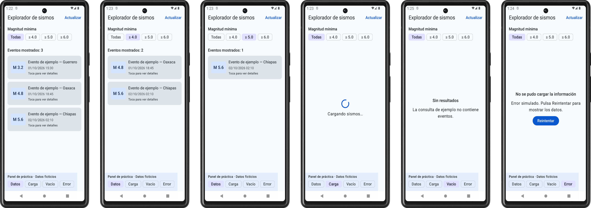
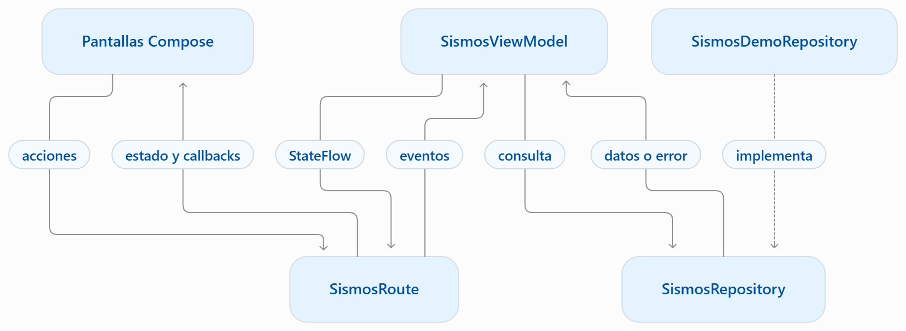
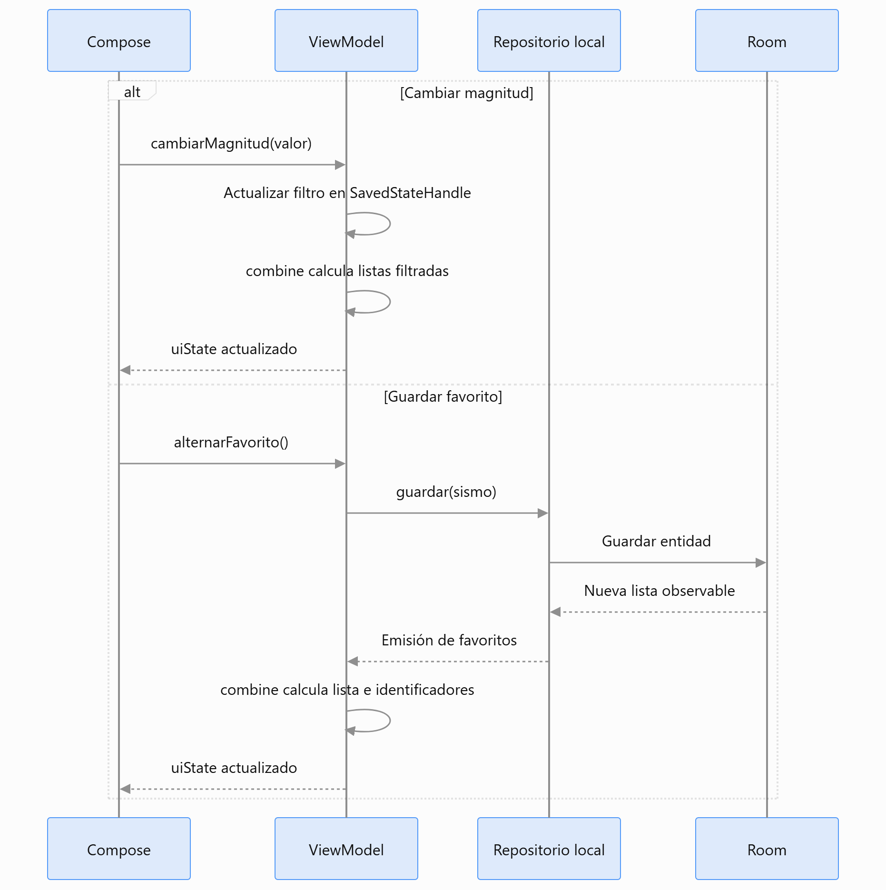
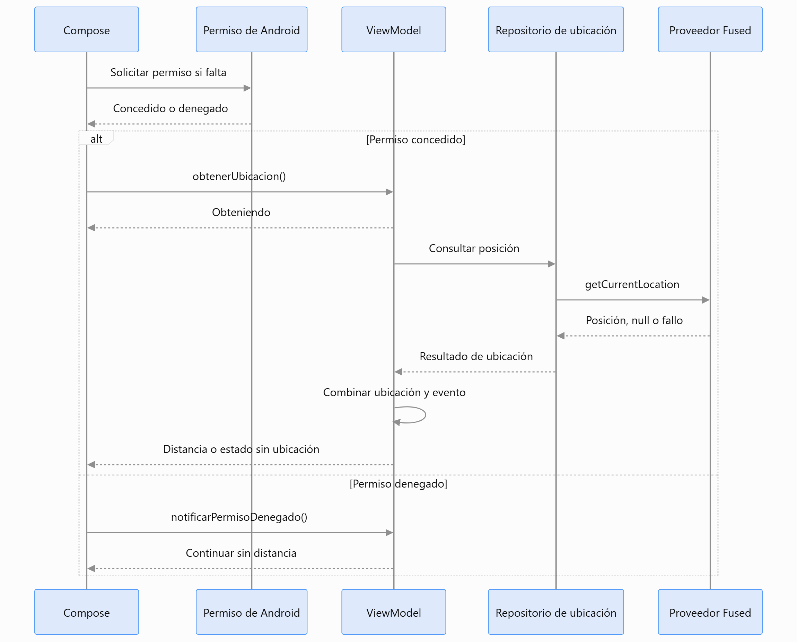

# Laboratorio Final: Aplicación Android para consultar eventos sísmicos, guardar favoritos y calcular su distancia aproximada

<br/>

## Descripción General

Desarrollarás una aplicación Android con Kotlin y Jetpack Compose para consultar información sísmica publicada por el Servicio Geológico de Estados Unidos — USGS.
La aplicación mostrará una lista de eventos con magnitud, lugar y fecha. Permitirá consultar sus detalles, filtrar por magnitud y guardar eventos favoritos para revisarlos posteriormente. Cuando el usuario autorice el acceso a su ubicación, también mostrará la distancia aproximada entre su posición y el epicentro.
Para mantener un alcance manejable, utilizaremos el servicio de sismos de magnitud 2.5 o superior registrados durante los últimos siete días, disponible en formato GeoJSON. GeoJSON utiliza JSON e incorpora información geográfica. http://earthquake.usgs.gov
El proyecto se construirá de forma incremental visto en el Capítulo 7. Integraremos Compose, MVVM, repositorios, Retrofit, Room, Flows y geolocalización. Cerraremos con el uso de IA Assistant para revisar, documentar y proponer pruebas unitarias.


<br/>

## Alcance funcional

- Consultar y actualizar la lista de sismos.
- Filtrar los resultados por magnitud mínima.
- Consultar magnitud, lugar, fecha, coordenadas y profundidad de un evento.
- Guardar y eliminar favoritos.
- Consultar los favoritos almacenados aunque no haya conexión.
- Solicitar la ubicación por acción del usuario y calcular la distancia aproximada al epicentro.
- Mostrar estados de carga, contenido, vacío y error.
- La consulta de sismos y favoritos estará disponible aunque el usuario deniegue el permiso de ubicación. 
- La aplicación tendrá un propósito educativo e informativo.

<br/>
<br/>

## Objetivos de Aprendizaje

Al finalizar este laboratorio, serás capaz de:
 
| Punto | Objetivo |
|---|---|
| **7.1 Compose UI completa** | Construir una interfaz con listas, detalles, acciones y estados visuales. |
| **7.2 MVVM + repositorios** | Separar las responsabilidades de la interfaz, el ViewModel y el acceso a datos. |
| **7.3 Retrofit** | Consumir un servicio HTTP real, transformar su respuesta en modelos de la aplicación y manejar errores. |
| **7.4 Persistencia** | Almacenar y consultar eventos favoritos mediante Room. |
| **7.5 Flows** | Exponer el estado con StateFlow y observar los cambios de datos para actualizar la interfaz. |
| **7.6 Geolocalización** | Gestionar el permiso de ubicación y utilizar las coordenadas para calcular una distancia aproximada. |
| **7.7 IA Assistant** | Evaluar propuestas de IA y validar comportamientos del proyecto mediante pruebas unitarias repetibles. |


<br/>
<br/>

## Prerrequisitos

El participante debe reconocer y haber practicado:

- **Kotlin**: funciones, clases de datos, nulabilidad, colecciones y lambdas.
- **Compose**: funciones componibles, modificadores, listas, estado y recomposición.
- **Arquitectura**: responsabilidades del ViewModel y del repositorio.
- **Programación asíncrona:** funciones suspend, corrutinas, Flow y StateFlow.
- **Networking:** solicitudes HTTP, JSON, Retrofit y manejo de errores.
- **Persistencia:** entidades, DAO y base de datos con Room.
- **Ubicación:** permisos en tiempo de ejecución y obtención de coordenadas.
- **Pruebas Unitarias:** caso de prueba, resultado esperado y aserciones. Los reforzaremos durante esa etapa.

<br/>

### **Herramientas y entorno**

- Android Studio con capacidad para crear y ejecutar proyectos Compose.
- Android SDK y componentes necesarios para compilar la plantilla.
- Emulador o dispositivo físico compatible con el proyecto.
- Conexión a internet para descargar dependencias y consultar USGS.
- Acceso a un asistente de IA en la etapa 7.7.

### **Acceso y condiciones de uso**

El servicio público de USGS seleccionado puede consultarse directamente, sin cuenta ni clave de API:
Consultar el feed de sismos de los últimos siete días. https://earthquake.usgs.gov/earthquakes/feed/v1.0/summary/2.5_week.geojson 
USGS publica sus datos científicos de acceso público sin costo. Para los datos producidos por USGS, su política indica dominio público y solicita reconocer la fuente. Incluiremos el crédito «Fuente de datos: USGS» en la aplicación y el README.

<br/><br/>

## Entorno de Laboratorio

### Requisitos de Hardware

| Componente | Requisito Mínimo | Requisito Recomendado |
| :--- | :--- | :--- |
| **Procesador** | Intel Core i7 / AMD Ryzen 7 (11ª Gen) o Apple Silicon (M1/M2/M3) | Apple Silicon M3 Pro/Max o AMD Ryzen 9 |
| **Memoria RAM** | 16 GB | 32 GB |
| **Almacenamiento** | SSD con 40 GB libres de espacio dedicado | SSD NVMe PCIe 4.0 con 80 GB libres |

<br/>

### Requisitos de Software

| Herramienta / SDK | Versión Exacta | Origen / Enlace Oficial | Licencia |
| :--- | :--- | :--- | :--- |
| **Android Studio** | Ladybug (2024.2.1 Patch 3) | [Android Developer](https://developer.android.com/studio) | Free / Apache 2.0 |
| **JDK** | Eclipse Temurin JDK 17.0.10+7 | [Adoptium](https://adoptium.net) | GPLv2+CE |
| **Kotlin Compiler** | 2.3.10 | [Kotlin Github](https://github.com/JetBrains/kotlin) | Apache 2.0 |
| **Room Database** | 2.8.4 | [Android Jetpack](https://developer.android.com/jetpack) | Apache 2.0 |
| **Retrofit** | 3.0.0-alpha | [Square Github](https://github.com/square/retrofit) | Apache 2.0 |
| **OkHttp** | 5.5.0-alpha | [Square Github](https://github.com/square/okhttp) | Apache 2.0 |
| **JetBrains AI Assistant** | 242.23339 | [JetBrains](https://www.jetbrains.com/ai/) | Licencia Comercial / Edu |
 

 <br/><br/>

## Instrucciones

### **Paso 0. Crear y verificar el proyecto Android**

**Propósito:** disponer de un proyecto nuevo que compile y se ejecute correctamente antes de desarrollar la interfaz del punto 7.1.

**0.1 Crear el proyecto**

En Android Studio, selecciona **New Project → Phone and Tablet → Empty Activity**. Esta plantilla configura el punto de partida para Jetpack Compose. [Android Studio](https://developer.android.com/studio/projects/create-project)

<br/>

Utiliza los siguientes valores:

| Campo | Valor propuesto |
|---|---|
| **Name** | `SismoExplorer` |
| **Package name** | `com.netec.pf.sismoexplorer` |
| **Save location** | `C:\Users\Netec\AndroidStudioProjects\SismoExplorer` o una carpeta de trabajo propia |
| **Language** | Kotlin |
| **Minimum SDK** | API 31 — Android 12 |
| **Build configuration language** | Kotlin DSL, si aparece esta opción |

<br/>

El mínimo API 31 es una decisión para este laboratorio y mantiene continuidad con la configuración que hemos utilizado en el curso. API 31 corresponde a Android 12. [developer.android.com](https://developer.android.com/about/versions/11/setup-sdk)

Pulsa **Finish** y espera a que finalice la sincronización de Gradle.

<br/><br/>

**0.2 Conservar y registrar la configuración inicial**

Conserva las versiones generadas por la plantilla. Registra:

- Versión de Android Studio.
- Android Gradle Plugin y configuración de Kotlin.
- Compose BOM.
- `compileSdk`, `targetSdk` y `minSdk`.
- JDK utilizado por Gradle.

Este registro será la referencia para incorporar dependencias compatibles en las siguientes etapas.

<br/>
<br/>

**0.3 Revisar la estructura**

Localiza estos archivos:

| Archivo | Qué debes identificar |
|---|---|
| `app/src/main/java/com/netec/pf/sismoexplorer/MainActivity.kt` | Actividad inicial y contenido Compose. |
| Paquete `ui.theme` | Tema visual generado. |
| `app/src/main/AndroidManifest.xml` | Configuración de la aplicación y actividad de inicio. |
| `app/build.gradle.kts` | Configuración y dependencias del módulo. |
| `gradle/libs.versions.toml` | Versiones y alias, si la plantilla lo incluye. |

<br/>
<br/>

**0.4 Ejecutar la aplicación**

1. Selecciona un emulador o dispositivo con API 31 o superior.
2. Ejecuta la configuración **app**.
3. Comprueba que aparece la pantalla inicial de la plantilla.
4. Cierra y vuelve a abrir la aplicación para verificar su inicio.

Las dependencias adicionales se incorporarán en la etapa correspondiente.

<br/><br/>

**Resultado esperado del Paso 0**

**Proyecto `SismoExplorer` creado, sincronizado, compilado y ejecutado correctamente**, con la configuración inicial registrada.

**Checklist**

- [ ] Utilicé la plantilla **Empty Activity** con Compose.
- [ ] El paquete es `com.netec.pf.sismoexplorer`.
- [ ] Gradle terminó de sincronizar sin errores.
- [ ] Registré las versiones y la configuración del proyecto.
- [ ] La aplicación compila.
- [ ] La pantalla inicial aparece en el emulador o dispositivo.

<br/><br/>

## **Paso 1. Construir la interfaz con Jetpack Compose**

**Propósito**

Construir una interfaz ejecutable con lista de sismos, filtro de magnitud, detalle y estados de carga, contenido, vacío y error.

Trabajaremos con **tres eventos ficticios**. El botón **Actualizar** restaurará esos datos y conservará el filtro. Un **panel de práctica temporal** permitirá seleccionar los estados visuales.

Utilizaremos las dependencias de Compose y Material 3 de la plantilla validada en el Paso 0.

### **Objetivo Visual**



<br/>
<br/>

### **1.1 Crear los paquetes y archivos**

Dentro del paquete base, crea estos archivos. Las rutas son relativas a la carpeta del proyecto:

| Acción | Archivo |
|---|---|
| Crear | `app/src/main/java/com/netec/pf/sismoexplorer/domain/model/Sismo.kt` |
| Crear | `app/src/main/java/com/netec/pf/sismoexplorer/data/demo/SismosDemo.kt` |
| Crear | `app/src/main/java/com/netec/pf/sismoexplorer/ui/sismos/SismosUiState.kt` |
| Crear | `app/src/main/java/com/netec/pf/sismoexplorer/ui/sismos/SismosScreen.kt` |
| Crear | `app/src/main/java/com/netec/pf/sismoexplorer/ui/sismos/SismoDetailScreen.kt` |
| Crear | `app/src/main/java/com/netec/pf/sismoexplorer/ui/sismos/SismosRoute.kt` |
| Modificar | `app/src/main/java/com/netec/pf/sismoexplorer/MainActivity.kt` |

Conserva el paquete `ui.theme` generado por la plantilla. Copia cada bloque completo en el archivo indicado.

<br/>

**1.2 Definir el modelo de un sismo**

**Archivo:** `domain/model/Sismo.kt`

La fecha se representa en milisegundos desde el epoch y la profundidad en kilómetros. El identificador permitirá reconocer cada evento en la lista y, posteriormente, en los favoritos.

<br/>

```kotlin
package com.netec.pf.sismoexplorer.domain.model

data class Sismo(
    val id: String,
    val magnitud: Double,
    val lugar: String,
    val fechaEpochMillis: Long,
    val latitud: Double,
    val longitud: Double,
    val profundidadKm: Double
)
```

Sus propiedades son de solo lectura y de tipos inmutables. En el Paso 3 transformaremos la respuesta de USGS a este modelo.

<br/>


**1.3 Preparar los datos de ejemplo**

**Archivo:** `data/demo/SismosDemo.kt`

Estos registros son ficticios. Sus magnitudes permitirán comprobar los filtros.

<br/>

```kotlin
package com.netec.pf.sismoexplorer.data.demo

import com.netec.pf.sismoexplorer.domain.model.Sismo
import java.time.Instant

object SismosDemo {
    val lista: List<Sismo> = listOf(
        Sismo(
            id = "demo-001",
            magnitud = 3.2,
            lugar = "Evento de ejemplo — Guerrero",
            fechaEpochMillis = Instant.parse(
                "2026-10-01T15:30:00Z"
            ).toEpochMilli(),
            latitud = 16.85,
            longitud = -99.90,
            profundidadKm = 12.0
        ),
        Sismo(
            id = "demo-002",
            magnitud = 4.8,
            lugar = "Evento de ejemplo — Oaxaca",
            fechaEpochMillis = Instant.parse(
                "2026-10-01T18:45:00Z"
            ).toEpochMilli(),
            latitud = 16.20,
            longitud = -95.20,
            profundidadKm = 25.0
        ),
        Sismo(
            id = "demo-003",
            magnitud = 5.6,
            lugar = "Evento de ejemplo — Chiapas",
            fechaEpochMillis = Instant.parse(
                "2026-10-02T02:10:00Z"
            ).toEpochMilli(),
            latitud = 14.90,
            longitud = -92.30,
            profundidadKm = 40.0
        )
    )
}
```

<br/>


**1.4 Representar los estados visuales**

**Archivo:** `ui/sismos/SismosUiState.kt`

El estado expresa qué debe presentar la pantalla. La rama `Vacio` admite diferentes mensajes para una consulta sin datos o un filtro sin coincidencias.

<br/>

```kotlin
package com.netec.pf.sismoexplorer.ui.sismos

import com.netec.pf.sismoexplorer.domain.model.Sismo

sealed interface SismosUiState {
    object Cargando : SismosUiState

    data class Contenido(
        val sismos: List<Sismo>
    ) : SismosUiState

    data class Vacio(
        val mensaje: String
    ) : SismosUiState

    data class Error(
        val mensaje: String
    ) : SismosUiState
}
```

Por ahora, el contenedor de demostración producirá este estado. En el Paso 2 trasladaremos esa responsabilidad al ViewModel.

<br/>

**1.5 Construir la pantalla principal**

**Archivo:** `ui/sismos/SismosScreen.kt`

`SismosScreen` recibe el estado y las acciones desde su contenedor. Esta separación permite que la pantalla presente valores y comunique eventos mediante callbacks, siguiendo el principio de *state hoisting*. [Android Developers](https://developer.android.com/develop/ui/compose/state)

El parámetro `panelPractica` es un espacio opcional para insertar los controles de demostración.

<br/>

```kotlin
package com.netec.pf.sismoexplorer.ui.sismos

import androidx.compose.foundation.layout.Arrangement
import androidx.compose.foundation.layout.Box
import androidx.compose.foundation.layout.Column
import androidx.compose.foundation.layout.PaddingValues
import androidx.compose.foundation.layout.Row
import androidx.compose.foundation.layout.consumeWindowInsets
import androidx.compose.foundation.layout.fillMaxSize
import androidx.compose.foundation.layout.fillMaxWidth
import androidx.compose.foundation.layout.padding
import androidx.compose.foundation.lazy.LazyColumn
import androidx.compose.foundation.lazy.LazyRow
import androidx.compose.foundation.lazy.items
import androidx.compose.material3.Button
import androidx.compose.material3.Card
import androidx.compose.material3.CircularProgressIndicator
import androidx.compose.material3.ExperimentalMaterial3Api
import androidx.compose.material3.FilterChip
import androidx.compose.material3.MaterialTheme
import androidx.compose.material3.Scaffold
import androidx.compose.material3.Surface
import androidx.compose.material3.Text
import androidx.compose.material3.TextButton
import androidx.compose.material3.TopAppBar
import androidx.compose.runtime.Composable
import androidx.compose.ui.Alignment
import androidx.compose.ui.Modifier
import androidx.compose.ui.text.style.TextAlign
import androidx.compose.ui.text.style.TextOverflow
import androidx.compose.ui.unit.dp
import com.netec.pf.sismoexplorer.domain.model.Sismo
import java.time.Instant
import java.time.ZoneId
import java.time.format.DateTimeFormatter
import java.util.Locale

@OptIn(ExperimentalMaterial3Api::class)
@Composable
fun SismosScreen(
    uiState: SismosUiState,
    magnitudMinima: Double,
    onMagnitudChange: (Double) -> Unit,
    onActualizar: () -> Unit,
    onSismoClick: (String) -> Unit,
    modifier: Modifier = Modifier,
    panelPractica: @Composable () -> Unit = {}
) {
    Scaffold(
        modifier = modifier,
        topBar = {
            TopAppBar(
                title = { Text("Explorador de sismos") },
                actions = {
                    TextButton(onClick = onActualizar) {
                        Text("Actualizar")
                    }
                }
            )
        },
        bottomBar = panelPractica
    ) { innerPadding ->
        Column(
            modifier = Modifier
                .fillMaxSize()
                .padding(innerPadding)
                .consumeWindowInsets(innerPadding)
        ) {
            FiltroMagnitud(
                magnitudMinima = magnitudMinima,
                onMagnitudChange = onMagnitudChange
            )

            Box(
                modifier = Modifier
                    .fillMaxWidth()
                    .weight(1f)
            ) {
                when (uiState) {
                    SismosUiState.Cargando -> {
                        Column(
                            modifier = Modifier.fillMaxSize(),
                            horizontalAlignment = Alignment.CenterHorizontally,
                            verticalArrangement = Arrangement.spacedBy(
                                12.dp,
                                Alignment.CenterVertically
                            )
                        ) {
                            CircularProgressIndicator()
                            Text("Cargando sismos…")
                        }
                    }

                    is SismosUiState.Contenido -> {
                        ListaSismos(
                            sismos = uiState.sismos,
                            onSismoClick = onSismoClick
                        )
                    }

                    is SismosUiState.Vacio -> {
                        MensajeEstado(
                            titulo = "Sin resultados",
                            mensaje = uiState.mensaje
                        )
                    }

                    is SismosUiState.Error -> {
                        MensajeEstado(
                            titulo = "No se pudo cargar la información",
                            mensaje = uiState.mensaje,
                            onReintentar = onActualizar
                        )
                    }
                }
            }
        }
    }
}

@Composable
private fun FiltroMagnitud(
    magnitudMinima: Double,
    onMagnitudChange: (Double) -> Unit
) {
    Column(
        modifier = Modifier
            .fillMaxWidth()
            .padding(top = 8.dp, bottom = 8.dp)
    ) {
        Text(
            text = "Magnitud mínima",
            style = MaterialTheme.typography.labelLarge,
            modifier = Modifier.padding(horizontal = 16.dp)
        )

        LazyRow(
            contentPadding = PaddingValues(horizontal = 16.dp),
            horizontalArrangement = Arrangement.spacedBy(8.dp)
        ) {
            items(
                items = listOf(0.0, 4.0, 5.0, 6.0),
                key = { it.toString() }
            ) { magnitud ->
                FilterChip(
                    selected = magnitudMinima == magnitud,
                    onClick = { onMagnitudChange(magnitud) },
                    label = {
                        Text(
                            if (magnitud == 0.0) {
                                "Todas"
                            } else {
                                "≥ " + formatearNumero(magnitud)
                            }
                        )
                    }
                )
            }
        }
    }
}

@Composable
private fun ListaSismos(
    sismos: List<Sismo>,
    onSismoClick: (String) -> Unit
) {
    LazyColumn(
        modifier = Modifier.fillMaxSize(),
        contentPadding = PaddingValues(16.dp),
        verticalArrangement = Arrangement.spacedBy(12.dp)
    ) {
        item(key = "resumen") {
            Text(
                text = "Eventos mostrados: " + sismos.size,
                style = MaterialTheme.typography.labelLarge
            )
        }

        items(
            items = sismos,
            key = { it.id }
        ) { sismo ->
            Card(
                onClick = { onSismoClick(sismo.id) },
                modifier = Modifier.fillMaxWidth()
            ) {
                Row(
                    modifier = Modifier.padding(16.dp),
                    horizontalArrangement = Arrangement.spacedBy(12.dp),
                    verticalAlignment = Alignment.CenterVertically
                ) {
                    Surface(
                        color = MaterialTheme.colorScheme.primaryContainer,
                        shape = MaterialTheme.shapes.small
                    ) {
                        Text(
                            text = "M " + formatearNumero(sismo.magnitud),
                            style = MaterialTheme.typography.titleMedium,
                            modifier = Modifier.padding(12.dp)
                        )
                    }

                    Column(
                        modifier = Modifier.weight(1f),
                        verticalArrangement = Arrangement.spacedBy(4.dp)
                    ) {
                        Text(
                            text = sismo.lugar,
                            style = MaterialTheme.typography.titleSmall,
                            maxLines = 2,
                            overflow = TextOverflow.Ellipsis
                        )
                        Text(
                            text = formatearFecha(sismo.fechaEpochMillis),
                            style = MaterialTheme.typography.bodySmall
                        )
                        Text(
                            text = "Toca para ver detalles",
                            style = MaterialTheme.typography.labelSmall
                        )
                    }
                }
            }
        }
    }
}

@Composable
private fun MensajeEstado(
    titulo: String,
    mensaje: String,
    onReintentar: (() -> Unit)? = null
) {
    Column(
        modifier = Modifier
            .fillMaxSize()
            .padding(24.dp),
        horizontalAlignment = Alignment.CenterHorizontally,
        verticalArrangement = Arrangement.spacedBy(
            12.dp,
            Alignment.CenterVertically
        )
    ) {
        Text(
            text = titulo,
            style = MaterialTheme.typography.titleMedium,
            textAlign = TextAlign.Center
        )
        Text(
            text = mensaje,
            textAlign = TextAlign.Center
        )

        if (onReintentar != null) {
            Button(onClick = onReintentar) {
                Text("Reintentar")
            }
        }
    }
}

internal fun formatearFecha(epochMillis: Long): String {
    val formato = DateTimeFormatter.ofPattern(
        "dd/MM/yyyy HH:mm",
        Locale("es", "MX")
    )
    return Instant.ofEpochMilli(epochMillis)
        .atZone(ZoneId.systemDefault())
        .format(formato)
}

internal fun formatearNumero(
    valor: Double,
    decimales: Int = 1
): String = String.format(
    Locale("es", "MX"),
    "%." + decimales + "f",
    valor
)
```

<br/>


**Aspectos para observar:**

- El `when` presenta una rama distinta para cada estado.
- Las acciones se comunican mediante callbacks.
- `key = { it.id }` identifica cada evento cuando cambia su posición en la lista. [Jetpack Compose - Android Developers](https://developer.android.com/develop/ui/compose/lists?utm_source=chatgpt.com)
- `innerPadding` reserva el espacio de las barras del `Scaffold`.
- La fecha se muestra en la zona horaria del dispositivo.
- **Todas** significa todos los eventos disponibles en la lista. En el Paso 3 serán los proporcionados por el feed seleccionado.


<br/>

**1.6 Construir la vista de detalle**

**Archivo:** `ui/sismos/SismoDetailScreen.kt`

La pantalla recibe el evento y una acción para volver. Puede utilizar las funciones de formato del archivo anterior porque ambos pertenecen al mismo paquete y módulo.

<br/>

```kotlin
package com.netec.pf.sismoexplorer.ui.sismos

import androidx.compose.foundation.layout.Arrangement
import androidx.compose.foundation.layout.Column
import androidx.compose.foundation.layout.consumeWindowInsets
import androidx.compose.foundation.layout.fillMaxSize
import androidx.compose.foundation.layout.fillMaxWidth
import androidx.compose.foundation.layout.padding
import androidx.compose.foundation.rememberScrollState
import androidx.compose.foundation.verticalScroll
import androidx.compose.material3.Card
import androidx.compose.material3.ExperimentalMaterial3Api
import androidx.compose.material3.MaterialTheme
import androidx.compose.material3.Scaffold
import androidx.compose.material3.Text
import androidx.compose.material3.TextButton
import androidx.compose.material3.TopAppBar
import androidx.compose.runtime.Composable
import androidx.compose.ui.Modifier
import androidx.compose.ui.unit.dp
import com.netec.pf.sismoexplorer.domain.model.Sismo

@OptIn(ExperimentalMaterial3Api::class)
@Composable
fun SismoDetailScreen(
    sismo: Sismo,
    onVolver: () -> Unit,
    modifier: Modifier = Modifier
) {
    Scaffold(
        modifier = modifier,
        topBar = {
            TopAppBar(
                title = { Text("Detalle del sismo") },
                navigationIcon = {
                    TextButton(onClick = onVolver) {
                        Text("Volver")
                    }
                }
            )
        }
    ) { innerPadding ->
        Column(
            modifier = Modifier
                .fillMaxSize()
                .padding(innerPadding)
                .consumeWindowInsets(innerPadding)
                .verticalScroll(rememberScrollState())
                .padding(16.dp),
            verticalArrangement = Arrangement.spacedBy(16.dp)
        ) {
            Text(
                text = "Magnitud " + formatearNumero(sismo.magnitud),
                style = MaterialTheme.typography.headlineMedium
            )
            Text(
                text = sismo.lugar,
                style = MaterialTheme.typography.titleLarge
            )

            Card(modifier = Modifier.fillMaxWidth()) {
                Column(
                    modifier = Modifier.padding(16.dp),
                    verticalArrangement = Arrangement.spacedBy(12.dp)
                ) {
                    DatoDetalle(
                        etiqueta = "Fecha y hora local",
                        valor = formatearFecha(sismo.fechaEpochMillis)
                    )
                    DatoDetalle(
                        etiqueta = "Latitud",
                        valor = formatearNumero(sismo.latitud, 4) + "°"
                    )
                    DatoDetalle(
                        etiqueta = "Longitud",
                        valor = formatearNumero(sismo.longitud, 4) + "°"
                    )
                    DatoDetalle(
                        etiqueta = "Profundidad",
                        valor = formatearNumero(sismo.profundidadKm) + " km"
                    )
                }
            }
        }
    }
}

@Composable
private fun DatoDetalle(
    etiqueta: String,
    valor: String
) {
    Column {
        Text(
            text = etiqueta,
            style = MaterialTheme.typography.labelMedium,
            color = MaterialTheme.colorScheme.onSurfaceVariant
        )
        Text(
            text = valor,
            style = MaterialTheme.typography.bodyLarge
        )
    }
}
```

<br/>

La vista admite desplazamiento vertical para consultar sus campos en pantallas pequeñas o en orientación horizontal.

<br/>

**1.7 Conectar el estado con la presentación**

**Archivo:** `ui/sismos/SismosRoute.kt`

Este contenedor administra el escenario, el filtro y el identificador seleccionado. Las pantallas reciben datos y callbacks.

Utilizamos `rememberSaveable` para guardar valores pequeños: el nombre del escenario, la magnitud mínima y el identificador. Este mecanismo permite restaurarlos después de una recreación de la actividad, como una rotación. [Android Developers](https://developer.android.com/develop/ui/compose/state-saving)


<br/>

```kotlin
package com.netec.pf.sismoexplorer.ui.sismos

import androidx.activity.compose.BackHandler
import androidx.compose.foundation.layout.Arrangement
import androidx.compose.foundation.layout.Column
import androidx.compose.foundation.layout.PaddingValues
import androidx.compose.foundation.layout.navigationBarsPadding
import androidx.compose.foundation.layout.padding
import androidx.compose.foundation.lazy.LazyRow
import androidx.compose.foundation.lazy.items
import androidx.compose.material3.FilterChip
import androidx.compose.material3.MaterialTheme
import androidx.compose.material3.Surface
import androidx.compose.material3.Text
import androidx.compose.runtime.Composable
import androidx.compose.runtime.getValue
import androidx.compose.runtime.mutableStateOf
import androidx.compose.runtime.saveable.rememberSaveable
import androidx.compose.runtime.setValue
import androidx.compose.ui.Modifier
import androidx.compose.ui.unit.dp
import com.netec.pf.sismoexplorer.data.demo.SismosDemo

private enum class EscenarioDemo(val etiqueta: String) {
    CONTENIDO("Datos"),
    CARGA("Carga"),
    VACIO("Vacío"),
    ERROR("Error")
}

@Composable
fun SismosRoute() {
    var escenarioNombre by rememberSaveable {
        mutableStateOf(EscenarioDemo.CONTENIDO.name)
    }
    var magnitudMinima by rememberSaveable {
        mutableStateOf(0.0)
    }
    var sismoSeleccionadoId by rememberSaveable {
        mutableStateOf<String?>(null)
    }

    val escenario = EscenarioDemo.valueOf(escenarioNombre)
    val sismoSeleccionado = SismosDemo.lista.firstOrNull {
        it.id == sismoSeleccionadoId
    }

    BackHandler(enabled = sismoSeleccionado != null) {
        sismoSeleccionadoId = null
    }

    if (sismoSeleccionado != null) {
        SismoDetailScreen(
            sismo = sismoSeleccionado,
            onVolver = { sismoSeleccionadoId = null }
        )
    } else {
        val uiState: SismosUiState = when (escenario) {
            EscenarioDemo.CARGA -> SismosUiState.Cargando

            EscenarioDemo.VACIO -> SismosUiState.Vacio(
                mensaje = "La consulta de ejemplo no contiene eventos."
            )

            EscenarioDemo.ERROR -> SismosUiState.Error(
                mensaje = "Error simulado. Pulsa Reintentar para mostrar los datos."
            )

            EscenarioDemo.CONTENIDO -> {
                val filtrados = SismosDemo.lista.filter {
                    it.magnitud >= magnitudMinima
                }

                if (filtrados.isEmpty()) {
                    SismosUiState.Vacio(
                        mensaje = "No hay eventos con la magnitud seleccionada. " +
                            "Prueba con un filtro menor."
                    )
                } else {
                    SismosUiState.Contenido(sismos = filtrados)
                }
            }
        }

        SismosScreen(
            uiState = uiState,
            magnitudMinima = magnitudMinima,
            onMagnitudChange = { magnitudMinima = it },
            onActualizar = {
                escenarioNombre = EscenarioDemo.CONTENIDO.name
            },
            onSismoClick = { sismoSeleccionadoId = it },
            panelPractica = {
                PanelPractica(
                    escenario = escenario,
                    onEscenarioChange = {
                        escenarioNombre = it.name
                    }
                )
            }
        )
    }
}

@Composable
private fun PanelPractica(
    escenario: EscenarioDemo,
    onEscenarioChange: (EscenarioDemo) -> Unit
) {
    Surface(tonalElevation = 3.dp) {
        Column(
            modifier = Modifier
                .navigationBarsPadding()
                .padding(vertical = 8.dp)
        ) {
            Text(
                text = "Panel de práctica · Datos ficticios",
                style = MaterialTheme.typography.labelMedium,
                modifier = Modifier.padding(horizontal = 16.dp)
            )

            LazyRow(
                contentPadding = PaddingValues(horizontal = 16.dp),
                horizontalArrangement = Arrangement.spacedBy(8.dp)
            ) {
                items(
                    items = EscenarioDemo.values().toList(),
                    key = { it.name }
                ) { opcion ->
                    FilterChip(
                        selected = escenario == opcion,
                        onClick = { onEscenarioChange(opcion) },
                        label = { Text(opcion.etiqueta) }
                    )
                }
            }
        }
    }
}
```

<br/>

El botón o gesto **Atrás** del sistema también vuelve desde el detalle.

<br/>

**1.8 Integrar la interfaz en MainActivity**

**Archivo:** `MainActivity.kt`

Reemplaza su contenido por el siguiente.

**Si tu tema generado tiene otro nombre**, conserva su nombre y su import original en los dos lugares donde aparece `SismoExplorerTheme`.

<br/>

```kotlin
package com.netec.pf.sismoexplorer

import android.os.Bundle
import androidx.activity.ComponentActivity
import androidx.activity.compose.setContent
import androidx.activity.enableEdgeToEdge
import com.netec.pf.sismoexplorer.ui.sismos.SismosRoute
import com.netec.pf.sismoexplorer.ui.theme.SismoExplorerTheme

class MainActivity : ComponentActivity() {
    override fun onCreate(savedInstanceState: Bundle?) {
        super.onCreate(savedInstanceState)
        enableEdgeToEdge()

        setContent {
            SismoExplorerTheme {
                SismosRoute()
            }
        }
    }
}
```

<br/>

**1.9 Ejecutar y verificar**

Ejecuta la configuración **app** y realiza estas comprobaciones:

| Acción | Resultado esperado |
|---|---|
| Iniciar con **Datos** y **Todas** | Aparecen tres eventos ficticios. |
| Seleccionar **≥ 4.0** | Aparecen los eventos de magnitudes 4.8 y 5.6. |
| Seleccionar **≥ 5.0** | Aparece el evento de magnitud 5.6. |
| Seleccionar **≥ 6.0** | Aparece **Sin resultados**, con un mensaje sobre el filtro. |
| Volver a **Todas** y tocar un evento | Se abre su detalle con fecha, coordenadas y profundidad. |
| Pulsar **Volver** o Atrás del sistema | Regresa a la lista y conserva el filtro. |
| Elegir **Carga** en el panel | Aparecen el indicador y **Cargando sismos…**. |
| Elegir **Vacío** | Se informa que la consulta de ejemplo no contiene eventos. |
| Elegir **Error** | Aparecen el mensaje y el botón **Reintentar**. |
| Con **Todas**, pulsar **Reintentar** | Aparecen los tres eventos y se selecciona **Datos**. |
| Pulsar **Actualizar** | Se restaura **Datos** y se conserva el filtro. |
| Rotar con **≥ 4.0** seleccionado | Se conserva el filtro y aparecen dos eventos. |
| Rotar mientras se consulta un detalle | Se mantiene el evento seleccionado. |

<br/>

**Actualizar y Reintentar conservan el filtro.** Si estaba seleccionado **≥ 6.0**, seguirá apareciendo el estado vacío por falta de coincidencias.

La opción **Carga** permanece visible hasta seleccionar otro escenario o pulsar **Actualizar**.

<br/>

**Checklist del Paso 1**

- [ ] Creé los seis archivos con sus paquetes correctos.
- [ ] `MainActivity` presenta `SismosRoute` con el tema generado.
- [ ] La lista muestra tres eventos ficticios.
- [ ] El filtro modifica los resultados.
- [ ] Cada evento abre su detalle.
- [ ] Puedo volver mediante la acción visible y Atrás del sistema.
- [ ] Comprobé carga, contenido, vacío y error.
- [ ] Actualizar y Reintentar muestran los datos correspondientes al filtro.
- [ ] La rotación conserva el filtro y el evento seleccionado.
- [ ] El contenido respeta las barras del sistema y del `Scaffold`.
- [ ] La aplicación compila y se ejecuta en mi entorno.


<br/><br/>


## Paso 2. ViewModel, repositorio y conexión con la pantalla


### **Propósito**

Trasladar la consulta, el filtro y la producción del estado al ViewModel. El repositorio proporcionará los datos y el contenedor Compose observará el estado para conectar las acciones con las pantallas existentes.

<br/>

### **Resultado esperado**

La interfaz conserva la lista, los filtros, el detalle y los estados visuales del Paso 1. Al iniciar o actualizar aparece una carga breve y después el resultado del repositorio. El panel de práctica permite provocar una consulta sin resultados, un error o una carga que permanece pendiente.

El objetivo visual del Paso 1 sigue siendo una referencia válida para las vistas. Las imágenes de los filtros muestran tres, dos y un evento, respectivamente; las restantes muestran carga, vacío y error.

<br/>

### **Responsabilidades**

| Componente | Responsabilidad |
|---|---|
| SismosScreen y SismoDetailScreen | Presentar datos y comunicar acciones mediante callbacks. |
| SismosRoute | Observar el estado y conectar eventos con el ViewModel. |
| SismosViewModel | Consultar el repositorio, filtrar y producir el estado de la pantalla. |
| SismosRepository | Definir el contrato de consulta. |
| SismosDemoRepository | Implementar el contrato con datos y escenarios de práctica. |
| SismoExplorerApplication y MainActivity | Crear y conectar las dependencias. |


<br/>



Utilizaremos lo necesario de StateFlow para realizar la conexión. El Paso 5 profundizará en el manejo de Flows.

<br/>

### **Archivos afectados**

Las rutas siguientes son relativas a la carpeta del proyecto.

| Acción | Archivo |
|---|---|
| Actualizar dependencias | `gradle/libs.versions.toml` |
| Actualizar dependencias | `app/build.gradle.kts` |
| Crear | `app/src/main/java/com/netec/pf/sismoexplorer/data/repository/SismosRepository.kt` |
| Crear | `app/src/main/java/com/netec/pf/sismoexplorer/data/demo/SismosDemoRepository.kt` |
| Crear | `app/src/main/java/com/netec/pf/sismoexplorer/SismoExplorerApplication.kt` |
| Actualizar | `app/src/main/AndroidManifest.xml` |
| Crear | `app/src/main/java/com/netec/pf/sismoexplorer/ui/sismos/SismosScreenState.kt` |
| Crear | `app/src/main/java/com/netec/pf/sismoexplorer/ui/sismos/SismosViewModel.kt` |
| Reemplazar | `app/src/main/java/com/netec/pf/sismoexplorer/ui/sismos/SismosRoute.kt` |
| Reemplazar | `app/src/main/java/com/netec/pf/sismoexplorer/MainActivity.kt` |

Conserva los archivos validados: `Sismo.kt`, `SismosDemo.kt`, `SismosUiState.kt`, `SismosScreen.kt`, `SismoDetailScreen.kt` y el tema generado.

<br/>

### **2.1 Incorporar las dependencias**

**Archivo:** `gradle/libs.versions.toml`.

Busca la referencia que utiliza la dependencia `androidx.lifecycle:lifecycle-runtime-ktx` del proyecto. En las plantillas suele llamarse `lifecycleRuntimeKtx`.

Las cuatro dependencias Lifecycle siguientes deben utilizar **esa misma referencia de versión**. Si en tu catálogo tiene otro nombre, sustituye `lifecycleRuntimeKtx` en las cuatro líneas.

En la sección `[versions]`, agrega esta entrada únicamente si todavía no tienes una versión para corrutinas:

```toml
coroutines = "1.10.1"
```

Si ya existe una referencia de corrutinas, conserva su versión y utiliza su nombre en la nueva dependencia.

Dentro de la sección `[libraries]`, agrega los alias que falten:

```toml
androidx-lifecycle-viewmodel-ktx = { module = "androidx.lifecycle:lifecycle-viewmodel-ktx", version.ref = "lifecycleRuntimeKtx" }
androidx-lifecycle-viewmodel-compose = { module = "androidx.lifecycle:lifecycle-viewmodel-compose", version.ref = "lifecycleRuntimeKtx" }
androidx-lifecycle-runtime-compose = { module = "androidx.lifecycle:lifecycle-runtime-compose", version.ref = "lifecycleRuntimeKtx" }
androidx-lifecycle-viewmodel-savedstate = { module = "androidx.lifecycle:lifecycle-viewmodel-savedstate", version.ref = "lifecycleRuntimeKtx" }
kotlinx-coroutines-android = { module = "org.jetbrains.kotlinx:kotlinx-coroutines-android", version.ref = "coroutines" }
```

<br/>

**Archivo:** `app/build.gradle.kts`.

Dentro del bloque `dependencies`, agrega las declaraciones que falten:

```kotlin
implementation(libs.androidx.lifecycle.viewmodel.ktx)
implementation(libs.androidx.lifecycle.viewmodel.compose)
implementation(libs.androidx.lifecycle.runtime.compose)
implementation(libs.androidx.lifecycle.viewmodel.savedstate)
implementation(libs.kotlinx.coroutines.android)
```

Si una dependencia ya está declarada con otro alias, reutiliza el alias existente. Conserva las versiones de AGP, Kotlin, Compose y SDK que validaste en el Paso 0.

Sincroniza Gradle antes de continuar.

<br/>

### **2.2 Definir el contrato del repositorio**

**Archivo:** `data/repository/SismosRepository.kt`.

```kotlin
package com.netec.pf.sismoexplorer.data.repository

import com.netec.pf.sismoexplorer.domain.model.Sismo

interface SismosRepository {
    suspend fun obtenerSismos(): List<Sismo>
}
```

El ViewModel solicitará datos mediante este contrato. La implementación decide de dónde obtenerlos. El modificador `suspend` permite que la consulta suspenda la corrutina mientras espera el resultado.

<br/>

### **2.3 Implementar el repositorio de práctica**

**Archivo:** `data/demo/SismosDemoRepository.kt`.

El escenario es una configuración temporal para el laboratorio. El contrato `SismosRepository` contiene únicamente la operación de consulta.

<br/>

```kotlin
package com.netec.pf.sismoexplorer.data.demo

import com.netec.pf.sismoexplorer.data.repository.SismosRepository
import com.netec.pf.sismoexplorer.domain.model.Sismo
import java.io.IOException
import kotlinx.coroutines.awaitCancellation
import kotlinx.coroutines.delay
import kotlinx.coroutines.flow.MutableStateFlow
import kotlinx.coroutines.flow.StateFlow
import kotlinx.coroutines.flow.asStateFlow

enum class EscenarioDemo(val etiqueta: String) {
    CONTENIDO("Datos"),
    CARGA("Carga"),
    VACIO("Vacío"),
    ERROR("Error")
}

class SismosDemoRepository : SismosRepository {
    private val _escenario = MutableStateFlow(EscenarioDemo.CONTENIDO)
    val escenario: StateFlow<EscenarioDemo> = _escenario.asStateFlow()

    fun configurarEscenario(nuevoEscenario: EscenarioDemo) {
        _escenario.value = nuevoEscenario
    }

    override suspend fun obtenerSismos(): List<Sismo> {
        val escenarioConsulta = _escenario.value

        delay(800L)

        return when (escenarioConsulta) {
            EscenarioDemo.CONTENIDO -> SismosDemo.lista
            EscenarioDemo.VACIO -> emptyList()
            EscenarioDemo.ERROR -> {
                throw IOException("Error simulado del repositorio de práctica.")
            }
            EscenarioDemo.CARGA -> awaitCancellation()
        }
    }
}
```

<br/>

- **Datos:** devuelve los tres eventos del Paso 1.
- **Vacío:** devuelve una lista vacía.
- **Error:** produce una `IOException` que manejará el ViewModel.
- **Carga:** mantiene la consulta pendiente hasta que se cancele.

`delay` suspende la corrutina y deja disponible el hilo. En el escenario Carga, cambiar de opción o pulsar Actualizar cancelará la consulta anterior.

<br/>

### **2.4 Crear las dependencias de la aplicación**

**Archivo:** `SismoExplorerApplication.kt`.

<br/>

```kotlin
package com.netec.pf.sismoexplorer

import android.app.Application
import com.netec.pf.sismoexplorer.data.demo.SismosDemoRepository
import com.netec.pf.sismoexplorer.data.repository.SismosRepository

class SismoExplorerApplication : Application() {
    val repositorioDemo: SismosDemoRepository by lazy {
        SismosDemoRepository()
    }

    val repositorio: SismosRepository
        get() = repositorioDemo
}
```

La aplicación mantiene una instancia del repositorio durante la vida del proceso. Tanto la factory del ViewModel como los controles de práctica utilizarán esa misma instancia.

El ViewModel recibirá la propiedad `repositorio`, cuyo tipo es el contrato. El acceso concreto a `repositorioDemo` se utiliza para configurar el panel de práctica.

<br/>

### **2.5 Registrar Application en el manifiesto**

**Archivo:** `app/src/main/AndroidManifest.xml`.

Agrega el atributo siguiente en la etiqueta de apertura `<application>`:

```xml
android:name=".SismoExplorerApplication"
```

Por ejemplo, el inicio de la etiqueta tendrá esta forma:

```xml
<application
    android:name=".SismoExplorerApplication"
```

Conserva los demás atributos de esa etiqueta y las declaraciones de la actividad. El fragmento anterior muestra únicamente dónde colocar el nuevo atributo; no sustituye el manifiesto completo.

<br/>
<br/>

### **2.6 Definir el estado completo de la pantalla**

**Archivo:** `ui/sismos/SismosScreenState.kt`.

<br/>

```kotlin
package com.netec.pf.sismoexplorer.ui.sismos

import com.netec.pf.sismoexplorer.domain.model.Sismo

data class SismosScreenState(
    val pantalla: SismosUiState = SismosUiState.Cargando,
    val magnitudMinima: Double = 0.0,
    val sismoSeleccionado: Sismo? = null
)
```

`SismosUiState` conserva las ramas visuales del Paso 1. Este nuevo estado reúne esa rama con el filtro y el evento seleccionado para exponerlos mediante un único StateFlow.

<br/>
<br/>

### **2.7 Crear el ViewModel**

**Archivo:** `ui/sismos/SismosViewModel.kt`.


```kotlin
package com.netec.pf.sismoexplorer.ui.sismos

import androidx.lifecycle.SavedStateHandle
import androidx.lifecycle.ViewModel
import androidx.lifecycle.ViewModelProvider
import androidx.lifecycle.createSavedStateHandle
import androidx.lifecycle.viewModelScope
import androidx.lifecycle.viewmodel.initializer
import androidx.lifecycle.viewmodel.viewModelFactory
import com.netec.pf.sismoexplorer.data.repository.SismosRepository
import com.netec.pf.sismoexplorer.domain.model.Sismo
import java.io.IOException
import kotlinx.coroutines.CancellationException
import kotlinx.coroutines.Job
import kotlinx.coroutines.currentCoroutineContext
import kotlinx.coroutines.ensureActive
import kotlinx.coroutines.flow.MutableStateFlow
import kotlinx.coroutines.flow.StateFlow
import kotlinx.coroutines.flow.asStateFlow
import kotlinx.coroutines.flow.update
import kotlinx.coroutines.launch

class SismosViewModel(
    private val repositorio: SismosRepository,
    private val savedStateHandle: SavedStateHandle
) : ViewModel() {

    private val _uiState = MutableStateFlow(
        SismosScreenState(
            magnitudMinima = savedStateHandle[CLAVE_MAGNITUD] ?: 0.0
        )
    )
    val uiState: StateFlow<SismosScreenState> = _uiState.asStateFlow()

    private var sismosCargados: List<Sismo> = emptyList()
    private var consultaJob: Job? = null

    init {
        actualizar()
    }

    fun actualizar() {
        consultaJob?.cancel()

        _uiState.update {
            it.copy(pantalla = SismosUiState.Cargando)
        }

        consultaJob = viewModelScope.launch {
            try {
                val resultado = repositorio.obtenerSismos()
                currentCoroutineContext().ensureActive()
                sismosCargados = resultado

                val seleccionadoId: String? =
                    savedStateHandle[CLAVE_SELECCIONADO]

                val seleccionado = resultado.firstOrNull {
                    it.id == seleccionadoId
                }

                if (seleccionadoId != null && seleccionado == null) {
                    savedStateHandle[CLAVE_SELECCIONADO] = null
                }

                _uiState.update { actual ->
                    actual.copy(
                        pantalla = crearEstadoVisual(
                            sismos = resultado,
                            magnitudMinima = actual.magnitudMinima
                        ),
                        sismoSeleccionado = seleccionado
                    )
                }
            } catch (cancelacion: CancellationException) {
                throw cancelacion
            } catch (error: IOException) {
                currentCoroutineContext().ensureActive()
                _uiState.update {
                    it.copy(
                        pantalla = SismosUiState.Error(
                            mensaje = "No fue posible cargar los sismos. " +
                                "Intenta nuevamente."
                        )
                    )
                }
            }
        }
    }

    fun cambiarMagnitud(nuevaMagnitud: Double) {
        require(nuevaMagnitud.isFinite() && nuevaMagnitud >= 0.0) {
            "La magnitud mínima debe ser un número finito no negativo."
        }

        savedStateHandle[CLAVE_MAGNITUD] = nuevaMagnitud

        _uiState.update { actual ->
            val nuevaPantalla = when (actual.pantalla) {
                is SismosUiState.Contenido,
                is SismosUiState.Vacio -> crearEstadoVisual(
                    sismos = sismosCargados,
                    magnitudMinima = nuevaMagnitud
                )

                SismosUiState.Cargando,
                is SismosUiState.Error -> actual.pantalla
            }

            actual.copy(
                magnitudMinima = nuevaMagnitud,
                pantalla = nuevaPantalla
            )
        }
    }

    fun seleccionarSismo(id: String) {
        val seleccionado = sismosCargados.firstOrNull {
            it.id == id
        } ?: return

        savedStateHandle[CLAVE_SELECCIONADO] = seleccionado.id

        _uiState.update {
            it.copy(sismoSeleccionado = seleccionado)
        }
    }

    fun volverALista() {
        savedStateHandle[CLAVE_SELECCIONADO] = null
        _uiState.update {
            it.copy(sismoSeleccionado = null)
        }
    }

    private fun crearEstadoVisual(
        sismos: List<Sismo>,
        magnitudMinima: Double
    ): SismosUiState {
        if (sismos.isEmpty()) {
            return SismosUiState.Vacio(
                mensaje = "La consulta no contiene eventos."
            )
        }

        val filtrados = sismos.filter {
            it.magnitud >= magnitudMinima
        }

        return if (filtrados.isEmpty()) {
            SismosUiState.Vacio(
                mensaje = "No hay eventos con la magnitud seleccionada. " +
                    "Prueba con un filtro menor."
            )
        } else {
            SismosUiState.Contenido(sismos = filtrados)
        }
    }

    companion object {
        private const val CLAVE_MAGNITUD = "magnitudMinima"
        private const val CLAVE_SELECCIONADO = "sismoSeleccionadoId"

        fun factory(
            repositorio: SismosRepository
        ): ViewModelProvider.Factory = viewModelFactory {
            initializer {
                SismosViewModel(
                    repositorio = repositorio,
                    savedStateHandle = createSavedStateHandle()
                )
            }
        }
    }
}
```

<br/>

**Qué hace el ViewModel:**

1. Inicia una consulta al crearse.
2. Publica Cargando antes de solicitar datos.
3. Conserva la lista obtenida para aplicar filtros sin repetir la consulta.
4. Publica Contenido, Vacío o Error.
5. Gestiona la selección y el regreso a la lista.
6. Guarda el filtro y el identificador mediante SavedStateHandle.
7. Cancela la consulta anterior antes de iniciar otra.

La cancelación se propaga mediante `CancellationException`; no se convierte en un mensaje de error. En el Paso 3 completaremos el manejo de errores del acceso HTTP.

El ViewModel mantiene sus datos durante una rotación. SavedStateHandle conserva pequeños valores de UI para una restauración gestionada por Android; no sustituye a Room ni almacena la lista de eventos. La selección se reconstruye cuando el repositorio devuelve los datos.

<br/>
<br/>

### **2.8 Conectar el ViewModel con Compose**

**Archivo:** `ui/sismos/SismosRoute.kt`.

Reemplaza todo el archivo anterior. La definición privada de EscenarioDemo del Paso 1 queda sustituida por la del repositorio de práctica.

```kotlin
package com.netec.pf.sismoexplorer.ui.sismos

import androidx.activity.compose.BackHandler
import androidx.compose.foundation.layout.Arrangement
import androidx.compose.foundation.layout.Column
import androidx.compose.foundation.layout.PaddingValues
import androidx.compose.foundation.layout.navigationBarsPadding
import androidx.compose.foundation.layout.padding
import androidx.compose.foundation.lazy.LazyRow
import androidx.compose.foundation.lazy.items
import androidx.compose.material3.FilterChip
import androidx.compose.material3.MaterialTheme
import androidx.compose.material3.Surface
import androidx.compose.material3.Text
import androidx.compose.runtime.Composable
import androidx.compose.runtime.getValue
import androidx.compose.ui.Modifier
import androidx.compose.ui.unit.dp
import androidx.lifecycle.compose.collectAsStateWithLifecycle
import com.netec.pf.sismoexplorer.data.demo.EscenarioDemo

@Composable
fun SismosRoute(
    modelo: SismosViewModel,
    escenarioDemo: EscenarioDemo,
    onEscenarioChange: (EscenarioDemo) -> Unit,
    onActualizar: () -> Unit
) {
    val estado by modelo.uiState.collectAsStateWithLifecycle()
    val seleccionado = estado.sismoSeleccionado

    BackHandler(enabled = seleccionado != null) {
        modelo.volverALista()
    }

    if (seleccionado != null) {
        SismoDetailScreen(
            sismo = seleccionado,
            onVolver = modelo::volverALista
        )
    } else {
        SismosScreen(
            uiState = estado.pantalla,
            magnitudMinima = estado.magnitudMinima,
            onMagnitudChange = modelo::cambiarMagnitud,
            onActualizar = onActualizar,
            onSismoClick = modelo::seleccionarSismo,
            panelPractica = {
                PanelPractica(
                    escenario = escenarioDemo,
                    onEscenarioChange = onEscenarioChange
                )
            }
        )
    }
}

@Composable
private fun PanelPractica(
    escenario: EscenarioDemo,
    onEscenarioChange: (EscenarioDemo) -> Unit
) {
    Surface(tonalElevation = 3.dp) {
        Column(
            modifier = Modifier
                .navigationBarsPadding()
                .padding(vertical = 8.dp)
        ) {
            Text(
                text = "Panel de práctica · Datos ficticios",
                style = MaterialTheme.typography.labelMedium,
                modifier = Modifier.padding(horizontal = 16.dp)
            )

            LazyRow(
                contentPadding = PaddingValues(horizontal = 16.dp),
                horizontalArrangement = Arrangement.spacedBy(8.dp)
            ) {
                items(
                    items = EscenarioDemo.values().toList(),
                    key = { it.name }
                ) { opcion ->
                    FilterChip(
                        selected = escenario == opcion,
                        onClick = { onEscenarioChange(opcion) },
                        label = { Text(opcion.etiqueta) }
                    )
                }
            }
        }
    }
}
```

`collectAsStateWithLifecycle` adapta el StateFlow a un estado observable de Compose y realiza la recolección de acuerdo con el ciclo de vida.

El contenedor conecta las acciones con el ViewModel. El panel configura el repositorio de práctica mediante los callbacks recibidos.

<br/>
<br/>

### **2.9 Conectar las dependencias en MainActivity**

**Archivo:** `MainActivity.kt`.

Reemplaza su contenido. Conserva el nombre y el import de tu tema si difieren de `SismoExplorerTheme`.

```kotlin
package com.netec.pf.sismoexplorer

import android.os.Bundle
import androidx.activity.ComponentActivity
import androidx.activity.compose.setContent
import androidx.activity.enableEdgeToEdge
import androidx.compose.runtime.getValue
import androidx.lifecycle.compose.collectAsStateWithLifecycle
import androidx.lifecycle.viewmodel.compose.viewModel
import com.netec.pf.sismoexplorer.data.demo.EscenarioDemo
import com.netec.pf.sismoexplorer.ui.sismos.SismosRoute
import com.netec.pf.sismoexplorer.ui.sismos.SismosViewModel
import com.netec.pf.sismoexplorer.ui.theme.SismoExplorerTheme

class MainActivity : ComponentActivity() {
    override fun onCreate(savedInstanceState: Bundle?) {
        super.onCreate(savedInstanceState)
        enableEdgeToEdge()

        val app = application as SismoExplorerApplication
        val factory = SismosViewModel.factory(app.repositorio)

        setContent {
            SismoExplorerTheme {
                val modelo: SismosViewModel = viewModel(factory = factory)
                val escenario by app.repositorioDemo.escenario
                    .collectAsStateWithLifecycle()

                SismosRoute(
                    modelo = modelo,
                    escenarioDemo = escenario,
                    onEscenarioChange = { nuevoEscenario ->
                        app.repositorioDemo.configurarEscenario(nuevoEscenario)
                        modelo.actualizar()
                    },
                    onActualizar = {
                        app.repositorioDemo.configurarEscenario(
                            EscenarioDemo.CONTENIDO
                        )
                        modelo.actualizar()
                    }
                )
            }
        }
    }
}
```

<br/>

`viewModel(factory = factory)` recupera la instancia asociada a la actividad o la crea cuando hace falta. Así la recomposición y la rotación no provocan la creación manual de nuevos ViewModels.

Actualizar y Reintentar solicitan el escenario Datos. Las opciones del panel solicitan el escenario elegido. Este comportamiento es específico de la implementación de práctica.

<br/>
<br/>

### **2.10 Ejecutar y verificar**

Ejecuta la configuración **app** y verifica:

| Acción | Resultado esperado |
|---|---|
| Iniciar la aplicación | Carga breve y después tres eventos. |
| Seleccionar ≥ 4.0 | Dos eventos; el filtro utiliza los datos ya cargados. |
| Seleccionar ≥ 5.0 | Un evento. |
| Seleccionar ≥ 6.0 | Vacío por falta de coincidencias con el filtro. |
| Volver a Todas y elegir Vacío | Carga breve y después vacío por consulta sin eventos. |
| Cambiar el filtro mientras permanece el escenario Vacío | La consulta continúa vacía. |
| Elegir Error | Carga breve y después error con Reintentar. |
| Con Todas, pulsar Reintentar | Carga breve y después tres eventos; el panel selecciona Datos. |
| Elegir Carga | El indicador permanece visible. |
| Desde Carga, elegir Datos | Se cancela la consulta pendiente y aparecen los eventos. |
| Desde Carga, pulsar Actualizar | Se cancela la consulta pendiente y se solicitan los datos. |
| Tocar un evento | Se abre el detalle correcto. |
| Pulsar Volver o Atrás del sistema | Regresa a la lista y conserva el filtro. |
| Rotar con ≥ 4.0 | Se mantienen los dos resultados y el filtro. |
| Rotar mientras se consulta un detalle | Se mantiene el evento seleccionado. |
| Rotar durante el escenario Carga | Continúa la consulta pendiente. |
| Pulsar rápidamente Actualizar varias veces | La consulta más reciente determina el resultado. |

Si el filtro es ≥ 6.0, Actualizar y Reintentar conservan ese filtro y el resultado será vacío por falta de coincidencias.

<br/>
<br/>

### Solución de incidencias comunes

| Síntoma | Revisar |
|---|---|
| `Unresolved reference: collectAsStateWithLifecycle` | Dependencia lifecycle-runtime-compose, import y sincronización. |
| `Unresolved reference: viewModel` | Dependencia lifecycle-viewmodel-compose e import. |
| `Unresolved reference: createSavedStateHandle` | Dependencia lifecycle-viewmodel-savedstate e import. |
| ClassCastException al iniciar MainActivity | Registro de SismoExplorerApplication en el manifiesto. |
| Sigue apareciendo el comportamiento del Paso 1 | Sustitución completa de SismosRoute y MainActivity. |
| Carga permanece indefinidamente | Es el resultado esperado del escenario Carga; elige Datos o Actualizar. |
| Error después de tocar Error | Es el escenario solicitado; pulsa Reintentar para consultar Datos. |

<br/>
<br/>

### Checklist del Paso 2

- [ ] Las dependencias Lifecycle comparten la referencia de versión del proyecto.
- [ ] Gradle sincroniza sin errores.
- [ ] Creé el contrato SismosRepository.
- [ ] SismosDemoRepository implementa el contrato.
- [ ] Registré SismoExplorerApplication en el manifiesto.
- [ ] El ViewModel recibe el repositorio por constructor.
- [ ] El ViewModel expone StateFlow de solo lectura.
- [ ] La pantalla observa el estado con collectAsStateWithLifecycle.
- [ ] El filtro, la selección y los estados se gestionan en el ViewModel.
- [ ] La carga no bloquea la interfaz.
- [ ] Reintentar recupera los datos de práctica.
- [ ] Puedo abandonar una carga pendiente.
- [ ] La rotación conserva el filtro y el detalle.
- [ ] La aplicación compila y se ejecuta correctamente.


<br/>
<br/>

## Paso 3. Consulta real a USGS y transformación de la respuesta. 

<br/>


### Propósito

Sustituir el repositorio de práctica por una implementación que consulte USGS con Retrofit, transforme la respuesta GeoJSON al modelo `Sismo` y comunique los errores a la pantalla mediante el ViewModel.

Continuamos en el mismo proyecto **SismoExplorer**, con el paquete `com.netec.pf.sismoexplorer` y Minimum SDK API 31, conservando la configuración validada en los pasos anteriores.

<br/>

### Resultado esperado

Al iniciar o actualizar, la aplicación consulta eventos de magnitud 2.5 o superior registrados durante los últimos siete días. Permite filtrarlos y consultar sus detalles con las pantallas existentes. Ante un error, muestra un mensaje y permite reintentar.

La cantidad, las magnitudes y los lugares de los eventos cambian con el tiempo. El objetivo visual del Paso 1 sigue siendo una referencia para la distribución de la pantalla; sus tres registros ficticios dejan de ser los resultados esperados.

<br/>

### Archivos afectados

Las rutas de los archivos Kotlin de esta tabla parten de `app/src/main/java/com/netec/pf/sismoexplorer/`.

| Acción | Archivo |
|---|---|
| Agregar dependencias | `gradle/libs.versions.toml` y `app/build.gradle.kts` |
| Agregar permiso | `app/src/main/AndroidManifest.xml` |
| Crear | `data/remote/dto/SismosResponseDto.kt` |
| Crear | `data/remote/UsgsApi.kt` |
| Crear | `data/remote/UsgsNetwork.kt` |
| Crear | `data/remote/mapper/SismoMapper.kt` |
| Crear | `data/repository/SismosConsultaException.kt` |
| Crear | `data/repository/SismosRemoteRepository.kt` |
| Reemplazar | `SismoExplorerApplication.kt` |
| Reemplazar | `ui/sismos/SismosViewModel.kt` |
| Reemplazar | `ui/sismos/SismosRoute.kt` |
| Reemplazar | `MainActivity.kt` |

Conserva `Sismo.kt`, `SismosRepository.kt`, `SismosUiState.kt`, `SismosScreenState.kt`, `SismosScreen.kt`, `SismoDetailScreen.kt` y el tema generado. Los archivos de `data/demo` pueden permanecer como referencia; la aplicación utilizará el nuevo repositorio remoto.

<br/>

### 3.1 Incorporar Retrofit y el convertidor JSON

**Archivo:** `gradle/libs.versions.toml`.

En la sección `[versions]`, agrega:

```toml
retrofit = "3.0.0"
```

En la sección `[libraries]`, agrega:

```toml
retrofit-core = { module = "com.squareup.retrofit2:retrofit", version.ref = "retrofit" }
retrofit-converter-gson = { module = "com.squareup.retrofit2:converter-gson", version.ref = "retrofit" }
```

Agrega las entradas dentro de las secciones existentes; no repitas sus encabezados. Si estos módulos ya están declarados, reutiliza sus alias y mantén Retrofit y su convertidor en la misma versión.

<br/>

**Archivo:** `app/build.gradle.kts`.

Dentro del bloque `dependencies`, agrega las declaraciones que falten:

```kotlin
implementation(libs.retrofit.core)
implementation(libs.retrofit.converter.gson)
```

<br/>

Utilizaremos **Retrofit 3.0.0**, una versión publicada sin sufijo `alpha`. Para este paso, esta es la referencia que sustituye la entrada `3.0.0-alpha` de la tabla general del entorno. OkHttp llega como dependencia transitiva de Retrofit; Gson llega mediante el convertidor. No agregues las versiones `alpha` indicadas en aquella tabla para realizar esta integración.

El convertidor Gson transforma JSON en los DTO. Este camino no requiere agregar un plugin de serialización. Conserva las versiones de AGP, Kotlin, Compose, Lifecycle, corrutinas y SDK que ya funcionan.

Sincroniza Gradle antes de continuar.

<br/><br/>

### 3.2 Autorizar el acceso a internet

**Archivo:** `app/src/main/AndroidManifest.xml`.

Agrega esta declaración como hija de `<manifest>`, antes de `<application>`:

```xml
<uses-permission android:name="android.permission.INTERNET" />
```

Conserva `android:name=".SismoExplorerApplication"`, los demás atributos y la actividad inicial. No sustituyas todo el manifiesto por este fragmento.

El permiso `INTERNET` no requiere un diálogo de autorización en tiempo de ejecución. La conexión utiliza HTTPS.

<br/><br/>

### 3.3 Identificar los datos de la respuesta

Consultaremos el mismo feed definido en la descripción del laboratorio:

https://earthquake.usgs.gov/earthquakes/feed/v1.0/summary/2.5_week.geojson

La respuesta contiene una colección `features`. Cada elemento describe un evento y reúne sus propiedades y geometría.

```json

 {
      "type": "Feature",
      "properties": {
        "mag": 2.6,
        "place": "14 km S of Honaunau-Napoopoo, Hawaii",
        "time": 1791558135926,
        "updated": 1791559079040,
        "tz": null,
        "url": "https://earthquake.usgs.gov/earthquakes/eventpage/us6000u166",
        "detail": "https://earthquake.usgs.gov/earthquakes/feed/v1.0/detail/us6000u166.geojson",
        "felt": null,
        "cdi": null,
        "mmi": null,
        "alert": null,
        "status": "reviewed",
        "tsunami": 0,
        "sig": 104,
        "net": "us",
        "code": "6000u166",
        "ids": ",us6000u166,",
        "sources": ",us,",
        "types": ",origin,phase-data,",
        "nst": 18,
        "dmin": 0.199,
        "rms": 0.89,
        "gap": 214,
        "magType": "ml",
        "type": "earthquake",
        "title": "M 2.6 - 14 km S of Honaunau-Napoopoo, Hawaii"
      },
      "geometry": {
        "type": "Point",
        "coordinates": [-155.8724, 19.3266, 10]
      },
      "id": "us6000u166"
    }
```

<br/><br/>

| Campo GeoJSON | Propiedad de `Sismo` | Interpretación |
|---|---|---|
| `id` | `id` | Identificador del evento. |
| `properties.mag` | `magnitud` | Magnitud informada. |
| `properties.place` | `lugar` | Descripción del lugar. |
| `properties.time` | `fechaEpochMillis` | Tiempo en milisegundos desde el epoch. |
| `geometry.coordinates[0]` | `longitud` | Longitud en grados. |
| `geometry.coordinates[1]` | `latitud` | Latitud en grados. |
| `geometry.coordinates[2]` | `profundidadKm` | Profundidad en kilómetros. |

<br/>

**Atención:** el arreglo utiliza el orden **longitud, latitud, profundidad**. El modelo de la aplicación declara primero `latitud`; utilizaremos argumentos con nombre para asignar cada dato correctamente.

El feed tiene alcance mundial. La opción **Todas** mostrará todos los eventos utilizables de este feed; el filtro de magnitud se aplicará localmente, después de descargarlo. No se solicitará información de ubicación en este paso.

<br/>
<br/>

### 3.4 Crear los DTO

**Archivo:** `data/remote/dto/SismosResponseDto.kt`.

Crea el archivo y copia el bloque completo:

<br/>

```kotlin
package com.netec.pf.sismoexplorer.data.remote.dto

import com.google.gson.annotations.SerializedName

data class SismosResponseDto(
    @SerializedName("type")
    val tipo: String? = null,
    @SerializedName("features")
    val eventos: List<SismoFeatureDto?>? = null
)

data class SismoFeatureDto(
    @SerializedName("id")
    val id: String? = null,
    @SerializedName("properties")
    val propiedades: SismoPropertiesDto? = null,
    @SerializedName("geometry")
    val geometria: SismoGeometryDto? = null
)

data class SismoPropertiesDto(
    @SerializedName("mag")
    val magnitud: Double? = null,
    @SerializedName("place")
    val lugar: String? = null,
    @SerializedName("time")
    val fechaEpochMillis: Long? = null
)

data class SismoGeometryDto(
    @SerializedName("type")
    val tipo: String? = null,
    @SerializedName("coordinates")
    val coordenadas: List<Double?>? = null
)
```

<br/>

`@SerializedName` conecta el nombre del campo JSON con la propiedad Kotlin. Los DTO representan exclusivamente los campos que necesitamos; Gson ignora los adicionales.

Las propiedades admiten `null` para representar campos ausentes o nulos. El mapper decidirá si un evento contiene los datos necesarios para construir un `Sismo`. No sustituiremos una magnitud o una coordenada faltante por cero.

<br/><br/>

### 3.5 Declarar el servicio y configurar Retrofit

**Archivo:** `data/remote/UsgsApi.kt`.

```kotlin
package com.netec.pf.sismoexplorer.data.remote

import com.netec.pf.sismoexplorer.data.remote.dto.SismosResponseDto
import retrofit2.Response
import retrofit2.http.GET

interface UsgsApi {
    @GET("earthquakes/feed/v1.0/summary/2.5_week.geojson")
    suspend fun obtenerSismos(): Response<SismosResponseDto>
}
```

<br/>

`@GET` indica la operación HTTP y su ruta relativa. `suspend` permite esperar la respuesta sin bloquear la interfaz. `Response` permite revisar el código HTTP y el cuerpo antes de utilizar los datos.

<br/>

**Archivo:** `data/remote/UsgsNetwork.kt`.

<br/>

```kotlin
package com.netec.pf.sismoexplorer.data.remote

import java.util.concurrent.TimeUnit
import okhttp3.OkHttpClient
import retrofit2.Retrofit
import retrofit2.converter.gson.GsonConverterFactory

object UsgsNetwork {
    private const val BASE_URL = "https://earthquake.usgs.gov/"

    fun crearApi(): UsgsApi {
        val cliente = OkHttpClient.Builder()
            .connectTimeout(15, TimeUnit.SECONDS)
            .readTimeout(20, TimeUnit.SECONDS)
            .callTimeout(30, TimeUnit.SECONDS)
            .build()

        return Retrofit.Builder()
            .baseUrl(BASE_URL)
            .client(cliente)
            .addConverterFactory(GsonConverterFactory.create())
            .build()
            .create(UsgsApi::class.java)
    }
}
```

<br/>

La URL base termina en `/` y la ruta de `@GET` no comienza con `/`. Al combinarlas obtenemos la dirección completa del feed.

Los tiempos de espera limitan la conexión, la lectura y la duración total de una llamada. El repositorio usará la API creada una vez por la aplicación.

<br/><br/>

### 3.6 Transformar cada evento al modelo de dominio

**Archivo:** `data/remote/mapper/SismoMapper.kt`.

<br/>

```kotlin
package com.netec.pf.sismoexplorer.data.remote.mapper

import com.netec.pf.sismoexplorer.data.remote.dto.SismoFeatureDto
import com.netec.pf.sismoexplorer.domain.model.Sismo

fun SismoFeatureDto.toDomainOrNull(): Sismo? {
    val identificador = id?.trim()?.takeIf { it.isNotEmpty() }
        ?: return null
    val datos = propiedades ?: return null
    val ubicacion = geometria ?: return null

    if (ubicacion.tipo != "Point") return null

    val magnitud = datos.magnitud ?: return null
    val fecha = datos.fechaEpochMillis ?: return null
    val coordenadas = ubicacion.coordenadas ?: return null
    val longitud = coordenadas.getOrNull(0) ?: return null
    val latitud = coordenadas.getOrNull(1) ?: return null
    val profundidad = coordenadas.getOrNull(2) ?: return null

    if (!magnitud.isFinite() || fecha <= 0L) return null
    if (!longitud.isFinite() || longitud !in -180.0..180.0) return null
    if (!latitud.isFinite() || latitud !in -90.0..90.0) return null
    if (!profundidad.isFinite()) return null

    return Sismo(
        id = identificador,
        magnitud = magnitud,
        lugar = datos.lugar?.trim()?.takeIf { it.isNotEmpty() }
            ?: "Lugar no informado",
        fechaEpochMillis = fecha,
        latitud = latitud,
        longitud = longitud,
        profundidadKm = profundidad
    )
}
```

<br/>

La función devuelve un `Sismo` cuando los campos esenciales son utilizables. Devuelve `null` si faltan o son inválidos, para que el repositorio omita ese evento. `getOrNull` evita acceder a una posición inexistente del arreglo.

El lugar admite un texto alternativo porque su ausencia no impide mostrar las demás propiedades. Conservamos la profundidad informada, incluso si es negativa; no imponemos una regla de profundidad no negativa.

<br/>
<br/>

### 3.7 Implementar el repositorio remoto

**Archivo:** `data/repository/SismosConsultaException.kt`.

<br/>

```kotlin
package com.netec.pf.sismoexplorer.data.repository

import java.io.IOException

class SismosConsultaException(
    mensaje: String,
    causa: Throwable? = null
) : IOException(mensaje, causa)
```

<br/>

Esta excepción transportará mensajes controlados sobre errores HTTP o respuestas incompatibles. Así, el ViewModel no necesita conocer los DTO ni los tipos de Retrofit o Gson.

<br/><br/>

**Archivo:** `data/repository/SismosRemoteRepository.kt`.

<br/>

```kotlin
package com.netec.pf.sismoexplorer.data.repository

import com.google.gson.JsonParseException
import com.netec.pf.sismoexplorer.data.remote.UsgsApi
import com.netec.pf.sismoexplorer.data.remote.mapper.toDomainOrNull
import com.netec.pf.sismoexplorer.domain.model.Sismo
import kotlinx.coroutines.Dispatchers
import kotlinx.coroutines.withContext

class SismosRemoteRepository(
    private val api: UsgsApi
) : SismosRepository {

    override suspend fun obtenerSismos(): List<Sismo> {
        try {
            val respuesta = api.obtenerSismos()

            if (!respuesta.isSuccessful) {
                respuesta.errorBody()?.close()
                throw SismosConsultaException(
                    "USGS respondió con un error HTTP " +
                        "${respuesta.code()}. Intenta nuevamente."
                )
            }

            val cuerpo = respuesta.body()
                ?: throw SismosConsultaException(
                    "USGS devolvió una respuesta sin contenido."
                )

            if (cuerpo.tipo != "FeatureCollection") {
                throw SismosConsultaException(
                    "La respuesta de USGS no tiene el formato esperado."
                )
            }

            val eventos = cuerpo.eventos
                ?: throw SismosConsultaException(
                    "La respuesta de USGS no contiene la colección de eventos."
                )

            return withContext(Dispatchers.Default) {
                val sismos = eventos
                    .mapNotNull { it?.toDomainOrNull() }
                    .distinctBy { it.id }
                    .sortedByDescending { it.fechaEpochMillis }

                if (eventos.isNotEmpty() && sismos.isEmpty()) {
                    throw SismosConsultaException(
                        "La respuesta de USGS no contiene eventos " +
                            "con los datos necesarios para mostrarlos."
                    )
                }

                sismos
            }
        } catch (error: JsonParseException) {
            throw SismosConsultaException(
                mensaje = "No fue posible interpretar la respuesta de USGS.",
                causa = error
            )
        }
    }
}
```

<br/>

**Qué hace esta implementación:**

1. Solicita el feed y comprueba que la respuesta HTTP sea exitosa.
2. Verifica que exista una colección GeoJSON reconocible.
3. Transforma los eventos y omite los que carecen de datos esenciales.
4. Elimina identificadores repetidos y ordena del más reciente al más antiguo.
5. Devuelve una lista vacía si la colección recibida está realmente vacía.
6. Comunica un error si hay eventos, pero ninguno puede representarse.

La conversión y ordenación de la colección se realizan con `Dispatchers.Default`, fuera del hilo de interfaz. Retrofit ejecuta de forma asíncrona la solicitud declarada con `suspend`; no llamamos a `execute()` ni añadimos esperas artificiales.

<br/>

**Error HTTP y error de conexión son resultados diferentes:** con el retorno `Response`, los códigos HTTP no exitosos se revisan mediante `isSuccessful`; los problemas de conexión o tiempo de espera pueden producir `IOException`, que llegará al ViewModel. El error no se transforma en `emptyList()`, porque eso lo confundiría con una consulta válida sin eventos.

La cancelación no se captura aquí. Continúa propagándose cuando el ViewModel cancela una consulta anterior.

<br/><br/>

### 3.8 Conectar el repositorio en Application

**Archivo:** `SismoExplorerApplication.kt`.

Reemplaza su contenido completo:

<br/>

```kotlin
package com.netec.pf.sismoexplorer

import android.app.Application
import com.netec.pf.sismoexplorer.data.remote.UsgsNetwork
import com.netec.pf.sismoexplorer.data.repository.SismosRemoteRepository
import com.netec.pf.sismoexplorer.data.repository.SismosRepository

class SismoExplorerApplication : Application() {
    val repositorio: SismosRepository by lazy {
        SismosRemoteRepository(
            api = UsgsNetwork.crearApi()
        )
    }
}
```

<br/>

La aplicación mantiene el repositorio durante la vida del proceso. El ViewModel continúa recibiendo `SismosRepository`; cambia su implementación concreta.

<br/>
<br/>

### 3.9 Completar el manejo de errores en el ViewModel

**Archivo:** `ui/sismos/SismosViewModel.kt`.

Reemplaza el archivo completo por este bloque. Conserva las operaciones de consulta, filtro, selección, restauración y cancelación del Paso 2; incorpora los mensajes de la consulta remota.

```kotlin
package com.netec.pf.sismoexplorer.ui.sismos

import androidx.lifecycle.SavedStateHandle
import androidx.lifecycle.ViewModel
import androidx.lifecycle.ViewModelProvider
import androidx.lifecycle.createSavedStateHandle
import androidx.lifecycle.viewModelScope
import androidx.lifecycle.viewmodel.initializer
import androidx.lifecycle.viewmodel.viewModelFactory
import com.netec.pf.sismoexplorer.data.repository.SismosConsultaException
import com.netec.pf.sismoexplorer.data.repository.SismosRepository
import com.netec.pf.sismoexplorer.domain.model.Sismo
import java.io.IOException
import kotlinx.coroutines.CancellationException
import kotlinx.coroutines.Job
import kotlinx.coroutines.currentCoroutineContext
import kotlinx.coroutines.ensureActive
import kotlinx.coroutines.flow.MutableStateFlow
import kotlinx.coroutines.flow.StateFlow
import kotlinx.coroutines.flow.asStateFlow
import kotlinx.coroutines.flow.update
import kotlinx.coroutines.launch

class SismosViewModel(
    private val repositorio: SismosRepository,
    private val savedStateHandle: SavedStateHandle
) : ViewModel() {

    private val _uiState = MutableStateFlow(
        SismosScreenState(
            magnitudMinima = savedStateHandle[CLAVE_MAGNITUD] ?: 0.0
        )
    )
    val uiState: StateFlow<SismosScreenState> = _uiState.asStateFlow()

    private var sismosCargados: List<Sismo> = emptyList()
    private var consultaJob: Job? = null

    init {
        actualizar()
    }

    fun actualizar() {
        consultaJob?.cancel()

        _uiState.update {
            it.copy(pantalla = SismosUiState.Cargando)
        }

        consultaJob = viewModelScope.launch {
            try {
                val resultado = repositorio.obtenerSismos()
                currentCoroutineContext().ensureActive()
                sismosCargados = resultado

                val seleccionadoId: String? =
                    savedStateHandle[CLAVE_SELECCIONADO]

                val seleccionado = resultado.firstOrNull {
                    it.id == seleccionadoId
                }

                if (seleccionadoId != null && seleccionado == null) {
                    savedStateHandle[CLAVE_SELECCIONADO] = null
                }

                _uiState.update { actual ->
                    actual.copy(
                        pantalla = crearEstadoVisual(
                            sismos = resultado,
                            magnitudMinima = actual.magnitudMinima
                        ),
                        sismoSeleccionado = seleccionado
                    )
                }
            } catch (cancelacion: CancellationException) {
                throw cancelacion
            } catch (error: SismosConsultaException) {
                currentCoroutineContext().ensureActive()
                publicarError(
                    error.message ?: "No fue posible consultar USGS."
                )
            } catch (error: IOException) {
                currentCoroutineContext().ensureActive()
                publicarError(
                    "No fue posible completar la conexión con USGS. " +
                        "Revisa tu conexión a internet e intenta nuevamente."
                )
            }
        }
    }

    fun cambiarMagnitud(nuevaMagnitud: Double) {
        require(nuevaMagnitud.isFinite() && nuevaMagnitud >= 0.0) {
            "La magnitud mínima debe ser un número finito no negativo."
        }

        savedStateHandle[CLAVE_MAGNITUD] = nuevaMagnitud

        _uiState.update { actual ->
            val nuevaPantalla = when (actual.pantalla) {
                is SismosUiState.Contenido,
                is SismosUiState.Vacio -> crearEstadoVisual(
                    sismos = sismosCargados,
                    magnitudMinima = nuevaMagnitud
                )

                SismosUiState.Cargando,
                is SismosUiState.Error -> actual.pantalla
            }

            actual.copy(
                magnitudMinima = nuevaMagnitud,
                pantalla = nuevaPantalla
            )
        }
    }

    fun seleccionarSismo(id: String) {
        val seleccionado = sismosCargados.firstOrNull {
            it.id == id
        } ?: return

        savedStateHandle[CLAVE_SELECCIONADO] = seleccionado.id

        _uiState.update {
            it.copy(sismoSeleccionado = seleccionado)
        }
    }

    fun volverALista() {
        savedStateHandle[CLAVE_SELECCIONADO] = null
        _uiState.update {
            it.copy(sismoSeleccionado = null)
        }
    }

    private fun publicarError(mensaje: String) {
        _uiState.update {
            it.copy(pantalla = SismosUiState.Error(mensaje = mensaje))
        }
    }

    private fun crearEstadoVisual(
        sismos: List<Sismo>,
        magnitudMinima: Double
    ): SismosUiState {
        if (sismos.isEmpty()) {
            return SismosUiState.Vacio(
                mensaje = "La consulta no contiene eventos."
            )
        }

        val filtrados = sismos.filter {
            it.magnitud >= magnitudMinima
        }

        return if (filtrados.isEmpty()) {
            SismosUiState.Vacio(
                mensaje = "No hay eventos con la magnitud seleccionada. " +
                    "Prueba con un filtro menor."
            )
        } else {
            SismosUiState.Contenido(sismos = filtrados)
        }
    }

    companion object {
        private const val CLAVE_MAGNITUD = "magnitudMinima"
        private const val CLAVE_SELECCIONADO = "sismoSeleccionadoId"

        fun factory(
            repositorio: SismosRepository
        ): ViewModelProvider.Factory = viewModelFactory {
            initializer {
                SismosViewModel(
                    repositorio = repositorio,
                    savedStateHandle = createSavedStateHandle()
                )
            }
        }
    }
}
```

<br/>

`SismosConsultaException` se captura antes de `IOException` porque hereda de ella. Si invertimos el orden, sus mensajes específicos quedarían sustituidos por el mensaje general de conexión.

Se conserva `ensureActive()` para impedir que una consulta cancelada publique un resultado o un error. `CancellationException` se propaga y no se presenta como fallo de red.

El filtro trabaja sobre `sismosCargados`. Cambiarlo no inicia una llamada HTTP. Si el usuario lo cambia durante una carga, el resultado se filtra con el valor actual cuando llega la respuesta.


<br/>

### 3.10 Conectar las pantallas sin el panel de práctica

**Archivo:** `ui/sismos/SismosRoute.kt`.

Reemplaza su contenido completo:

<br/>

```kotlin
package com.netec.pf.sismoexplorer.ui.sismos

import androidx.activity.compose.BackHandler
import androidx.compose.foundation.layout.Column
import androidx.compose.foundation.layout.fillMaxWidth
import androidx.compose.foundation.layout.navigationBarsPadding
import androidx.compose.foundation.layout.padding
import androidx.compose.material3.MaterialTheme
import androidx.compose.material3.Surface
import androidx.compose.material3.Text
import androidx.compose.runtime.Composable
import androidx.compose.runtime.getValue
import androidx.compose.ui.Modifier
import androidx.compose.ui.unit.dp
import androidx.lifecycle.compose.collectAsStateWithLifecycle

@Composable
fun SismosRoute(modelo: SismosViewModel) {
    val estado by modelo.uiState.collectAsStateWithLifecycle()
    val seleccionado = estado.sismoSeleccionado

    BackHandler(enabled = seleccionado != null) {
        modelo.volverALista()
    }

    if (seleccionado != null) {
        SismoDetailScreen(
            sismo = seleccionado,
            onVolver = modelo::volverALista
        )
    } else {
        SismosScreen(
            uiState = estado.pantalla,
            magnitudMinima = estado.magnitudMinima,
            onMagnitudChange = modelo::cambiarMagnitud,
            onActualizar = modelo::actualizar,
            onSismoClick = modelo::seleccionarSismo,
            panelPractica = { FuenteDatos() }
        )
    }
}

@Composable
private fun FuenteDatos() {
    Surface(tonalElevation = 3.dp) {
        Column(
            modifier = Modifier
                .fillMaxWidth()
                .navigationBarsPadding()
                .padding(horizontal = 16.dp, vertical = 8.dp)
        ) {
            Text(
                text = "Fuente de datos: USGS",
                style = MaterialTheme.typography.labelMedium
            )
            Text(
                text = "Magnitud ≥ 2.5 · Últimos 7 días",
                style = MaterialTheme.typography.bodySmall
            )
        }
    }
}
```

<br/>

El parámetro opcional `panelPractica` de `SismosScreen` ya ocupa la barra inferior del `Scaffold`. Reutilizamos ese espacio para el crédito de USGS; el panel con escenarios ficticios deja de aparecer. Su nombre permanece para conservar el archivo de pantalla validado.

Actualizar y Reintentar llaman ahora a `modelo.actualizar()`. Ambos consultan el repositorio remoto y conservan la magnitud mínima elegida.


<br/><br/>

### 3.11 Actualizar MainActivity

**Archivo:** `MainActivity.kt`.

Reemplaza su contenido completo. Conserva el nombre y el import del tema si difieren de `SismoExplorerTheme`:

<br/>

```kotlin
package com.netec.pf.sismoexplorer

import android.os.Bundle
import androidx.activity.ComponentActivity
import androidx.activity.compose.setContent
import androidx.activity.enableEdgeToEdge
import androidx.lifecycle.viewmodel.compose.viewModel
import com.netec.pf.sismoexplorer.ui.sismos.SismosRoute
import com.netec.pf.sismoexplorer.ui.sismos.SismosViewModel
import com.netec.pf.sismoexplorer.ui.theme.SismoExplorerTheme

class MainActivity : ComponentActivity() {
    override fun onCreate(savedInstanceState: Bundle?) {
        super.onCreate(savedInstanceState)
        enableEdgeToEdge()

        val app = application as SismoExplorerApplication
        val factory = SismosViewModel.factory(app.repositorio)

        setContent {
            SismoExplorerTheme {
                val modelo: SismosViewModel = viewModel(factory = factory)
                SismosRoute(modelo = modelo)
            }
        }
    }
}
```

<br/>

Desaparecen las referencias de `MainActivity` a `repositorioDemo` y `EscenarioDemo`. El ViewModel sigue creándose mediante la factory y continúa asociado al ciclo de vida de la actividad.

<br/>
<br/>

### 3.12 Ejecutar y verificar

Sincroniza Gradle y ejecuta la configuración **app** con acceso a internet.

| Acción | Resultado esperado |
|---|---|
| Iniciar la aplicación | Aparece carga y, si la consulta tiene éxito, se muestran eventos de USGS. En una conexión rápida la carga puede ser muy breve. |
| Revisar la lista | Los eventos aparecen del más reciente al más antiguo. Se muestra el crédito de USGS. |
| Seleccionar Todas | Aparecen todos los eventos utilizables del feed de magnitud 2.5 o superior. |
| Elegir ≥ 4.0, ≥ 5.0 o ≥ 6.0 | Todos los eventos mostrados cumplen el filtro; si no hay coincidencias, aparece Vacío. |
| Cambiar el filtro | La lista se actualiza utilizando los datos descargados, sin otra solicitud HTTP. |
| Pulsar Actualizar con un filtro elegido | Se consulta el feed y se aplica nuevamente el mismo filtro. |
| Tocar un evento | Se muestran su magnitud, lugar, fecha, latitud, longitud y profundidad. |
| Pulsar Volver o Atrás del sistema | Regresa a la lista con el filtro conservado. |
| Rotar la lista o el detalle | Se mantienen el filtro y el evento seleccionado durante la rotación. |
| Desactivar la conexión del dispositivo y pulsar Actualizar desde la lista | Tras fallar la consulta, aparece Error con Reintentar. |
| Restaurar la conexión y pulsar Reintentar | Se consulta USGS otra vez; si responde correctamente, se recupera la lista con el filtro conservado. |
| Pulsar Actualizar varias veces rápidamente | La consulta anterior se cancela y la más reciente determina el resultado. |

<br/>

**No esperes exactamente tres eventos ni un estado vacío obligatorio con ≥ 6.0.** Estas condiciones correspondían a los datos ficticios. Con USGS dependen de los eventos disponibles.

Para comprobar un vacío por filtro de forma deliberada, puedes usar temporalmente el depurador para evaluar `modelo.cambiarMagnitud(99.0)` con una lista ya cargada. Verifica el estado Vacío y pulsa Todas para regresar. No es necesario modificar el código ni añadir una opción al filtro.

Para la prueba de desconexión en un emulador, comprueba que este haya perdido realmente el acceso a internet; apagar solamente el Wi-Fi de la laptop puede dejar otra conexión disponible. Si no puedes desconectarlo, no marques esa comprobación como realizada.

Los errores HTTP y de formato se manejan en el código; no esperamos que USGS los produzca durante una ejecución normal. El panel de práctica ya no permite provocarlos.


<br/><br/>

### Solución de incidencias comunes

| Síntoma | Qué revisar |
|---|---|
| No se resuelven los alias de Retrofit | Las entradas de `[libraries]`, la referencia de versión y la sincronización de Gradle. |
| `Unresolved reference: SerializedName` o `GsonConverterFactory` | La dependencia `retrofit-converter-gson` y sus imports. |
| `Unresolved reference: OkHttpClient` | La dependencia de Retrofit y la sincronización; OkHttp forma parte de sus dependencias transitivas. |
| Error de permiso al abrir la conexión | `INTERNET` como hijo de `<manifest>`, fuera de `<application>`. |
| `Unresolved reference: repositorioDemo` | Reemplazar completamente MainActivity y SismosRoute por los bloques de este paso. |
| Siguen apareciendo los tres datos ficticios | SismoExplorerApplication debe crear SismosRemoteRepository. |
| ClassCastException al abrir la aplicación | El registro de `.SismoExplorerApplication` en el manifiesto. |
| Error de URL base | Debe utilizar HTTPS y terminar en `/`; la ruta de `@GET` debe coincidir con el feed. |
| Aparece un error de conexión | Verifica acceso a internet desde el emulador o dispositivo y vuelve a intentar. |
| La carga tarda al probar sin internet | Espera el fallo de conexión o el límite total configurado de 30 segundos para la llamada. |
| Las coordenadas parecen intercambiadas | En GeoJSON, el índice 0 es longitud y el índice 1 es latitud. |
| El filtro ≥ 6.0 presenta eventos | Es válido: el feed puede contener eventos con esa magnitud. |

<br/><br/>

### Checklist del Paso 3

- [ ] Agregué Retrofit y su convertidor Gson con la misma versión.
- [ ] Conservé las versiones y la configuración previamente validadas.
- [ ] Gradle sincroniza sin errores.
- [ ] Agregué el permiso INTERNET y conservé el registro de Application.
- [ ] Creé los DTO y la interfaz UsgsApi.
- [ ] La URL base y la ruta forman la dirección del feed semanal.
- [ ] El mapper respeta longitud, latitud y profundidad.
- [ ] Los datos esenciales ausentes no se sustituyen por valores inventados.
- [ ] El repositorio implementa el contrato SismosRepository existente.
- [ ] La aplicación utiliza SismosRemoteRepository.
- [ ] El ViewModel distingue errores de consulta y conexión de una lista vacía.
- [ ] La cancelación continúa propagándose.
- [ ] Actualizar y Reintentar realizan consultas reales.
- [ ] Cambiar la magnitud filtra los datos cargados sin consultar otra vez.
- [ ] La lista y el detalle presentan información de USGS.
- [ ] El panel de práctica fue sustituido por el crédito de la fuente.
- [ ] Comprobé la recuperación al restaurar la conexión, si pude desconectar realmente el dispositivo.
- [ ] La aplicación compila y se ejecuta correctamente en mi entorno.


<br/>

**Resultado del Paso 3:** la interfaz existente consume un servicio real mediante Retrofit, recibe modelos `Sismo` a través del repositorio y presenta los estados producidos por el ViewModel.


 
<br/>
<br/>

## Paso 4. Guardado y consulta de sismos favoritos con Room. 
 
### Propósito

Guardar los eventos seleccionados en una base de datos local, consultar sus datos sin conexión y eliminar favoritos desde el detalle. Integraremos Room con el repositorio, el ViewModel y las pantallas que ya funcionan.


<br/>

### Resultado esperado y decisiones del laboratorio

- La lista permite elegir **Recientes** o **Favoritos** y aplicar el filtro de magnitud a ambas vistas.
- El detalle muestra **Guardar favorito** o **Eliminar favorito**, según el estado local del evento.
- Room almacena todos los campos de `Sismo`, para consultar también el detalle sin internet.
- Los favoritos permanecen después de cerrar y volver a abrir la aplicación.
- El fallo de la consulta a USGS no impide abrir Favoritos.

Un favorito es una **copia local del evento en el momento de guardarlo**. Actualizar USGS no modifica ni elimina automáticamente esa copia. Si el evento deja de pertenecer al feed de los últimos siete días, continúa en Favoritos hasta que el usuario lo elimine.

El identificador USGS será la clave primaria. Guardar el mismo identificador no crea filas duplicadas.

<br/>

### Archivos afectados

Las rutas Kotlin de la tabla parten de `app/src/main/java/com/netec/pf/sismoexplorer/`.

| Acción | Archivo |
|---|---|
| Agregar dependencias y plugin | `gradle/libs.versions.toml` |
| Declarar plugin | `build.gradle.kts` del proyecto |
| Aplicar plugin y agregar dependencias | `app/build.gradle.kts` |
| Crear | `data/local/entity/SismoFavoritoEntity.kt` |
| Crear | `data/local/dao/FavoritosDao.kt` |
| Crear | `data/local/SismoDatabase.kt` |
| Crear | `data/local/mapper/FavoritoMapper.kt` |
| Crear | `data/repository/FavoritosRepository.kt` |
| Crear | `data/repository/FavoritosRoomRepository.kt` |
| Reemplazar | `SismoExplorerApplication.kt` |
| Reemplazar | `ui/sismos/SismosScreenState.kt` |
| Reemplazar | `ui/sismos/SismosViewModel.kt` |
| Reemplazar | `ui/sismos/SismosScreen.kt` |
| Reemplazar | `ui/sismos/SismoDetailScreen.kt` |
| Reemplazar | `ui/sismos/SismosRoute.kt` |
| Reemplazar | `MainActivity.kt` |

<br/>

Conserva `Sismo.kt`, `SismosUiState.kt`, `SismosRepository.kt`, `SismosRemoteRepository.kt`, `SismosConsultaException.kt`, todo `data/remote`, el tema y el manifiesto del Paso 3. Room no requiere permisos adicionales para esta base de datos interna.

Los bloques Kotlin con `package` son archivos completos. Reemplaza el contenido del archivo indicado para evitar funciones duplicadas.

<br/>

### 4.1 Incorporar Room y KSP

**Archivo:** `gradle/libs.versions.toml`.

Dentro de `[versions]`, agrega las entradas que falten:

```toml
room = "2.8.4"
ksp = "2.3.6"
```

Room 2.8.4 es la referencia ya indicada para este laboratorio. KSP 2.3.6 es la versión propuesta para generar sus implementaciones. Si el proyecto ya utiliza Room o KSP con versiones compatibles que has validado, reutilízalas y evita declarar un segundo plugin o referencias de versión duplicadas. Runtime y compiler de Room deben compartir la misma versión.

Dentro de `[libraries]`, agrega:

```toml
androidx-room-runtime = { module = "androidx.room:room-runtime", version.ref = "room" }
androidx-room-compiler = { module = "androidx.room:room-compiler", version.ref = "room" }
```

Dentro de `[plugins]`, agrega:

```toml
ksp = { id = "com.google.devtools.ksp", version.ref = "ksp" }
```

<br/>

**Archivo:** `build.gradle.kts` del proyecto, no el de `app`.

Dentro del bloque `plugins`, agrega, si todavía no está declarado:

```kotlin
alias(libs.plugins.ksp) apply false
```

<br/>

**Archivo:** `app/build.gradle.kts`.

Dentro de `plugins`, agrega:

```kotlin
alias(libs.plugins.ksp)
```

Dentro de `dependencies`, agrega:

```kotlin
implementation(libs.androidx.room.runtime)
ksp(libs.androidx.room.compiler)
```

Agrega este bloque de configuración a nivel superior, fuera de `android`, `plugins` y `dependencies`:

```kotlin
ksp {
    arg("room.schemaLocation", "$projectDir/schemas")
}
```

Room exportará el esquema a `app/schemas` al compilar. Conservaremos ese archivo generado como registro de la estructura de la base de datos.

En Room 2.8, las APIs de corrutinas y Flow están incluidas en `room-runtime`; para este paso no necesitamos agregar `room-ktx`. KSP genera las implementaciones de la base de datos y del DAO durante la compilación; no crearemos sus clases `Impl` a mano.

No cambies AGP, Kotlin, Compose ni las dependencias Lifecycle y Retrofit que ya funcionan. Conserva la configuración de Kotlin de la plantilla; agregar KSP no requiere aplicar otro plugin Kotlin Android.

**Sincroniza Gradle.** Compilaremos cuando hayamos creado la base de datos y conectado los archivos siguientes.

<br/>

### 4.2 Crear la entidad de favoritos

**Archivo:** `data/local/entity/SismoFavoritoEntity.kt`.

<br/>

```kotlin
package com.netec.pf.sismoexplorer.data.local.entity

import androidx.room.Entity
import androidx.room.PrimaryKey

@Entity(tableName = "sismos_favoritos")
data class SismoFavoritoEntity(
    @PrimaryKey
    val id: String,
    val magnitud: Double,
    val lugar: String,
    val fechaEpochMillis: Long,
    val latitud: Double,
    val longitud: Double,
    val profundidadKm: Double
)
```

<br/>

`@Entity` define la tabla. Cada instancia representa una fila. `@PrimaryKey` identifica el registro mediante el mismo `id` que entrega USGS.

No anotamos el modelo `Sismo` con Room: la entidad representa almacenamiento y el modelo continúa siendo el que utilizan las pantallas.

<br/>

### 4.3 Definir las operaciones del DAO

**Archivo:** `data/local/dao/FavoritosDao.kt`.

<br/>

```kotlin
package com.netec.pf.sismoexplorer.data.local.dao

import androidx.room.Dao
import androidx.room.Query
import androidx.room.Upsert
import com.netec.pf.sismoexplorer.data.local.entity.SismoFavoritoEntity
import kotlinx.coroutines.flow.Flow

@Dao
interface FavoritosDao {
    @Query(
        "SELECT * FROM sismos_favoritos " +
            "ORDER BY fechaEpochMillis DESC, id ASC"
    )
    fun observarFavoritos(): Flow<List<SismoFavoritoEntity>>

    @Upsert
    suspend fun guardar(sismo: SismoFavoritoEntity)

    @Query("DELETE FROM sismos_favoritos WHERE id = :id")
    suspend fun eliminar(id: String)
}
```

<br/>


| Operación | Comportamiento |
|---|---|
| `observarFavoritos` | Emite la lista inicial y vuelve a consultar cuando cambia la tabla. |
| `guardar` | Inserta el evento o actualiza la fila si ya existe ese identificador. |
| `eliminar` | Borra únicamente el evento cuyo identificador coincide. |

La lista se ordena por fecha del evento, del más reciente al más antiguo. Los empates se ordenan por identificador.

Las escrituras usan `suspend`; la lectura observable usa Flow. Room ejecuta estas operaciones de forma asíncrona, sin habilitar consultas en el hilo principal.

<br/>

### 4.4 Crear la base de datos

**Archivo:** `data/local/SismoDatabase.kt`.

```kotlin
package com.netec.pf.sismoexplorer.data.local

import androidx.room.Database
import androidx.room.RoomDatabase
import com.netec.pf.sismoexplorer.data.local.dao.FavoritosDao
import com.netec.pf.sismoexplorer.data.local.entity.SismoFavoritoEntity

@Database(
    entities = [SismoFavoritoEntity::class],
    version = 1,
    exportSchema = true
)
abstract class SismoDatabase : RoomDatabase() {
    abstract fun favoritosDao(): FavoritosDao
}
```

<br/>

Esta es la primera versión de la base de datos. Room generará la implementación y verificará las consultas SQL al compilar.

No incrementes `version` para corregir imports o errores de código. Si posteriormente cambia la estructura de una base de datos ya instalada, ese cambio requiere una nueva versión y la migración correspondiente.

<br/>

### 4.5 Convertir entre dominio y almacenamiento

**Archivo:** `data/local/mapper/FavoritoMapper.kt`.

<br/>

```kotlin
package com.netec.pf.sismoexplorer.data.local.mapper

import com.netec.pf.sismoexplorer.data.local.entity.SismoFavoritoEntity
import com.netec.pf.sismoexplorer.domain.model.Sismo

fun Sismo.toFavoritoEntity(): SismoFavoritoEntity = SismoFavoritoEntity(
    id = id,
    magnitud = magnitud,
    lugar = lugar,
    fechaEpochMillis = fechaEpochMillis,
    latitud = latitud,
    longitud = longitud,
    profundidadKm = profundidadKm
)

fun SismoFavoritoEntity.toDomain(): Sismo = Sismo(
    id = id,
    magnitud = magnitud,
    lugar = lugar,
    fechaEpochMillis = fechaEpochMillis,
    latitud = latitud,
    longitud = longitud,
    profundidadKm = profundidadKm
)
```

<br/>

Guardamos y recuperamos los siete campos. Estas conversiones no cambian unidades, coordenadas ni la fecha.

Las pantallas de la aplicación trabajan con Sismo y Room trabaja con SismoFavoritoEntity

<br/>
<br/>

### 4.6 Crear el repositorio local

**Archivo:** `data/repository/FavoritosRepository.kt`.

<br/>

```kotlin
package com.netec.pf.sismoexplorer.data.repository

import com.netec.pf.sismoexplorer.domain.model.Sismo
import kotlinx.coroutines.flow.Flow

interface FavoritosRepository {
    fun observarFavoritos(): Flow<List<Sismo>>
    suspend fun guardar(sismo: Sismo)
    suspend fun eliminar(id: String)
}
```

<br/>

**Archivo:** `data/repository/FavoritosRoomRepository.kt`.

<br/>

```kotlin
package com.netec.pf.sismoexplorer.data.repository

import com.netec.pf.sismoexplorer.data.local.dao.FavoritosDao
import com.netec.pf.sismoexplorer.data.local.mapper.toDomain
import com.netec.pf.sismoexplorer.data.local.mapper.toFavoritoEntity
import com.netec.pf.sismoexplorer.domain.model.Sismo
import kotlinx.coroutines.flow.Flow
import kotlinx.coroutines.flow.distinctUntilChanged
import kotlinx.coroutines.flow.map

class FavoritosRoomRepository(
    private val dao: FavoritosDao
) : FavoritosRepository {
    override fun observarFavoritos(): Flow<List<Sismo>> =
        dao.observarFavoritos()
            .map { entidades -> entidades.map { it.toDomain() } }
            .distinctUntilChanged()

    override suspend fun guardar(sismo: Sismo) {
        dao.guardar(sismo.toFavoritoEntity())
    }

    override suspend fun eliminar(id: String) {
        dao.eliminar(id)
    }
}
```

<br/>
El repositorio local entrega modelos `Sismo`. El ViewModel recibe su contrato y no utiliza directamente entidades ni anotaciones Room.

`map` transforma cada lista emitida. `distinctUntilChanged` evita publicar una lista equivalente a la anterior. Un error de lectura sigue siendo un error: no lo convertimos en una lista vacía.

El contrato remoto `SismosRepository` permanece como está. La consulta a USGS y la persistencia de favoritos tienen operaciones y estados independientes.

<br/><br/>

### 4.7 Crear y conectar las dependencias

**Archivo:** `SismoExplorerApplication.kt`.

Reemplaza el archivo completo:

<br/>

```kotlin
package com.netec.pf.sismoexplorer

import android.app.Application
import androidx.room.Room
import com.netec.pf.sismoexplorer.data.local.SismoDatabase
import com.netec.pf.sismoexplorer.data.remote.UsgsNetwork
import com.netec.pf.sismoexplorer.data.repository.FavoritosRepository
import com.netec.pf.sismoexplorer.data.repository.FavoritosRoomRepository
import com.netec.pf.sismoexplorer.data.repository.SismosRemoteRepository
import com.netec.pf.sismoexplorer.data.repository.SismosRepository

class SismoExplorerApplication : Application() {
    private val baseDeDatos: SismoDatabase by lazy {
        Room.databaseBuilder(
            applicationContext,
            SismoDatabase::class.java,
            "sismo_explorer.db"
        ).build()
    }

    val repositorio: SismosRepository by lazy {
        SismosRemoteRepository(api = UsgsNetwork.crearApi())
    }

    val favoritosRepository: FavoritosRepository by lazy {
        FavoritosRoomRepository(dao = baseDeDatos.favoritosDao())
    }
}
```

<br/>

`Room.databaseBuilder` crea o abre la base persistente `sismo_explorer.db` en el almacenamiento interno de la aplicación. Usamos `applicationContext` y mantenemos una instancia durante la vida del proceso.

Se conserva la implementación remota del Paso 3. No usamos una base en memoria, `allowMainThreadQueries` ni una migración destructiva.

<br/>

### 4.8 Ampliar el estado de pantalla

**Archivo:** `ui/sismos/SismosScreenState.kt`.

Reemplaza el archivo completo:

<br/>

```kotlin
package com.netec.pf.sismoexplorer.ui.sismos

import com.netec.pf.sismoexplorer.domain.model.Sismo

enum class VistaSismos(val etiqueta: String) {
    RECIENTES("Recientes"),
    FAVORITOS("Favoritos")
}

data class SismosScreenState(
    val pantalla: SismosUiState = SismosUiState.Cargando,
    val pantallaFavoritos: SismosUiState = SismosUiState.Cargando,
    val vista: VistaSismos = VistaSismos.RECIENTES,
    val magnitudMinima: Double = 0.0,
    val sismoSeleccionado: Sismo? = null,
    val idsFavoritos: Set<String> = emptySet(),
    val favoritosDisponibles: Boolean = false,
    val guardandoFavorito: Boolean = false,
    val errorFavorito: String? = null
)
```

<br/>

`pantalla` conserva el resultado remoto. `pantallaFavoritos` expresa la lectura local. El contenedor elegirá cuál presentar mediante `vista`.

`idsFavoritos` contiene los identificadores de **todos** los favoritos, incluso si el filtro oculta algunos. Permite marcar los eventos guardados y decidir la acción del detalle.

`favoritosDisponibles` se activa después de una lectura local correcta. Mientras Room carga o su lectura falla, el botón de guardar/eliminar permanece deshabilitado para evitar decidir con un estado desconocido.


<br/><br/>

### 4.9 Integrar favoritos en el ViewModel

**Archivo:** `ui/sismos/SismosViewModel.kt`.

Reemplaza el archivo completo:

```kotlin
package com.netec.pf.sismoexplorer.ui.sismos

import android.util.Log
import androidx.lifecycle.SavedStateHandle
import androidx.lifecycle.ViewModel
import androidx.lifecycle.ViewModelProvider
import androidx.lifecycle.createSavedStateHandle
import androidx.lifecycle.viewModelScope
import androidx.lifecycle.viewmodel.initializer
import androidx.lifecycle.viewmodel.viewModelFactory
import com.netec.pf.sismoexplorer.data.repository.FavoritosRepository
import com.netec.pf.sismoexplorer.data.repository.SismosConsultaException
import com.netec.pf.sismoexplorer.data.repository.SismosRepository
import com.netec.pf.sismoexplorer.domain.model.Sismo
import java.io.IOException
import kotlinx.coroutines.CancellationException
import kotlinx.coroutines.Job
import kotlinx.coroutines.currentCoroutineContext
import kotlinx.coroutines.ensureActive
import kotlinx.coroutines.flow.MutableStateFlow
import kotlinx.coroutines.flow.StateFlow
import kotlinx.coroutines.flow.asStateFlow
import kotlinx.coroutines.flow.collect
import kotlinx.coroutines.flow.first
import kotlinx.coroutines.flow.update
import kotlinx.coroutines.launch

class SismosViewModel(
    private val repositorio: SismosRepository,
    private val favoritosRepository: FavoritosRepository,
    private val savedStateHandle: SavedStateHandle
) : ViewModel() {

    private val _uiState = MutableStateFlow(
        SismosScreenState(
            magnitudMinima = savedStateHandle[CLAVE_MAGNITUD] ?: 0.0,
            vista = VistaSismos.values().firstOrNull {
                it.name == savedStateHandle.get<String>(CLAVE_VISTA)
            } ?: VistaSismos.RECIENTES
        )
    )
    val uiState: StateFlow<SismosScreenState> = _uiState.asStateFlow()

    private var sismosCargados: List<Sismo> = emptyList()
    private var favoritosCargados: List<Sismo> = emptyList()
    private var consultaJob: Job? = null
    private var favoritosJob: Job? = null

    init {
        reintentarFavoritos()
        actualizar()
    }

    fun actualizar() {
        consultaJob?.cancel()
        _uiState.update {
            it.copy(pantalla = SismosUiState.Cargando)
        }

        consultaJob = viewModelScope.launch {
            try {
                val resultado = repositorio.obtenerSismos()
                currentCoroutineContext().ensureActive()
                sismosCargados = resultado

                _uiState.update { actual ->
                    actual.copy(
                        pantalla = crearEstadoVisual(
                            resultado,
                            actual.magnitudMinima,
                            VistaSismos.RECIENTES
                        ),
                        sismoSeleccionado = restaurarSeleccion(
                            actual,
                            resultado,
                            VistaSismos.RECIENTES
                        )
                    )
                }
            } catch (cancelacion: CancellationException) {
                throw cancelacion
            } catch (error: SismosConsultaException) {
                currentCoroutineContext().ensureActive()
                publicarErrorRemoto(
                    error.message ?: "No fue posible consultar USGS."
                )
            } catch (error: IOException) {
                currentCoroutineContext().ensureActive()
                publicarErrorRemoto(
                    "No fue posible completar la conexión con USGS. " +
                        "Revisa tu conexión a internet e intenta nuevamente."
                )
            }
        }
    }

    fun reintentarFavoritos() {
        favoritosJob?.cancel()
        _uiState.update {
            it.copy(
                pantallaFavoritos = SismosUiState.Cargando,
                favoritosDisponibles = false,
                errorFavorito = null
            )
        }

        favoritosJob = viewModelScope.launch {
            try {
                favoritosRepository.observarFavoritos().collect { lista ->
                    currentCoroutineContext().ensureActive()
                    favoritosCargados = lista
                    _uiState.update { actual ->
                        actual.copy(
                            pantallaFavoritos = crearEstadoVisual(
                                lista,
                                actual.magnitudMinima,
                                VistaSismos.FAVORITOS
                            ),
                            idsFavoritos = lista.map { it.id }.toSet(),
                            favoritosDisponibles = true,
                            sismoSeleccionado = restaurarSeleccion(
                                actual,
                                lista,
                                VistaSismos.FAVORITOS
                            )
                        )
                    }
                }
            } catch (cancelacion: CancellationException) {
                throw cancelacion
            } catch (error: Exception) {
                currentCoroutineContext().ensureActive()
                Log.e(TAG, "Error al observar favoritos", error)
                _uiState.update {
                    it.copy(
                        pantallaFavoritos = SismosUiState.Error(
                            "No fue posible leer los favoritos guardados. " +
                                "Intenta nuevamente."
                        ),
                        favoritosDisponibles = false
                    )
                }
            }
        }
    }

    fun cambiarVista(nuevaVista: VistaSismos) {
        if (nuevaVista == _uiState.value.vista) return
        savedStateHandle[CLAVE_VISTA] = nuevaVista.name
        savedStateHandle[CLAVE_SELECCIONADO] = null
        _uiState.update {
            it.copy(
                vista = nuevaVista,
                sismoSeleccionado = null,
                errorFavorito = null
            )
        }
    }

    fun cambiarMagnitud(nuevaMagnitud: Double) {
        require(nuevaMagnitud.isFinite() && nuevaMagnitud >= 0.0) {
            "La magnitud mínima debe ser un número finito no negativo."
        }
        savedStateHandle[CLAVE_MAGNITUD] = nuevaMagnitud

        _uiState.update { actual ->
            actual.copy(
                magnitudMinima = nuevaMagnitud,
                pantalla = refiltrar(
                    actual.pantalla,
                    sismosCargados,
                    nuevaMagnitud,
                    VistaSismos.RECIENTES
                ),
                pantallaFavoritos = refiltrar(
                    actual.pantallaFavoritos,
                    favoritosCargados,
                    nuevaMagnitud,
                    VistaSismos.FAVORITOS
                )
            )
        }
    }

    fun seleccionarSismo(id: String) {
        val actual = _uiState.value
        val lista = when (actual.vista) {
            VistaSismos.RECIENTES -> sismosCargados
            VistaSismos.FAVORITOS -> favoritosCargados
        }
        val seleccionado = lista.firstOrNull { it.id == id } ?: return
        savedStateHandle[CLAVE_SELECCIONADO] = seleccionado.id
        _uiState.update {
            it.copy(sismoSeleccionado = seleccionado, errorFavorito = null)
        }
    }

    fun volverALista() {
        savedStateHandle[CLAVE_SELECCIONADO] = null
        _uiState.update {
            it.copy(sismoSeleccionado = null, errorFavorito = null)
        }
    }

    fun alternarFavorito() {
        val actual = _uiState.value
        val sismo = actual.sismoSeleccionado ?: return
        if (!actual.favoritosDisponibles || actual.guardandoFavorito) return

        val eliminar = sismo.id in actual.idsFavoritos
        _uiState.update {
            it.copy(guardandoFavorito = true, errorFavorito = null)
        }

        viewModelScope.launch {
            try {
                if (eliminar) {
                    favoritosRepository.eliminar(sismo.id)
                } else {
                    favoritosRepository.guardar(sismo)
                }
                uiState.first { estado ->
                    !estado.favoritosDisponibles ||
                        (sismo.id in estado.idsFavoritos) == !eliminar
                }
            } catch (cancelacion: CancellationException) {
                throw cancelacion
            } catch (error: Exception) {
                currentCoroutineContext().ensureActive()
                Log.e(TAG, "Error al modificar un favorito", error)
                _uiState.update {
                    it.copy(
                        errorFavorito = "No fue posible modificar el favorito. " +
                            "Intenta nuevamente."
                    )
                }
            } finally {
                _uiState.update {
                    it.copy(guardandoFavorito = false)
                }
            }
        }
    }

    private fun publicarErrorRemoto(mensaje: String) {
        _uiState.update {
            it.copy(pantalla = SismosUiState.Error(mensaje))
        }
    }

    private fun restaurarSeleccion(
        actual: SismosScreenState,
        lista: List<Sismo>,
        origen: VistaSismos
    ): Sismo? {
        if (actual.sismoSeleccionado != null || actual.vista != origen) {
            return actual.sismoSeleccionado
        }
        val id: String? = savedStateHandle[CLAVE_SELECCIONADO]
        return lista.firstOrNull { it.id == id }
    }

    private fun refiltrar(
        estado: SismosUiState,
        lista: List<Sismo>,
        magnitudMinima: Double,
        vista: VistaSismos
    ): SismosUiState = when (estado) {
        is SismosUiState.Contenido,
        is SismosUiState.Vacio -> crearEstadoVisual(lista, magnitudMinima, vista)
        SismosUiState.Cargando,
        is SismosUiState.Error -> estado
    }

    private fun crearEstadoVisual(
        lista: List<Sismo>,
        magnitudMinima: Double,
        vista: VistaSismos
    ): SismosUiState {
        if (lista.isEmpty()) {
            return SismosUiState.Vacio(
                if (vista == VistaSismos.FAVORITOS) {
                    "Todavía no has guardado favoritos. " +
                        "Abre un evento de Recientes para guardarlo."
                } else {
                    "La consulta no contiene eventos."
                }
            )
        }

        val filtrados = lista.filter { it.magnitud >= magnitudMinima }
        return if (filtrados.isEmpty()) {
            SismosUiState.Vacio(
                "No hay eventos con la magnitud seleccionada. " +
                    "Prueba con un filtro menor."
            )
        } else {
            SismosUiState.Contenido(sismos = filtrados)
        }
    }

    companion object {
        private const val TAG = "SismosViewModel"
        private const val CLAVE_MAGNITUD = "magnitudMinima"
        private const val CLAVE_SELECCIONADO = "sismoSeleccionadoId"
        private const val CLAVE_VISTA = "vistaSismos"

        fun factory(
            repositorio: SismosRepository,
            favoritosRepository: FavoritosRepository
        ): ViewModelProvider.Factory = viewModelFactory {
            initializer {
                SismosViewModel(
                    repositorio = repositorio,
                    favoritosRepository = favoritosRepository,
                    savedStateHandle = createSavedStateHandle()
                )
            }
        }
    }
}
```

**Aspectos para observar:**

- La observación de Room y la consulta a USGS se inician en corrutinas independientes. Favoritos no espera a que termine una solicitud de red.
- Guardar o eliminar modifica Room. El Flow de Room entrega la lista actualizada, y el ViewModel publica el estado. No recargamos USGS ni alteramos manualmente la lista local después de escribir.
- Actualizar remotos solo cambia `pantalla`. Un error de internet no sobrescribe `pantallaFavoritos`.
- `reintentarFavoritos` reinicia la observación local. Se utiliza para releer o recuperarse de un error de lectura; no hace una petición HTTP.
- El filtro se conserva al cambiar de vista y se aplica a las listas ya cargadas. Un filtro vacío no significa que se hayan borrado favoritos.
- Durante una escritura se deshabilita la acción para evitar solicitudes simultáneas desde el botón. Después, `first` espera que el estado observable refleje el cambio, o que la lectura local deje de estar disponible. Esto evita habilitar el botón con una etiqueta anterior al resultado de Room. Se observa el StateFlow existente; no se hace una segunda consulta manual a la base.

Los errores de almacenamiento se capturan en las operaciones del repositorio local y se registran en Logcat. La cancelación se propaga antes de manejar los demás errores.

`SavedStateHandle` conserva pequeños valores de interfaz —filtro, vista e identificador seleccionado— durante una restauración gestionada por Android. **Room conserva los datos de los favoritos.** Un inicio nuevo puede abrir Recientes; siempre puedes elegir Favoritos aunque la red falle.

Si eliminas el favorito que estás viendo, su detalle permanece abierto con la copia ya presentada y el botón cambia a Guardar favorito. Al volver, la lista de Favoritos ya no lo incluye. La eliminación local no elimina el evento de USGS ni de la lista de Recientes.


<br/><br/>

### 4.10 Agregar las vistas Recientes y Favoritos a la lista

**Archivo:** `ui/sismos/SismosScreen.kt`.

Reemplaza el archivo completo por el siguiente bloque. Conservamos las funciones de formato que también utiliza el detalle:

<br/>

```kotlin
package com.netec.pf.sismoexplorer.ui.sismos
import androidx.compose.foundation.layout.Arrangement
import androidx.compose.foundation.layout.Box
import androidx.compose.foundation.layout.Column
import androidx.compose.foundation.layout.PaddingValues
import androidx.compose.foundation.layout.Row
import androidx.compose.foundation.layout.consumeWindowInsets
import androidx.compose.foundation.layout.fillMaxSize
import androidx.compose.foundation.layout.fillMaxWidth
import androidx.compose.foundation.layout.padding
import androidx.compose.foundation.lazy.LazyColumn
import androidx.compose.foundation.lazy.LazyRow
import androidx.compose.foundation.lazy.items
import androidx.compose.material3.Button
import androidx.compose.material3.Card
import androidx.compose.material3.CircularProgressIndicator
import androidx.compose.material3.ExperimentalMaterial3Api
import androidx.compose.material3.FilterChip
import androidx.compose.material3.MaterialTheme
import androidx.compose.material3.Scaffold
import androidx.compose.material3.Surface
import androidx.compose.material3.Text
import androidx.compose.material3.TextButton
import androidx.compose.material3.TopAppBar
import androidx.compose.runtime.Composable
import androidx.compose.ui.Alignment
import androidx.compose.ui.Modifier
import androidx.compose.ui.text.style.TextAlign
import androidx.compose.ui.text.style.TextOverflow
import androidx.compose.ui.unit.dp
import com.netec.pf.sismoexplorer.domain.model.Sismo
import java.time.Instant
import java.time.ZoneId
import java.time.format.DateTimeFormatter
import java.util.Locale
@OptIn(ExperimentalMaterial3Api::class)
@Composable
fun SismosScreen(
    uiState: SismosUiState,
    vista: VistaSismos,
    idsFavoritos: Set<String>,
    onVistaChange: (VistaSismos) -> Unit,
    magnitudMinima: Double,
    onMagnitudChange: (Double) -> Unit,
    onActualizar: () -> Unit,
    onSismoClick: (String) -> Unit,
    modifier: Modifier = Modifier,
    panelPractica: @Composable () -> Unit = {}
) {
    Scaffold(
        modifier = modifier,
        topBar = {
            TopAppBar(
                title = {
                    Text(
                        if (vista == VistaSismos.RECIENTES) {
                            "Explorador de sismos"
                        } else {
                            "Favoritos guardados"
                        }
                    )
                },
                actions = {
                    TextButton(onClick = onActualizar) {
                        Text(if (vista == VistaSismos.RECIENTES) "Actualizar" else "Releer")
                    }
                }
            )
        },
        bottomBar = panelPractica
    ) { innerPadding ->
        Column(
            modifier = Modifier
                .fillMaxSize()
                .padding(innerPadding)
                .consumeWindowInsets(innerPadding)
        ) {
            SelectorVista(
                vista = vista,
                onVistaChange = onVistaChange
            )
            FiltroMagnitud(
                magnitudMinima = magnitudMinima,
                onMagnitudChange = onMagnitudChange
            )
            Box(
                modifier = Modifier
                    .fillMaxWidth()
                    .weight(1f)
            ) {
                when (uiState) {
                    SismosUiState.Cargando -> {
                        Column(
                            modifier = Modifier.fillMaxSize(),
                            horizontalAlignment = Alignment.CenterHorizontally,
                            verticalArrangement = Arrangement.spacedBy(
                                12.dp,
                                Alignment.CenterVertically
                            )
                        ) {
                            CircularProgressIndicator()
                            Text(
                                if (vista == VistaSismos.RECIENTES) {
                                    "Cargando sismos…"
                                } else {
                                    "Leyendo favoritos…"
                                }
                            )
                        }
                    }
                    is SismosUiState.Contenido -> {
                        ListaSismos(
                            sismos = uiState.sismos,
                            idsFavoritos = idsFavoritos,
                            onSismoClick = onSismoClick
                        )
                    }
                    is SismosUiState.Vacio -> {
                        MensajeEstado(
                            titulo = "Sin resultados",
                            mensaje = uiState.mensaje
                        )
                    }
                    is SismosUiState.Error -> {
                        MensajeEstado(
                            titulo = "No se pudo cargar la información",
                            mensaje = uiState.mensaje,
                            onReintentar = onActualizar
                        )
                    }
                }
            }
        }
    }
}
@Composable
private fun SelectorVista(
    vista: VistaSismos,
    onVistaChange: (VistaSismos) -> Unit
) {
    LazyRow(
        contentPadding = PaddingValues(horizontal = 16.dp),
        horizontalArrangement = Arrangement.spacedBy(8.dp)
    ) {
        items(
            items = VistaSismos.values().toList(),
            key = { it.name }
        ) { opcion ->
            FilterChip(
                selected = vista == opcion,
                onClick = { onVistaChange(opcion) },
                label = { Text(opcion.etiqueta) }
            )
        }
    }
}

@Composable
private fun FiltroMagnitud(
    magnitudMinima: Double,
    onMagnitudChange: (Double) -> Unit
) {
    Column(
        modifier = Modifier
            .fillMaxWidth()
            .padding(top = 8.dp, bottom = 8.dp)
    ) {
        Text(
            text = "Magnitud mínima",
            style = MaterialTheme.typography.labelLarge,
            modifier = Modifier.padding(horizontal = 16.dp)
        )
        LazyRow(
            contentPadding = PaddingValues(horizontal = 16.dp),
            horizontalArrangement = Arrangement.spacedBy(8.dp)
        ) {
            items(
                items = listOf(0.0, 4.0, 5.0, 6.0),
                key = { it.toString() }
            ) { magnitud ->
                FilterChip(
                    selected = magnitudMinima == magnitud,
                    onClick = { onMagnitudChange(magnitud) },
                    label = {
                        Text(
                            if (magnitud == 0.0) {
                                "Todas"
                            } else {
                                "≥ " + formatearNumero(magnitud)
                            }
                        )
                    }
                )
            }
        }
    }
}
@Composable
private fun ListaSismos(
    sismos: List<Sismo>,
    idsFavoritos: Set<String>,
    onSismoClick: (String) -> Unit
) {
    LazyColumn(
        modifier = Modifier.fillMaxSize(),
        contentPadding = PaddingValues(16.dp),
        verticalArrangement = Arrangement.spacedBy(12.dp)
    ) {
        item(key = "resumen") {
            Text(
                text = "Eventos mostrados: " + sismos.size,
                style = MaterialTheme.typography.labelLarge
            )
        }
        items(
            items = sismos,
            key = { it.id }
        ) { sismo ->
            Card(
                onClick = { onSismoClick(sismo.id) },
                modifier = Modifier.fillMaxWidth()
            ) {
                Row(
                    modifier = Modifier.padding(16.dp),
                    horizontalArrangement = Arrangement.spacedBy(12.dp),
                    verticalAlignment = Alignment.CenterVertically
                ) {
                    Surface(
                        color = MaterialTheme.colorScheme.primaryContainer,
                        shape = MaterialTheme.shapes.small
                    ) {
                        Text(
                            text = "M " + formatearNumero(sismo.magnitud),
                            style = MaterialTheme.typography.titleMedium,
                            modifier = Modifier.padding(12.dp)
                        )
                    }
                    Column(
                        modifier = Modifier.weight(1f),
                        verticalArrangement = Arrangement.spacedBy(4.dp)
                    ) {
                        Text(
                            text = sismo.lugar,
                            style = MaterialTheme.typography.titleSmall,
                            maxLines = 2,
                            overflow = TextOverflow.Ellipsis
                        )
                        Text(
                            text = formatearFecha(sismo.fechaEpochMillis),
                            style = MaterialTheme.typography.bodySmall
                        )
                        if (sismo.id in idsFavoritos) {
                            Text(
                                text = "Guardado como favorito",
                                style = MaterialTheme.typography.labelSmall,
                                color = MaterialTheme.colorScheme.primary
                            )
                        }
                        Text(
                            text = "Toca para ver detalles",
                            style = MaterialTheme.typography.labelSmall
                        )
                    }
                }
            }
        }
    }
}
@Composable
private fun MensajeEstado(
    titulo: String,
    mensaje: String,
    onReintentar: (() -> Unit)? = null
) {
    Column(
        modifier = Modifier
            .fillMaxSize()
            .padding(24.dp),
        horizontalAlignment = Alignment.CenterHorizontally,
        verticalArrangement = Arrangement.spacedBy(
            12.dp,
            Alignment.CenterVertically
        )
    ) {
        Text(
            text = titulo,
            style = MaterialTheme.typography.titleMedium,
            textAlign = TextAlign.Center
        )
        Text(
            text = mensaje,
            textAlign = TextAlign.Center
        )
        if (onReintentar != null) {
            Button(onClick = onReintentar) {
                Text("Reintentar")
            }
        }
    }
}
internal fun formatearFecha(epochMillis: Long): String {
    val formato = DateTimeFormatter.ofPattern(
        "dd/MM/yyyy HH:mm",
        Locale("es", "MX")
    )
    return Instant.ofEpochMilli(epochMillis)
        .atZone(ZoneId.systemDefault())
        .format(formato)
}
internal fun formatearNumero(
    valor: Double,
    decimales: Int = 1
): String = String.format(
    Locale("es", "MX"),
    "%." + decimales + "f",
    valor
)
```

El selector comunica el cambio de vista al ViewModel. La lista marca los identificadores que Room informa como favoritos. No consulta ni escribe en la base de datos desde un composable.

<br/>
<br/>

### 4.11 Agregar la acción de favorito al detalle

**Archivo:** `ui/sismos/SismoDetailScreen.kt`.

Reemplaza el archivo completo:

```kotlin
package com.netec.pf.sismoexplorer.ui.sismos
import androidx.compose.foundation.layout.Arrangement
import androidx.compose.foundation.layout.Column
import androidx.compose.foundation.layout.consumeWindowInsets
import androidx.compose.foundation.layout.fillMaxSize
import androidx.compose.foundation.layout.fillMaxWidth
import androidx.compose.foundation.layout.padding
import androidx.compose.foundation.rememberScrollState
import androidx.compose.foundation.verticalScroll
import androidx.compose.material3.Button
import androidx.compose.material3.Card
import androidx.compose.material3.ExperimentalMaterial3Api
import androidx.compose.material3.MaterialTheme
import androidx.compose.material3.Scaffold
import androidx.compose.material3.Text
import androidx.compose.material3.TextButton
import androidx.compose.material3.TopAppBar
import androidx.compose.runtime.Composable
import androidx.compose.ui.Modifier
import androidx.compose.ui.unit.dp
import com.netec.pf.sismoexplorer.domain.model.Sismo
@OptIn(ExperimentalMaterial3Api::class)
@Composable
fun SismoDetailScreen(
    sismo: Sismo,
    esFavorito: Boolean,
    favoritosDisponibles: Boolean,
    guardandoFavorito: Boolean,
    errorFavorito: String?,
    onFavoritoClick: () -> Unit,
    onReintentarFavoritos: () -> Unit,    onVolver: () -> Unit,
    modifier: Modifier = Modifier
) {
    Scaffold(
        modifier = modifier,
        topBar = {
            TopAppBar(
                title = { Text("Detalle del sismo") },
                navigationIcon = {
                    TextButton(onClick = onVolver) {
                        Text("Volver")
                    }
                }
            )
        }
    ) { innerPadding ->
        Column(
            modifier = Modifier
                .fillMaxSize()
                .padding(innerPadding)
                .consumeWindowInsets(innerPadding)
                .verticalScroll(rememberScrollState())
                .padding(16.dp),
            verticalArrangement = Arrangement.spacedBy(16.dp)
        ) {
            Text(
                text = "Magnitud " + formatearNumero(sismo.magnitud),
                style = MaterialTheme.typography.headlineMedium
            )
            Text(
                text = sismo.lugar,
                style = MaterialTheme.typography.titleLarge
            )
            Button(
                onClick = onFavoritoClick,
                enabled = favoritosDisponibles && !guardandoFavorito,
                modifier = Modifier.fillMaxWidth()
            ) {
                Text(
                    when {
                        guardandoFavorito -> "Actualizando favorito…"
                        !favoritosDisponibles -> "Favoritos no disponibles"
                        esFavorito -> "Eliminar favorito"
                        else -> "Guardar favorito"
                    }
                )
            }
            if (!favoritosDisponibles) {
                Text(
                    text = "Esperando una lectura correcta de los favoritos.",
                    style = MaterialTheme.typography.bodySmall
                )
                TextButton(onClick = onReintentarFavoritos) {
                    Text("Reintentar lectura local")
                }
            }
            if (errorFavorito != null) {
                Text(
                    text = errorFavorito,
                    color = MaterialTheme.colorScheme.error,
                    style = MaterialTheme.typography.bodyMedium
                )
            }
            if (favoritosDisponibles) {
                Text(
                    text = if (esFavorito) {
                        "Este evento está guardado en el dispositivo."
                    } else {
                        "Guarda este evento para consultarlo sin conexión."
                    },
                    style = MaterialTheme.typography.bodySmall
                )
            }

            Card(modifier = Modifier.fillMaxWidth()) {
                Column(
                    modifier = Modifier.padding(16.dp),
                    verticalArrangement = Arrangement.spacedBy(12.dp)
                ) {
                    DatoDetalle(
                        etiqueta = "Fecha y hora local",
                        valor = formatearFecha(sismo.fechaEpochMillis)
                    )
                    DatoDetalle(
                        etiqueta = "Latitud",
                        valor = formatearNumero(sismo.latitud, 4) + "°"
                    )
                    DatoDetalle(
                        etiqueta = "Longitud",
                        valor = formatearNumero(sismo.longitud, 4) + "°"
                    )
                    DatoDetalle(
                        etiqueta = "Profundidad",
                        valor = formatearNumero(sismo.profundidadKm) + " km"
                    )
                }
            }
        }
    }
}
@Composable
private fun DatoDetalle(
    etiqueta: String,
    valor: String
) {
    Column {
        Text(
            text = etiqueta,
            style = MaterialTheme.typography.labelMedium,
            color = MaterialTheme.colorScheme.onSurfaceVariant
        )
        Text(
            text = valor,
            style = MaterialTheme.typography.bodyLarge
        )
    }
}
```

<br/>

El botón presenta el estado confirmado por la lectura local y comunica la acción al ViewModel. Durante una escritura permanece deshabilitado. Si la lectura local falla, puede reintentarse sin depender de USGS.

<br/><br/>

### 4.12 Conectar las acciones en el contenedor

**Archivo:** `ui/sismos/SismosRoute.kt`.

Reemplaza el archivo completo:

<br/>

```kotlin
package com.netec.pf.sismoexplorer.ui.sismos

import androidx.activity.compose.BackHandler
import androidx.compose.foundation.layout.Column
import androidx.compose.foundation.layout.fillMaxWidth
import androidx.compose.foundation.layout.navigationBarsPadding
import androidx.compose.foundation.layout.padding
import androidx.compose.material3.MaterialTheme
import androidx.compose.material3.Surface
import androidx.compose.material3.Text
import androidx.compose.runtime.Composable
import androidx.compose.runtime.getValue
import androidx.compose.ui.Modifier
import androidx.compose.ui.unit.dp
import androidx.lifecycle.compose.collectAsStateWithLifecycle

@Composable
fun SismosRoute(modelo: SismosViewModel) {
    val estado by modelo.uiState.collectAsStateWithLifecycle()
    val seleccionado = estado.sismoSeleccionado

    BackHandler(enabled = seleccionado != null) {
        modelo.volverALista()
    }

    if (seleccionado != null) {
        SismoDetailScreen(
            sismo = seleccionado,
            esFavorito = seleccionado.id in estado.idsFavoritos,
            favoritosDisponibles = estado.favoritosDisponibles,
            guardandoFavorito = estado.guardandoFavorito,
            errorFavorito = estado.errorFavorito,
            onFavoritoClick = modelo::alternarFavorito,
            onReintentarFavoritos = modelo::reintentarFavoritos,
            onVolver = modelo::volverALista
        )
    } else {
        val pantallaVisible = when (estado.vista) {
            VistaSismos.RECIENTES -> estado.pantalla
            VistaSismos.FAVORITOS -> estado.pantallaFavoritos
        }

        SismosScreen(
            uiState = pantallaVisible,
            vista = estado.vista,
            idsFavoritos = estado.idsFavoritos,
            onVistaChange = modelo::cambiarVista,
            magnitudMinima = estado.magnitudMinima,
            onMagnitudChange = modelo::cambiarMagnitud,
            onActualizar = {
                when (estado.vista) {
                    VistaSismos.RECIENTES -> modelo.actualizar()
                    VistaSismos.FAVORITOS -> modelo.reintentarFavoritos()
                }
            },
            onSismoClick = modelo::seleccionarSismo,
            panelPractica = { FuenteDatos(vista = estado.vista) }
        )
    }
}

@Composable
private fun FuenteDatos(vista: VistaSismos) {
    Surface(tonalElevation = 3.dp) {
        Column(
            modifier = Modifier
                .fillMaxWidth()
                .navigationBarsPadding()
                .padding(horizontal = 16.dp, vertical = 8.dp)
        ) {
            Text(
                text = "Fuente de datos: USGS",
                style = MaterialTheme.typography.labelMedium
            )
            Text(
                text = if (vista == VistaSismos.RECIENTES) {
                    "Magnitud ≥ 2.5 · Últimos 7 días"
                } else {
                    "Copias guardadas en este dispositivo · Consulta sin conexión"
                },
                style = MaterialTheme.typography.bodySmall
            )
        }
    }
}
```

<br/>

La pantalla sigue recibiendo valores y callbacks. El contenedor elige el estado de la fuente visible y conecta la acción correcta:

| Vista | Acción superior y Reintentar | Fuente |
|---|---|---|
| Recientes | Consultar USGS nuevamente | Repositorio remoto |
| Favoritos | Reiniciar la observación de la base local | Repositorio Room |

El parámetro `panelPractica` conserva el nombre de los pasos anteriores y continúa alojando el crédito de la fuente. No se restablecen los escenarios ficticios.

<br/>

### 4.13 Pasar ambos repositorios al ViewModel

**Archivo:** `MainActivity.kt`.

Reemplaza el archivo completo. Conserva el nombre y el import de tu tema si difieren de `SismoExplorerTheme`:

<br/>

```kotlin
package com.netec.pf.sismoexplorer

import android.os.Bundle
import androidx.activity.ComponentActivity
import androidx.activity.compose.setContent
import androidx.activity.enableEdgeToEdge
import androidx.lifecycle.viewmodel.compose.viewModel
import com.netec.pf.sismoexplorer.ui.sismos.SismosRoute
import com.netec.pf.sismoexplorer.ui.sismos.SismosViewModel
import com.netec.pf.sismoexplorer.ui.theme.SismoExplorerTheme

class MainActivity : ComponentActivity() {
    override fun onCreate(savedInstanceState: Bundle?) {
        super.onCreate(savedInstanceState)
        enableEdgeToEdge()

        val app = application as SismoExplorerApplication
        val factory = SismosViewModel.factory(
            repositorio = app.repositorio,
            favoritosRepository = app.favoritosRepository
        )

        setContent {
            SismoExplorerTheme {
                val modelo: SismosViewModel = viewModel(factory = factory)
                SismosRoute(modelo = modelo)
            }
        }
    }
}
```

<br/>

La creación del ViewModel conserva `createSavedStateHandle` y el mecanismo `viewModel(factory = factory)`. La recomposición no crea nuevas bases de datos ni ViewModels manualmente.


<br/><br/>

### 4.14 Compilar y verificar el comportamiento

Sincroniza Gradle y ejecuta la configuración **app**. Para compilar desde la terminal PowerShell de Android Studio, ubicada en la carpeta del proyecto:

```powershell
.\gradlew :app:assembleDebug
```

La primera compilación descargará las dependencias y ejecutará KSP. Si hay errores, revisa la primera causa mostrada en Build Output antes de continuar.

<br/>

Realiza las comprobaciones funcionales con el filtro **Todas** al inicio:

| Acción | Resultado esperado |
|---|---|
| Iniciar con internet | Recientes conserva la consulta y los estados del Paso 3. |
| Abrir Favoritos en la primera instalación | Aparece el mensaje de que todavía no has guardado favoritos. |
| Volver a Recientes, abrir un evento y pulsar Guardar favorito | El botón cambia a Eliminar favorito cuando Room confirma el nuevo estado. |
| Volver a la lista | El evento aparece marcado como guardado. |
| Elegir Favoritos | Aparece el evento que acabas de guardar. |
| Guardar un segundo evento distinto | Favoritos muestra ambos eventos, ordenados por fecha. |
| Cambiar la magnitud mínima | Se filtra la vista activa; los eventos ocultos permanecen guardados. |
| Volver a Todas | Aparecen nuevamente todos los favoritos. |
| Rotar la lista o el detalle | Se conserva la vista, el filtro y el detalle seleccionado. |
| En Favoritos, abrir un evento y pulsar Eliminar favorito | El botón cambia a Guardar favorito; al volver, el evento ya no aparece en Favoritos. |
| Eliminar un favorito y volver a Recientes | El evento remoto sigue disponible si pertenece al feed; ya no aparece marcado. |
| Pulsar rápidamente el botón durante una escritura | Permanece deshabilitado mientras la operación está pendiente. No se crean duplicados. |
| Pulsar Releer en Favoritos | Se relee la base local. No se requiere conexión con USGS. |
| Pulsar Actualizar en Recientes | Se actualiza el feed sin borrar los favoritos. |


<br/>

**Prueba de persistencia y consulta sin conexión:**

1. Con internet, guarda al menos un evento y comprueba que aparece en Favoritos con el filtro Todas.
2. Detén la aplicación con **Stop** en Android Studio. El cierre del proceso es una comprobación más clara de persistencia que una rotación o un simple regreso desde segundo plano.
3. Desconecta realmente el emulador o dispositivo de internet.
4. Abre nuevamente la aplicación desde su icono, sin borrar sus datos ni desinstalarla.
5. Si se abre Recientes, elige Favoritos mientras la solicitud a USGS está pendiente o después de que falle.
6. Comprueba que aparece el evento y que puedes abrir su detalle completo.
7. Elimina ese favorito sin conexión, vuelve a la lista y comprueba que desaparece.
8. Restaura internet y verifica que la consulta de Recientes sigue funcionando.

La carga remota puede durar hasta el límite de la llamada configurado en el Paso 3. No tienes que esperar ese fallo para elegir Favoritos. Comprueba que la desconexión sea real; en un emulador puede continuar existiendo otra ruta de acceso a internet.

El almacenamiento local pertenece a esta instalación. Desinstalar la aplicación o borrar sus datos elimina esta base local. Cerrar el proceso, rotar o actualizar el feed no debe eliminarla.

<br/><br/>

### 4.15 Inspeccionar la base de datos en Android Studio

Con la aplicación ejecutándose en el emulador o dispositivo:

1. Abre **View → Tool Windows → App Inspection**.
2. Selecciona el proceso de `com.netec.pf.sismoexplorer`.
3. Abre **Database Inspector** y localiza `sismo_explorer.db`.
4. Expande la tabla `sismos_favoritos`.
5. Guarda o elimina un favorito desde la aplicación y actualiza la vista del inspector, o utiliza Live updates si está disponible.

Ejecuta una consulta de lectura para revisar los registros:

```sql
SELECT id, magnitud, lugar, fechaEpochMillis,
       latitud, longitud, profundidadKm
FROM sismos_favoritos
ORDER BY fechaEpochMillis DESC, id ASC;
```

Para comprobar si existen identificadores repetidos:

```sql
SELECT id, COUNT(*) AS cantidad
FROM sismos_favoritos
GROUP BY id
HAVING COUNT(*) > 1;
```

<br/>

La segunda consulta debe devolver cero filas, porque `id` es la clave primaria.

Si no aparece la base, asegúrate de que la aplicación haya completado su lectura inicial de favoritos y de haber seleccionado el proceso correcto. El emulador del laboratorio, API 31 o superior, cumple el requisito de versión de Android del inspector.

**Diferencia:** `app/schemas` contiene la descripción exportada de las tablas; los registros guardados se encuentran en la base de datos del dispositivo, no en ese archivo de esquema.

<br/><br/>


## Solución de incidencias comunes

| Síntoma | Qué revisar |
|---|---|
| `Unresolved reference: ksp` en Gradle | Alias en `[plugins]`, declaración del proyecto, aplicación del plugin en `app` y sincronización. |
| Plugin KSP ya declarado o cargado con otra versión | Reutiliza la declaración existente; no declares el mismo plugin mediante alias y `id` simultáneamente. |
| Error de compatibilidad de KSP | Verifica la versión del plugin y el primer error de Build Output. Conserva KSP2; no actives `ksp.useKSP2=false` para esta configuración. |
| `Unresolved reference: Entity`, `Dao`, `Database` o `Upsert` | Dependencia `room-runtime`, imports `androidx.room` y sincronización. |
| `Cannot find implementation for SismoDatabase` | `room-compiler` debe estar declarado con `ksp(...)` en `app`; vuelve a compilar tras corregirlo. |
| No aparece el esquema exportado | `exportSchema = true`, bloque `ksp` fuera de `android` y compilación correcta. Revisa `app/schemas`. |
| Falta `favoritosRepository` al llamar a la factory | Reemplaza MainActivity y SismosViewModel con sus bloques completos. |
| Error por argumentos de las pantallas | Reemplaza también SismosScreen, SismoDetailScreen y SismosRoute; sus nuevas firmas deben coincidir. |
| Favoritos parece vacío después de guardar | Selecciona Todas. Un filtro alto puede ocultar el evento guardado. |
| El botón de guardar permanece deshabilitado | Revisa el estado de lectura local, usa Reintentar lectura local y consulta Logcat con la etiqueta `SismosViewModel`. |
| El favorito desaparece al borrar los datos de la aplicación | Esa operación elimina la base local; prueba cerrar y abrir sin borrar datos. |
| Un error de red aparece al iniciar sin conexión | Es esperado en Recientes. Abre Favoritos; su lectura es independiente. |
| Eliminar de Favoritos no elimina de Recientes | Es esperado: solo se borra la copia local. |


<br/>

## Checklist del Paso 4

- [ ] Runtime y compiler de Room utilizan la misma versión.
- [ ] KSP está declarado y aplicado sin duplicados.
- [ ] Gradle sincroniza y la aplicación compila.
- [ ] Room genera la implementación y exporta el esquema de la versión 1.
- [ ] La entidad almacena los siete campos del evento y usa su `id` como clave primaria.
- [ ] El DAO observa, guarda y elimina favoritos mediante operaciones asíncronas.
- [ ] El repositorio local transforma entre entidad y modelo `Sismo`.
- [ ] Application mantiene una base persistente y conecta ambos repositorios.
- [ ] La interfaz permite cambiar entre Recientes y Favoritos.
- [ ] El detalle permite guardar y eliminar el evento seleccionado.
- [ ] Los cambios de Room actualizan la interfaz sin volver a consultar USGS.
- [ ] La magnitud mínima filtra ambas vistas sin borrar datos.
- [ ] Un fallo de red no bloquea la consulta local de Favoritos.
- [ ] Los favoritos sobreviven al cierre del proceso y la reapertura.
- [ ] Puedo consultar el detalle y eliminar un favorito sin conexión.
- [ ] Database Inspector muestra los datos guardados y la ausencia de duplicados.
- [ ] La consulta de Recientes del Paso 3 sigue funcionando.


<br/>
<br/>

## Paso 5. Consolidación del flujo de datos y actualización de la interfaz. 

<br/>

### Propósito

Consolidar la producción del estado de pantalla mediante Flows. Combinaremos los resultados de USGS, los favoritos de Room, la magnitud mínima y los controles de interfaz para generar el `StateFlow` que observa Compose.

<br/>

### Resultado esperado

La aplicación conserva su comportamiento: consulta eventos recientes, guarda y elimina favoritos, permite filtrarlos y muestra sus detalles. Cambia la forma de construir el estado:

- Un cambio del filtro provoca un nuevo cálculo de las listas mostradas.
- Una emisión de Room actualiza la lista de favoritos y los identificadores guardados.
- Un resultado de USGS actualiza el estado de Recientes.
- Cambiar de vista, abrir un detalle o iniciar una escritura actualiza los controles de pantalla.

Estas entradas se reúnen mediante `combine`. Compose sigue observando **un único `StateFlow<SismosScreenState>`**.

<br/>

### Archivos afectados

| Acción | Archivo |
|---|---|
| Reemplazar | `app/src/main/java/com/netec/pf/sismoexplorer/ui/sismos/SismosViewModel.kt` |
| Revisar, sin editar | `ui/sismos/SismosRoute.kt` del Paso 4 |

Las rutas de la segunda fila parten del paquete base. No hay que modificar `SismosScreenState`, `SismosUiState`, las pantallas, MainActivity, Application, Retrofit, Room ni los mappers. Tampoco agregamos dependencias o cambiamos sus versiones.

Antes de reemplazar el archivo, conserva una copia de tu `SismosViewModel.kt` funcional del Paso 4 como respaldo fuera de la carpeta de fuentes, o registra el cambio con Git. Evita dejar otra clase con el mismo nombre y paquete dentro de `src/main`.

<br/>

### 5.1 Identificar qué cambia y qué permanece

En el Paso 4, distintos métodos actualizaban partes del estado de pantalla y recalculaban las listas filtradas. En este paso, los métodos modificarán sus fuentes de datos o controles; `combine` calculará el estado presentado.

| Entrada | Qué contiene | Cuándo cambia |
|---|---|---|
| `_datosRemotos` | Carga, lista completa recibida o error de USGS. | Al iniciar, actualizar o finalizar una consulta remota. |
| `_datosFavoritos` | Carga, lista completa local o error de lectura. | Al leer Room y cuando cambia su tabla. |
| `magnitudMinima` | El filtro, observado desde SavedStateHandle. | Al elegir una magnitud. |
| `_controles` | Vista, evento seleccionado, escritura pendiente y error de escritura. | Ante acciones de la interfaz. |

<br/>

`uiState` será el resultado de combinar esas entradas. Las fuentes contienen listas completas; el filtro se aplica al producir el estado de pantalla. No conservamos otras variables `sismosCargados` o `favoritosCargados` con copias adicionales de esas listas.

La consulta remota y la observación local siguen ejecutándose en corrutinas independientes. Un error de USGS continúa sin impedir la consulta de Favoritos.

<br/>

### 5.2 Reconocer los operadores que utilizaremos

| Elemento | Aplicación en este paso |
|---|---|
| `MutableStateFlow` | Mantiene las entradas privadas que el ViewModel puede actualizar. |
| `getStateFlow` | Expone el filtro almacenado en SavedStateHandle como un flujo observable. |
| `combine` | Usa los últimos valores de las cuatro entradas para construir el estado de pantalla. |
| `stateIn` | Comparte ese resultado como StateFlow y conserva su último valor. |
| `SharingStarted.WhileSubscribed(5_000)` | Mantiene el cálculo combinado mientras se observa y durante cinco segundos después de perder el último observador. |
| `collect` | Recibe las listas emitidas por el repositorio de favoritos. |
| `first` | Espera que el estado local confirme un guardado o una eliminación. |
| `update` | Actualiza los controles mediante una copia de su estado. |

<br/>

`combine` recalcula cuando cambian sus entradas, después de tener un valor de cada una. Aquí todas comienzan con un valor porque son StateFlow.

StateFlow representa **el estado actual**. Puede omitir valores intermedios cuando un observador es lento y no publica otra vez un valor equivalente. Una carga muy breve puede no llegar a verse; no agregaremos un retraso artificial para forzarla. No utilizamos StateFlow como un registro de todos los eventos ocurridos.


<br/>

### 5.3 Reemplazar el ViewModel

**Archivo:** `ui/sismos/SismosViewModel.kt`.

Reemplaza el contenido completo por este bloque. La factory y los métodos públicos mantienen los nombres y parámetros utilizados por MainActivity y SismosRoute en el Paso 4.

<br/>

```kotlin
package com.netec.pf.sismoexplorer.ui.sismos

import android.util.Log
import androidx.lifecycle.SavedStateHandle
import androidx.lifecycle.ViewModel
import androidx.lifecycle.ViewModelProvider
import androidx.lifecycle.createSavedStateHandle
import androidx.lifecycle.viewModelScope
import androidx.lifecycle.viewmodel.initializer
import androidx.lifecycle.viewmodel.viewModelFactory
import com.netec.pf.sismoexplorer.data.repository.FavoritosRepository
import com.netec.pf.sismoexplorer.data.repository.SismosConsultaException
import com.netec.pf.sismoexplorer.data.repository.SismosRepository
import com.netec.pf.sismoexplorer.domain.model.Sismo
import java.io.IOException
import kotlinx.coroutines.CancellationException
import kotlinx.coroutines.Job
import kotlinx.coroutines.currentCoroutineContext
import kotlinx.coroutines.ensureActive
import kotlinx.coroutines.flow.MutableStateFlow
import kotlinx.coroutines.flow.SharingStarted
import kotlinx.coroutines.flow.StateFlow
import kotlinx.coroutines.flow.collect
import kotlinx.coroutines.flow.combine
import kotlinx.coroutines.flow.first
import kotlinx.coroutines.flow.stateIn
import kotlinx.coroutines.flow.update
import kotlinx.coroutines.launch

class SismosViewModel(
    private val repositorio: SismosRepository,
    private val favoritosRepository: FavoritosRepository,
    private val savedStateHandle: SavedStateHandle
) : ViewModel() {

    private data class ControlesUi(
        val vista: VistaSismos = VistaSismos.RECIENTES,
        val sismoSeleccionado: Sismo? = null,
        val guardandoFavorito: Boolean = false,
        val errorFavorito: String? = null
    )

    private val _datosRemotos = MutableStateFlow<SismosUiState>(
        SismosUiState.Cargando
    )

    private val _datosFavoritos = MutableStateFlow<SismosUiState>(
        SismosUiState.Cargando
    )

    private val magnitudMinima: StateFlow<Double> =
        savedStateHandle.getStateFlow(CLAVE_MAGNITUD, 0.0)

    private val _controles = MutableStateFlow(
        ControlesUi(
            vista = VistaSismos.values().firstOrNull {
                it.name == savedStateHandle.get<String>(CLAVE_VISTA)
            } ?: VistaSismos.RECIENTES
        )
    )

    val uiState: StateFlow<SismosScreenState> = combine(
        _datosRemotos,
        _datosFavoritos,
        magnitudMinima,
        _controles
    ) { remotos, locales, magnitud, controles ->
        val favoritos = (locales as? SismosUiState.Contenido)?.sismos

        SismosScreenState(
            pantalla = filtrarEstado(
                remotos,
                magnitud,
                VistaSismos.RECIENTES
            ),
            pantallaFavoritos = filtrarEstado(
                locales,
                magnitud,
                VistaSismos.FAVORITOS
            ),
            vista = controles.vista,
            magnitudMinima = magnitud,
            sismoSeleccionado = controles.sismoSeleccionado,
            idsFavoritos = favoritos.orEmpty().map { it.id }.toSet(),
            favoritosDisponibles = favoritos != null,
            guardandoFavorito = controles.guardandoFavorito,
            errorFavorito = controles.errorFavorito
        )
    }.stateIn(
        scope = viewModelScope,
        started = SharingStarted.WhileSubscribed(5_000),
        initialValue = SismosScreenState(
            magnitudMinima = magnitudMinima.value,
            vista = _controles.value.vista
        )
    )

    private var consultaJob: Job? = null
    private var favoritosJob: Job? = null

    init {
        reintentarFavoritos()
        actualizar()
    }

    fun actualizar() {
        consultaJob?.cancel()
        _datosRemotos.value = SismosUiState.Cargando

        consultaJob = viewModelScope.launch {
            try {
                val resultado = repositorio.obtenerSismos()
                currentCoroutineContext().ensureActive()
                _datosRemotos.value = SismosUiState.Contenido(resultado)
                restaurarSeleccion(resultado, VistaSismos.RECIENTES)
            } catch (cancelacion: CancellationException) {
                throw cancelacion
            } catch (error: SismosConsultaException) {
                currentCoroutineContext().ensureActive()
                _datosRemotos.value = SismosUiState.Error(
                    error.message ?: "No fue posible consultar USGS."
                )
            } catch (error: IOException) {
                currentCoroutineContext().ensureActive()
                _datosRemotos.value = SismosUiState.Error(
                    "No fue posible completar la conexión con USGS. " +
                        "Revisa tu conexión a internet e intenta nuevamente."
                )
            }
        }
    }

    fun reintentarFavoritos() {
        favoritosJob?.cancel()
        _datosFavoritos.value = SismosUiState.Cargando
        _controles.update { it.copy(errorFavorito = null) }

        favoritosJob = viewModelScope.launch {
            try {
                favoritosRepository.observarFavoritos().collect { lista ->
                    currentCoroutineContext().ensureActive()
                    _datosFavoritos.value = SismosUiState.Contenido(lista)
                    restaurarSeleccion(lista, VistaSismos.FAVORITOS)
                }
            } catch (cancelacion: CancellationException) {
                throw cancelacion
            } catch (error: Exception) {
                currentCoroutineContext().ensureActive()
                Log.e(TAG, "Error al observar favoritos", error)
                _datosFavoritos.value = SismosUiState.Error(
                    "No fue posible leer los favoritos guardados. " +
                        "Intenta nuevamente."
                )
            }
        }
    }

    fun cambiarMagnitud(nuevaMagnitud: Double) {
        require(nuevaMagnitud.isFinite() && nuevaMagnitud >= 0.0) {
            "La magnitud mínima debe ser un número finito no negativo."
        }
        savedStateHandle[CLAVE_MAGNITUD] = nuevaMagnitud
    }

    fun cambiarVista(nuevaVista: VistaSismos) {
        if (nuevaVista == _controles.value.vista) return
        savedStateHandle[CLAVE_VISTA] = nuevaVista.name
        savedStateHandle[CLAVE_SELECCIONADO] = null
        _controles.update {
            it.copy(
                vista = nuevaVista,
                sismoSeleccionado = null,
                errorFavorito = null
            )
        }
    }

    fun seleccionarSismo(id: String) {
        val fuente = when (_controles.value.vista) {
            VistaSismos.RECIENTES -> _datosRemotos.value
            VistaSismos.FAVORITOS -> _datosFavoritos.value
        }
        val lista = (fuente as? SismosUiState.Contenido)?.sismos ?: return
        val seleccionado = lista.firstOrNull { it.id == id } ?: return

        savedStateHandle[CLAVE_SELECCIONADO] = seleccionado.id
        _controles.update {
            it.copy(sismoSeleccionado = seleccionado, errorFavorito = null)
        }
    }

    fun volverALista() {
        savedStateHandle[CLAVE_SELECCIONADO] = null
        _controles.update {
            it.copy(sismoSeleccionado = null, errorFavorito = null)
        }
    }

    fun alternarFavorito() {
        val controles = _controles.value
        val sismo = controles.sismoSeleccionado ?: return
        val locales = _datosFavoritos.value as? SismosUiState.Contenido
            ?: return
        if (controles.guardandoFavorito) return

        val eliminar = locales.sismos.any { it.id == sismo.id }
        _controles.update {
            it.copy(guardandoFavorito = true, errorFavorito = null)
        }

        viewModelScope.launch {
            try {
                if (eliminar) {
                    favoritosRepository.eliminar(sismo.id)
                } else {
                    favoritosRepository.guardar(sismo)
                }

                _datosFavoritos.first { estado ->
                    estado !is SismosUiState.Contenido ||
                        estado.sismos.any { it.id == sismo.id } == !eliminar
                }
            } catch (cancelacion: CancellationException) {
                throw cancelacion
            } catch (error: Exception) {
                currentCoroutineContext().ensureActive()
                Log.e(TAG, "Error al modificar un favorito", error)
                _controles.update {
                    it.copy(
                        errorFavorito = "No fue posible modificar el favorito. " +
                            "Intenta nuevamente."
                    )
                }
            } finally {
                _controles.update {
                    it.copy(guardandoFavorito = false)
                }
            }
        }
    }

    private fun restaurarSeleccion(
        lista: List<Sismo>,
        origen: VistaSismos
    ) {
        val controles = _controles.value
        if (controles.sismoSeleccionado != null || controles.vista != origen) {
            return
        }

        val id: String? = savedStateHandle[CLAVE_SELECCIONADO]
        val seleccionado = lista.firstOrNull { it.id == id } ?: return

        _controles.update { actual ->
            if (actual.sismoSeleccionado == null && actual.vista == origen) {
                actual.copy(sismoSeleccionado = seleccionado)
            } else {
                actual
            }
        }
    }

    private fun filtrarEstado(
        estado: SismosUiState,
        magnitud: Double,
        vista: VistaSismos
    ): SismosUiState = when (estado) {
        SismosUiState.Cargando -> estado
        is SismosUiState.Error -> estado
        is SismosUiState.Vacio -> estado
        is SismosUiState.Contenido -> {
            if (estado.sismos.isEmpty()) {
                SismosUiState.Vacio(
                    if (vista == VistaSismos.FAVORITOS) {
                        "Todavía no has guardado favoritos. " +
                            "Abre un evento de Recientes para guardarlo."
                    } else {
                        "La consulta no contiene eventos."
                    }
                )
            } else {
                val filtrados = estado.sismos.filter {
                    it.magnitud >= magnitud
                }
                if (filtrados.isEmpty()) {
                    SismosUiState.Vacio(
                        "No hay eventos con la magnitud seleccionada. " +
                            "Prueba con un filtro menor."
                    )
                } else {
                    SismosUiState.Contenido(filtrados)
                }
            }
        }
    }

    companion object {
        private const val TAG = "SismosViewModel"
        private const val CLAVE_MAGNITUD = "magnitudMinima"
        private const val CLAVE_SELECCIONADO = "sismoSeleccionadoId"
        private const val CLAVE_VISTA = "vistaSismos"

        fun factory(
            repositorio: SismosRepository,
            favoritosRepository: FavoritosRepository
        ): ViewModelProvider.Factory = viewModelFactory {
            initializer {
                SismosViewModel(
                    repositorio = repositorio,
                    favoritosRepository = favoritosRepository,
                    savedStateHandle = createSavedStateHandle()
                )
            }
        }
    }
}
```

<br/>
<br/>

### 5.4 Comprender la producción del estado

**El filtro tiene su propio flujo.** `getStateFlow(CLAVE_MAGNITUD, 0.0)` proporciona el valor guardado o el inicial. Cuando `cambiarMagnitud` escribe en esa clave de SavedStateHandle, el flujo entrega el nuevo valor y `combine` vuelve a producir el estado.

La función `cambiarMagnitud` ya no recorre las listas ni modifica las pantallas. Su responsabilidad es validar y actualizar el filtro.

**Las fuentes mantienen los datos completos.** Cuando llega una lista, `_datosRemotos` o `_datosFavoritos` publica `Contenido(lista)`, incluso si la lista está vacía. Es un resultado de datos sin filtrar; `filtrarEstado` decide después si la pantalla muestra Contenido o Vacío. Esta convención es interna del ViewModel.

**El estado de pantalla se deriva en un solo lugar.** Dentro de `combine`, `filtrarEstado` construye las ramas visuales y se calculan los identificadores de favoritos. Cambiar los controles también provoca una nueva combinación. Una entrada puede producir una emisión que resulte equivalente al estado anterior; StateFlow no necesita publicarla otra vez.

**La disponibilidad local no depende de tener registros.** Una lista vacía de Room es una lectura correcta y permite guardar el primer favorito. Cargando o Error indican que todavía no conocemos correctamente el estado local.

**Los métodos de acción consultan sus fuentes privadas.** El estado combinado se actualiza de forma asíncrona. Por eso, decidir un guardado o consultar la vista activa usa `_datosFavoritos.value` y `_controles.value`, no supone que `uiState.value` ya reflejó un cambio recién enviado.

`_controles` se actualiza inmediatamente para bloquear una segunda escritura. Después de guardar o eliminar, `first` espera la confirmación en el estado local emitido por Room. Así, la acción no depende de que la pantalla esté recolectando `uiState` en ese instante.


<br/>
<br/>

### 5.5 Revisar la observación desde Compose y el ciclo de vida

**Archivo:** `ui/sismos/SismosRoute.kt` del Paso 4. **No lo reemplaces.** Comprueba que conserva esta línea dentro del composable:

```kotlin
val estado by modelo.uiState.collectAsStateWithLifecycle()
```

El contenedor sigue utilizando `estado.pantalla`, `estado.pantallaFavoritos`, `estado.vista`, los identificadores y los controles del detalle. Sus callbacks conservan los mismos métodos del ViewModel.

La relación con el ciclo de vida tiene tres alcances distintos:

| Mecanismo | Alcance en esta implementación |
|---|---|
| `collectAsStateWithLifecycle` | La pantalla recolecta el estado según su ciclo de vida; por defecto, desde STARTED. |
| `WhileSubscribed(5_000)` | Si no queda ningún observador, el cálculo de `combine` continúa cinco segundos y después se detiene. Al volver a observar, se retoma con los valores actuales. |
| `viewModelScope` | Mantiene y cancela las corrutinas según la vida del ViewModel. |

<br/>

**Precisión para este código:** detener el cálculo combinado no cancela la observación de Room ni una consulta HTTP que ya esté en curso. Estas operaciones fueron iniciadas por separado en `viewModelScope`, como en el Paso 4. La observación local se conserva para confirmar escrituras pendientes, y cada actualización remota sigue siendo una consulta solicitada explícitamente.

Los cinco segundos son un margen después de perder observadores; no son un intervalo de actualización, una espera antes de mostrar datos ni una consulta periódica.

Con la configuración utilizada, `stateIn` conserva el último estado mientras no se observa. Al regresar, Compose puede recibir primero ese valor y después el resultado actualizado de la combinación. Ninguna de esas pausas borra los favoritos de Room.

<br/>
<br/>

### 5.6 Seguir dos recorridos de actualización

Este diagrama compara el cambio de filtro con un guardado. En ambos casos, el ViewModel vuelve a producir el estado; solo guardar modifica la base de datos.

<br/>



La acción de **Actualizar** en Recientes inicia la consulta remota; su resultado modifica `_datosRemotos` y entra en la misma combinación. El botón **Releer** en Favoritos reinicia la observación local. Se conservan las acciones y los límites definidos en el Paso 4.

<br/>

### 5.7 Ejecutar y comprobar la actualización reactiva

No borres los datos de la aplicación: los favoritos guardados en el Paso 4 deben continuar disponibles. Compila desde la terminal PowerShell situada en la carpeta del proyecto:


```powershell
.\gradlew :app:assembleDebug
```

<br/>

Ejecuta la aplicación y verifica:

| Acción | Resultado esperado |
|---|---|
| Abrir Recientes con internet | Se conserva la carga, la lista real y el manejo de errores de USGS. |
| Cambiar el filtro varias veces | La lista corresponde al último valor elegido, sin nuevas consultas HTTP causadas por el filtro. |
| Pulsar Actualizar y cambiar el filtro mientras espera | Al llegar la respuesta, se aplica la magnitud vigente, aunque haya cambiado durante la consulta. |
| Abrir Favoritos | Los eventos guardados en el Paso 4 siguen disponibles. |
| Cambiar entre Recientes y Favoritos | Se conserva el filtro y se muestra el estado de la fuente seleccionada. |
| Guardar un evento y volver a Favoritos | Room emite el cambio y el evento aparece sin recargar USGS. |
| Eliminar un favorito y volver a la lista | El evento desaparece de Favoritos; su presencia en Recientes depende del feed. |
| Elegir un filtro que oculta un favorito y después Todas | El evento vuelve a aparecer, porque filtrar no modifica Room. |
| Rotar con un filtro seleccionado o un detalle abierto | Se mantiene el estado gestionado por el mismo ViewModel. |
| Desconectar internet, abrir Favoritos y consultar un detalle | Los datos locales continúan disponibles, aunque Recientes falle. |
| Ir a segundo plano durante más de cinco segundos y regresar | La observación de pantalla se retoma y presenta los valores actuales; no aparecen cargas artificiales por el margen de cinco segundos. |
| Guardar y pulsar Volver inmediatamente | La escritura puede finalizar mientras se muestra la lista; el cambio se refleja cuando Room lo emite. |
| Pulsar Actualizar repetidamente | Se cancela la consulta anterior; la cancelación no aparece como error. |
| Cerrar y abrir de nuevo | Los favoritos persisten; la vista inicial de un inicio nuevo puede ser Recientes. |

<br/>

No uses el número de recomposiciones como equivalente del número de solicitudes HTTP. Cambiar el filtro produce nuevos estados de interfaz; una llamada a USGS se inicia en `actualizar()`.

**Comprobación opcional del flujo de Room:** con la aplicación abierta, usa Database Inspector para modificar el campo `lugar` de un favorito de práctica. Observa que la lista de Favoritos cambia sin pulsar Releer. Al terminar, restaura el valor original. No modifiques el identificador ni elimines registros para esta comprobación.

Realiza esa comprobación desde la lista. Un detalle que ya está abierto conserva el objeto que se seleccionó; no promete sustituir sus campos con cada modificación externa de la base de datos. Su condición de favorito sí se recalcula mediante los identificadores locales.


<br/><br/>

### 5.8 Interpretar los estados sin confundir sus causas

| Situación | Qué comunica el estado |
|---|---|
| Room devuelve una lista vacía | Todavía no se han guardado favoritos; la lectura local fue correcta. |
| Existen favoritos, pero el filtro no coincide | Hay datos guardados, aunque la lista visible esté vacía. |
| Room no puede leerse | Error local; el botón de guardar/eliminar queda deshabilitado hasta recuperar una lectura correcta. |
| USGS falla | Error de Recientes; los favoritos locales se mantienen independientes. |
| Una consulta se cancela | Se abandona esa consulta; no se presenta como error de red. |

Las excepciones esperadas se manejan al consultar u observar los repositorios, antes de producir el estado combinado. `stateIn` no transforma automáticamente una excepción en `SismosUiState.Error`.

<br/><br/>

### Solución de incidencias comunes

| Síntoma | Qué revisar |
|---|---|
| `Unresolved reference: combine`, `stateIn` o `SharingStarted` | Imports `kotlinx.coroutines.flow` del archivo completo y dependencia de corrutinas ya utilizada. |
| `Unresolved reference: getStateFlow` | Import de SavedStateHandle y dependencias Lifecycle del proyecto. Esta API pertenece a las dependencias ya incorporadas. |
| Quedaron referencias a `_uiState`, `sismosCargados` o `favoritosCargados` | Sustituye el archivo completo; no mezcles fragmentos de ambos ViewModels. |
| El filtro no provoca cambios | `cambiarMagnitud` debe escribir en `CLAVE_MAGNITUD`, la misma clave de `getStateFlow`. |
| `uiState.value` parece anterior a un cambio | Es un estado derivado que se calcula de forma asíncrona. Verifica la recolección de la pantalla; los métodos utilizan sus fuentes privadas para tomar decisiones. |
| La pantalla no se actualiza | Comprueba `collectAsStateWithLifecycle` y que MainActivity siga creando el ViewModel mediante la factory. |
| Los favoritos cargan, pero aparecen ocultos | Vuelve a Todas. La combinación utiliza la magnitud mínima vigente. |
| Parece que el margen de cinco segundos no detiene Room | Es esperado aquí: controla el cálculo combinado, no la corrutina independiente que observa la base. |
| Aparece error local | Usa Reintentar lectura local o Releer y revisa Logcat con la etiqueta `SismosViewModel`. |


<br/><br/>

### Checklist del Paso 5

- [ ] Reemplacé únicamente el ViewModel y conservé los archivos funcionales del Paso 4.
- [ ] Mantengo las versiones y las dependencias existentes.
- [ ] La magnitud mínima se observa mediante getStateFlow.
- [ ] Las fuentes remota y local conservan sus listas completas sin filtrar.
- [ ] combine reúne datos, filtro y controles para producir SismosScreenState.
- [ ] stateIn expone un StateFlow público de solo lectura.
- [ ] Las fuentes mutables permanecen privadas.
- [ ] Cambiar el filtro no inicia consultas HTTP ni escrituras Room.
- [ ] Una emisión de Room actualiza favoritos e identificadores guardados.
- [ ] Una lectura local vacía permite guardar el primer favorito.
- [ ] Los errores remotos y locales permanecen independientes.
- [ ] La cancelación se propaga sin convertirse en un error visual.
- [ ] Compose conserva collectAsStateWithLifecycle.
- [ ] Distingo la recolección de pantalla, el cálculo combinado y las tareas de viewModelScope.
- [ ] Los favoritos guardados anteriormente siguen disponibles después del cambio.
- [ ] La aplicación compila y las verificaciones funcionales mantienen el comportamiento esperado.

<br/>
<br/>

## Paso 6. Ubicación del usuario y distancia aproximada al sismo. 

<br/>

### Propósito

Solicitar la ubicación por una acción del usuario y calcular la distancia aproximada entre esa posición y el epicentro del evento seleccionado. Integraremos el permiso, una consulta puntual al proveedor de ubicación y el nuevo estado en el flujo del Paso 5.


<br/>

### Resultado esperado y alcance

- El detalle incluye el botón **Usar mi ubicación**.
- Al pulsarlo, la pantalla comprueba el permiso y lo solicita si hace falta.
- Con autorización, aparece un estado de búsqueda y después ubicación, ausencia de ubicación o error.
- Si existe una ubicación, se calcula la distancia al evento seleccionado.
- Denegar el permiso permite continuar consultando sismos y favoritos.

Utilizaremos únicamente **ACCESS_COARSE_LOCATION**, suficiente para solicitar una posición aproximada. El proveedor puede devolver coordenadas con una incertidumbre considerable; mostrar decimales no las convierte en precisas.

La distancia se aproxima sobre la superficie terrestre usando una esfera de radio 6371 km. Es una separación geográfica hasta el **epicentro**, no una ruta de transporte ni una distancia tridimensional hasta el foco del sismo. No incorporamos su profundidad.

La solicitud es puntual. No iniciamos seguimiento continuo, un servicio ni acceso de ubicación en segundo plano. La ubicación obtenida se conserva en memoria durante la vida del ViewModel y puede reutilizarse al abrir otro evento. **Actualizar mi ubicación** solicita otra medición. No la guardamos en Room.

<br/>

### Archivos afectados

Las rutas Kotlin de esta tabla parten de `app/src/main/java/com/netec/pf/sismoexplorer/`.

| Acción | Archivo |
|---|---|
| Agregar dependencia | `gradle/libs.versions.toml` y `app/build.gradle.kts` |
| Agregar permiso | `app/src/main/AndroidManifest.xml` |
| Crear | `domain/model/UbicacionUsuario.kt` |
| Crear | `domain/location/CalcularDistancia.kt` |
| Crear | `data/location/UbicacionRepository.kt` |
| Crear | `data/location/FusedUbicacionRepository.kt` |
| Crear | `ui/sismos/UbicacionUiState.kt` |
| Reemplazar | `ui/sismos/SismosScreenState.kt` |
| Reemplazar | `SismoExplorerApplication.kt` |
| Reemplazar | `ui/sismos/SismosViewModel.kt` |
| Reemplazar | `ui/sismos/SismosRoute.kt` |
| Reemplazar | `ui/sismos/SismoDetailScreen.kt` |
| Reemplazar | `MainActivity.kt` |

Conserva SismosScreen, SismosUiState, el modelo Sismo, Retrofit, los repositorios remoto y de favoritos, Room y los mappers existentes. No cambiamos el esquema de la base de datos.


<br/><br/>

### 6.1 Incorporar el proveedor de ubicación

**Archivo:** `gradle/libs.versions.toml`.

Dentro de `[versions]`, agrega si todavía no existe:

```toml
playServicesLocation = "21.3.0"
```

Dentro de `[libraries]`, agrega:

```toml
google-play-services-location = { module = "com.google.android.gms:play-services-location", version.ref = "playServicesLocation" }
```

<br/>

**Archivo:** `app/build.gradle.kts`, dentro de `dependencies`:

```kotlin
implementation(libs.google.play.services.location)
```

<br/>

21.3.0 es una versión publicada que utilizaremos como referencia para este paso; no afirmamos que sea la más reciente. Si ya tienes este módulo con otra versión compatible validada, reutiliza su alias y versión. Evita duplicados.

Conserva las dependencias actuales de corrutinas. Adaptaremos la respuesta del proveedor con `suspendCancellableCoroutine`; no necesitamos agregar otro módulo de corrutinas para Google Play services.

Para ejecutar esta implementación necesitas un dispositivo con **Google Play services**, o un emulador con una imagen **Google APIs** o **Google Play** que los incluya. Una imagen AOSP sin esos servicios puede ejecutar otras partes de la aplicación, pero no este proveedor. No se requiere una clave de Google Maps para esta consulta.

**Sincroniza Gradle.**

<br/><br/>


### 6.2 Declarar el permiso

**Archivo:** `app/src/main/AndroidManifest.xml`.

Agrega como hija de `<manifest>`, fuera de `<application>`:

```xml
<uses-permission android:name="android.permission.ACCESS_COARSE_LOCATION" />
```

Conserva `INTERNET`, el registro de SismoExplorerApplication y la actividad inicial. No sustituyas todo el manifiesto por este fragmento.

La declaración no concede el permiso: también debemos solicitarlo en tiempo de ejecución. No agregues ACCESS_FINE_LOCATION ni ACCESS_BACKGROUND_LOCATION para seguir este camino del laboratorio.

<br/>
<br/>

### 6.3 Representar la ubicación y calcular la distancia

**Archivo:** `domain/model/UbicacionUsuario.kt`.

<br/>

```kotlin
package com.netec.pf.sismoexplorer.domain.model

data class UbicacionUsuario(
    val latitud: Double,
    val longitud: Double,
    val precisionMetros: Double?,
    val obtenidaEpochMillis: Long
)
```

Las coordenadas se expresan en grados. La precisión horizontal informada por el proveedor se representa en metros cuando está disponible. La fecha permite indicar cuándo se obtuvo la posición que estamos reutilizando.

<br/>

**Archivo:** `domain/location/CalcularDistancia.kt`.

```kotlin
package com.netec.pf.sismoexplorer.domain.location

import com.netec.pf.sismoexplorer.domain.model.Sismo
import com.netec.pf.sismoexplorer.domain.model.UbicacionUsuario
import kotlin.math.PI
import kotlin.math.atan2
import kotlin.math.cos
import kotlin.math.sin
import kotlin.math.sqrt

fun calcularDistanciaKm(
    origen: UbicacionUsuario,
    destino: Sismo
): Double {
    require(coordenadasValidas(origen.latitud, origen.longitud)) {
        "Las coordenadas de origen deben ser válidas."
    }
    require(coordenadasValidas(destino.latitud, destino.longitud)) {
        "Las coordenadas del epicentro deben ser válidas."
    }

    val latitudOrigen = origen.latitud * PI / 180.0
    val latitudDestino = destino.latitud * PI / 180.0
    val diferenciaLatitud = (destino.latitud - origen.latitud) * PI / 180.0
    val diferenciaLongitud = (destino.longitud - origen.longitud) * PI / 180.0

    val senoLatitud = sin(diferenciaLatitud / 2.0)
    val senoLongitud = sin(diferenciaLongitud / 2.0)
    val a = (
        senoLatitud * senoLatitud +
            cos(latitudOrigen) * cos(latitudDestino) *
            senoLongitud * senoLongitud
        ).coerceIn(0.0, 1.0)

    val anguloCentral = 2.0 * atan2(sqrt(a), sqrt(1.0 - a))
    val radioTerrestreKm = 6371.0
    return radioTerrestreKm * anguloCentral
}

private fun coordenadasValidas(latitud: Double, longitud: Double): Boolean =
    latitud.isFinite() && longitud.isFinite() &&
        latitud in -90.0..90.0 && longitud in -180.0..180.0
```

<br/>

Utilizamos la fórmula de Haversine: convertimos grados a radianes, obtenemos el ángulo entre los puntos y lo multiplicamos por el radio elegido. `coerceIn` controla pequeños errores numéricos antes de calcular las raíces.

La función recibe modelos y devuelve kilómetros. No consulta Android, no solicita permisos y no accede a internet. Las coordenadas válidas llegan del mapper de USGS o de la copia local y del repositorio de ubicación.

<br/><br/>

### 6.4 Obtener una ubicación puntual mediante un repositorio

**Archivo:** `data/location/UbicacionRepository.kt`.

<br/>

```kotlin
package com.netec.pf.sismoexplorer.data.location

import com.netec.pf.sismoexplorer.domain.model.UbicacionUsuario

interface UbicacionRepository {
    suspend fun obtenerUbicacion(): UbicacionUsuario?
}
```

Un resultado `null` significa que no se obtuvo una posición utilizable. Denegar el permiso y obtener `null` son resultados diferentes.

<br/>

**Archivo:** `data/location/FusedUbicacionRepository.kt`.

<br/>

```kotlin
package com.netec.pf.sismoexplorer.data.location

import android.Manifest
import android.annotation.SuppressLint
import android.content.Context
import android.content.pm.PackageManager
import android.location.Location
import android.location.LocationManager
import androidx.core.content.ContextCompat
import com.google.android.gms.common.ConnectionResult
import com.google.android.gms.common.GoogleApiAvailability
import com.google.android.gms.location.CurrentLocationRequest
import com.google.android.gms.location.Granularity
import com.google.android.gms.location.LocationServices
import com.google.android.gms.location.Priority
import com.google.android.gms.tasks.CancellationTokenSource
import com.netec.pf.sismoexplorer.domain.model.UbicacionUsuario
import java.io.IOException
import kotlin.coroutines.resume
import kotlin.coroutines.resumeWithException
import kotlinx.coroutines.suspendCancellableCoroutine
import kotlinx.coroutines.withTimeoutOrNull

class FusedUbicacionRepository(contexto: Context) : UbicacionRepository {
    private val contextoApp = contexto.applicationContext
    private val cliente = LocationServices.getFusedLocationProviderClient(
        contextoApp
    )

    override suspend fun obtenerUbicacion(): UbicacionUsuario? {
        comprobarPermiso()
        val servicios = GoogleApiAvailability.getInstance()
            .isGooglePlayServicesAvailable(contextoApp)
        if (servicios != ConnectionResult.SUCCESS) {
            throw IOException("Google Play services no está disponible: $servicios")
        }
        val gestor = contextoApp.getSystemService(LocationManager::class.java)
            ?: return null
        if (!gestor.isLocationEnabled) return null

        val ubicacion = withTimeoutOrNull(20_000L) {
            solicitarUbicacion()
        } ?: return null

        if (!ubicacion.latitude.isFinite() ||
            !ubicacion.longitude.isFinite() ||
            ubicacion.latitude !in -90.0..90.0 ||
            ubicacion.longitude !in -180.0..180.0
        ) {
            throw IOException("El proveedor devolvió coordenadas inválidas.")
        }

        val precision = if (ubicacion.hasAccuracy()) {
            ubicacion.accuracy.toDouble().takeIf {
                it.isFinite() && it >= 0.0
            }
        } else {
            null
        }

        return UbicacionUsuario(
            latitud = ubicacion.latitude,
            longitud = ubicacion.longitude,
            precisionMetros = precision,
            obtenidaEpochMillis = ubicacion.time
        )
    }

    private fun comprobarPermiso() {
        val concedido = ContextCompat.checkSelfPermission(
            contextoApp,
            Manifest.permission.ACCESS_COARSE_LOCATION
        ) == PackageManager.PERMISSION_GRANTED

        if (!concedido) {
            throw SecurityException("El permiso de ubicación no está concedido.")
        }
    }

    @SuppressLint("MissingPermission")
    private suspend fun solicitarUbicacion(): Location? {
        comprobarPermiso()
        val solicitud = CurrentLocationRequest.Builder()
            .setPriority(Priority.PRIORITY_HIGH_ACCURACY)
            .setGranularity(Granularity.GRANULARITY_COARSE)
            .setMaxUpdateAgeMillis(60_000L)
            .setDurationMillis(15_000L)
            .build()

        return suspendCancellableCoroutine { continuacion ->
            val cancelacion = CancellationTokenSource()
            continuacion.invokeOnCancellation {
                cancelacion.cancel()
            }

            cliente.getCurrentLocation(solicitud, cancelacion.token)
                .addOnSuccessListener { ubicacion ->
                    if (continuacion.isActive) {
                        continuacion.resume(ubicacion)
                    }
                }
                .addOnFailureListener { error ->
                    if (continuacion.isActive) {
                        continuacion.resumeWithException(error)
                    }
                }
                .addOnCanceledListener {
                    if (continuacion.isActive) {
                        continuacion.resume(null)
                    }
                }
        }
    }
}
```

<br/>

**Decisiones de esta implementación:**

- Comprueba nuevamente el permiso antes de llamar al proveedor. La pantalla también lo comprueba, pero puede cambiar entre ambas acciones.
- Comprueba la disponibilidad de Google Play services; si falta o requiere atención, informa un error que puede revisarse en Logcat.
- Usa `getCurrentLocation` para una consulta puntual. Puede admitir una posición reciente de hasta 60 segundos; si necesita obtener otra, la solicitud dispone de hasta 15 segundos.
- La prioridad solicitada no concede ubicación precisa: la granularidad y el permiso siguen siendo aproximados.
- El límite exterior de 20 segundos evita mantener indefinidamente pendiente la adaptación de la tarea. Si vence, devuelve `null`.
- `suspendCancellableCoroutine` conecta los callbacks con la corrutina. Su cancelación cancela también el token del proveedor.
- Si Ubicación está desactivada, o el proveedor no consigue una posición, el resultado es `null`.

`@SuppressLint("MissingPermission")` evita la advertencia estática en la llamada después de nuestra comprobación explícita. No concede un permiso ni sustituye la autorización del usuario.

<br/><br/>

### 6.5 Conectar el repositorio en Application

**Archivo:** `SismoExplorerApplication.kt`.

Reemplaza el archivo completo:

<br/>

```kotlin
package com.netec.pf.sismoexplorer

import android.app.Application
import androidx.room.Room
import com.netec.pf.sismoexplorer.data.local.SismoDatabase
import com.netec.pf.sismoexplorer.data.location.FusedUbicacionRepository
import com.netec.pf.sismoexplorer.data.location.UbicacionRepository
import com.netec.pf.sismoexplorer.data.remote.UsgsNetwork
import com.netec.pf.sismoexplorer.data.repository.FavoritosRepository
import com.netec.pf.sismoexplorer.data.repository.FavoritosRoomRepository
import com.netec.pf.sismoexplorer.data.repository.SismosRemoteRepository
import com.netec.pf.sismoexplorer.data.repository.SismosRepository

class SismoExplorerApplication : Application() {
    private val baseDeDatos: SismoDatabase by lazy {
        Room.databaseBuilder(
            applicationContext,
            SismoDatabase::class.java,
            "sismo_explorer.db"
        ).build()
    }

    val repositorio: SismosRepository by lazy {
        SismosRemoteRepository(api = UsgsNetwork.crearApi())
    }

    val favoritosRepository: FavoritosRepository by lazy {
        FavoritosRoomRepository(dao = baseDeDatos.favoritosDao())
    }

    val ubicacionRepository: UbicacionRepository by lazy {
        FusedUbicacionRepository(applicationContext)
    }
}
```

Se conservan la base y los dos repositorios anteriores. El nuevo repositorio utiliza el contexto de aplicación; el ViewModel recibirá su contrato.


<br/><br/>

### 6.6 Representar los estados de ubicación

**Archivo:** `ui/sismos/UbicacionUiState.kt`.

<br/>

```kotlin
package com.netec.pf.sismoexplorer.ui.sismos

import com.netec.pf.sismoexplorer.domain.model.UbicacionUsuario

sealed interface UbicacionUiState {
    object Inicial : UbicacionUiState
    object Obteniendo : UbicacionUiState
    object PermisoDenegado : UbicacionUiState

    data class Disponible(
        val ubicacion: UbicacionUsuario
    ) : UbicacionUiState

    data class NoDisponible(
        val mensaje: String
    ) : UbicacionUiState

    data class Error(
        val mensaje: String
    ) : UbicacionUiState
}
```

<br/>

**Archivo:** `ui/sismos/SismosScreenState.kt`.

Reemplaza el archivo completo:

```kotlin
package com.netec.pf.sismoexplorer.ui.sismos

import com.netec.pf.sismoexplorer.domain.model.Sismo

enum class VistaSismos(val etiqueta: String) {
    RECIENTES("Recientes"),
    FAVORITOS("Favoritos")
}

data class SismosScreenState(
    val pantalla: SismosUiState = SismosUiState.Cargando,
    val pantallaFavoritos: SismosUiState = SismosUiState.Cargando,
    val vista: VistaSismos = VistaSismos.RECIENTES,
    val magnitudMinima: Double = 0.0,
    val sismoSeleccionado: Sismo? = null,
    val idsFavoritos: Set<String> = emptySet(),
    val favoritosDisponibles: Boolean = false,
    val guardandoFavorito: Boolean = false,
    val errorFavorito: String? = null,
    val ubicacion: UbicacionUiState = UbicacionUiState.Inicial,
    val distanciaKm: Double? = null
)
```

<br/>

La ubicación se mantiene independiente de los datos de sismos y favoritos. La distancia se deriva de dos valores: la ubicación disponible y el evento seleccionado. Sin ambos, `distanciaKm` permanece en `null`.

<br/><br/>

### 6.7 Integrar ubicación y distancia en el ViewModel

**Archivo:** `ui/sismos/SismosViewModel.kt`.

Reemplaza el archivo completo. Conservamos la combinación del Paso 5 y agregamos la ubicación como quinta entrada:

<br/>

```kotlin
package com.netec.pf.sismoexplorer.ui.sismos

import android.util.Log
import androidx.lifecycle.SavedStateHandle
import androidx.lifecycle.ViewModel
import androidx.lifecycle.ViewModelProvider
import androidx.lifecycle.createSavedStateHandle
import androidx.lifecycle.viewModelScope
import androidx.lifecycle.viewmodel.initializer
import androidx.lifecycle.viewmodel.viewModelFactory
import com.netec.pf.sismoexplorer.data.location.UbicacionRepository
import com.netec.pf.sismoexplorer.data.repository.FavoritosRepository
import com.netec.pf.sismoexplorer.data.repository.SismosConsultaException
import com.netec.pf.sismoexplorer.data.repository.SismosRepository
import com.netec.pf.sismoexplorer.domain.location.calcularDistanciaKm
import com.netec.pf.sismoexplorer.domain.model.Sismo
import java.io.IOException
import kotlinx.coroutines.CancellationException
import kotlinx.coroutines.Job
import kotlinx.coroutines.currentCoroutineContext
import kotlinx.coroutines.ensureActive
import kotlinx.coroutines.flow.MutableStateFlow
import kotlinx.coroutines.flow.SharingStarted
import kotlinx.coroutines.flow.StateFlow
import kotlinx.coroutines.flow.collect
import kotlinx.coroutines.flow.combine
import kotlinx.coroutines.flow.first
import kotlinx.coroutines.flow.stateIn
import kotlinx.coroutines.flow.update
import kotlinx.coroutines.launch

class SismosViewModel(
    private val repositorio: SismosRepository,
    private val favoritosRepository: FavoritosRepository,
    private val ubicacionRepository: UbicacionRepository,
    private val savedStateHandle: SavedStateHandle
) : ViewModel() {

    private data class ControlesUi(
        val vista: VistaSismos = VistaSismos.RECIENTES,
        val sismoSeleccionado: Sismo? = null,
        val guardandoFavorito: Boolean = false,
        val errorFavorito: String? = null
    )

    private val _datosRemotos = MutableStateFlow<SismosUiState>(
        SismosUiState.Cargando
    )

    private val _datosFavoritos = MutableStateFlow<SismosUiState>(
        SismosUiState.Cargando
    )

    private val _ubicacion = MutableStateFlow<UbicacionUiState>(
        UbicacionUiState.Inicial
    )

    private val magnitudMinima: StateFlow<Double> =
        savedStateHandle.getStateFlow(CLAVE_MAGNITUD, 0.0)

    private val _controles = MutableStateFlow(
        ControlesUi(
            vista = VistaSismos.values().firstOrNull {
                it.name == savedStateHandle.get<String>(CLAVE_VISTA)
            } ?: VistaSismos.RECIENTES
        )
    )

    val uiState: StateFlow<SismosScreenState> = combine(
        _datosRemotos,
        _datosFavoritos,
        magnitudMinima,
        _controles,
        _ubicacion
    ) { remotos, locales, magnitud, controles, ubicacion ->
        val favoritos = (locales as? SismosUiState.Contenido)?.sismos
        val seleccionado = controles.sismoSeleccionado
        val disponible = ubicacion as? UbicacionUiState.Disponible
        val distancia = if (seleccionado != null && disponible != null) {
            calcularDistanciaKm(disponible.ubicacion, seleccionado)
        } else {
            null
        }

        SismosScreenState(
            pantalla = filtrarEstado(
                remotos,
                magnitud,
                VistaSismos.RECIENTES
            ),
            pantallaFavoritos = filtrarEstado(
                locales,
                magnitud,
                VistaSismos.FAVORITOS
            ),
            vista = controles.vista,
            magnitudMinima = magnitud,
            sismoSeleccionado = controles.sismoSeleccionado,
            idsFavoritos = favoritos.orEmpty().map { it.id }.toSet(),
            favoritosDisponibles = favoritos != null,
            guardandoFavorito = controles.guardandoFavorito,
            errorFavorito = controles.errorFavorito,
            ubicacion = ubicacion,
            distanciaKm = distancia
        )
    }.stateIn(
        scope = viewModelScope,
        started = SharingStarted.WhileSubscribed(5_000),
        initialValue = SismosScreenState(
            magnitudMinima = magnitudMinima.value,
            vista = _controles.value.vista
        )
    )

    private var consultaJob: Job? = null
    private var favoritosJob: Job? = null
    private var ubicacionJob: Job? = null

    init {
        reintentarFavoritos()
        actualizar()
    }

    fun actualizar() {
        consultaJob?.cancel()
        _datosRemotos.value = SismosUiState.Cargando

        consultaJob = viewModelScope.launch {
            try {
                val resultado = repositorio.obtenerSismos()
                currentCoroutineContext().ensureActive()
                _datosRemotos.value = SismosUiState.Contenido(resultado)
                restaurarSeleccion(resultado, VistaSismos.RECIENTES)
            } catch (cancelacion: CancellationException) {
                throw cancelacion
            } catch (error: SismosConsultaException) {
                currentCoroutineContext().ensureActive()
                _datosRemotos.value = SismosUiState.Error(
                    error.message ?: "No fue posible consultar USGS."
                )
            } catch (error: IOException) {
                currentCoroutineContext().ensureActive()
                _datosRemotos.value = SismosUiState.Error(
                    "No fue posible completar la conexión con USGS. " +
                        "Revisa tu conexión a internet e intenta nuevamente."
                )
            }
        }
    }

    fun reintentarFavoritos() {
        favoritosJob?.cancel()
        _datosFavoritos.value = SismosUiState.Cargando
        _controles.update { it.copy(errorFavorito = null) }

        favoritosJob = viewModelScope.launch {
            try {
                favoritosRepository.observarFavoritos().collect { lista ->
                    currentCoroutineContext().ensureActive()
                    _datosFavoritos.value = SismosUiState.Contenido(lista)
                    restaurarSeleccion(lista, VistaSismos.FAVORITOS)
                }
            } catch (cancelacion: CancellationException) {
                throw cancelacion
            } catch (error: Exception) {
                currentCoroutineContext().ensureActive()
                Log.e(TAG, "Error al observar favoritos", error)
                _datosFavoritos.value = SismosUiState.Error(
                    "No fue posible leer los favoritos guardados. " +
                        "Intenta nuevamente."
                )
            }
        }
    }

    fun cambiarMagnitud(nuevaMagnitud: Double) {
        require(nuevaMagnitud.isFinite() && nuevaMagnitud >= 0.0) {
            "La magnitud mínima debe ser un número finito no negativo."
        }
        savedStateHandle[CLAVE_MAGNITUD] = nuevaMagnitud
    }

    fun cambiarVista(nuevaVista: VistaSismos) {
        if (nuevaVista == _controles.value.vista) return
        cancelarSolicitudUbicacion()
        savedStateHandle[CLAVE_VISTA] = nuevaVista.name
        savedStateHandle[CLAVE_SELECCIONADO] = null
        _controles.update {
            it.copy(
                vista = nuevaVista,
                sismoSeleccionado = null,
                errorFavorito = null
            )
        }
    }

    fun seleccionarSismo(id: String) {
        val fuente = when (_controles.value.vista) {
            VistaSismos.RECIENTES -> _datosRemotos.value
            VistaSismos.FAVORITOS -> _datosFavoritos.value
        }
        val lista = (fuente as? SismosUiState.Contenido)?.sismos ?: return
        val seleccionado = lista.firstOrNull { it.id == id } ?: return

        savedStateHandle[CLAVE_SELECCIONADO] = seleccionado.id
        _controles.update {
            it.copy(sismoSeleccionado = seleccionado, errorFavorito = null)
        }
    }

    fun volverALista() {
        cancelarSolicitudUbicacion()
        savedStateHandle[CLAVE_SELECCIONADO] = null
        _controles.update {
            it.copy(sismoSeleccionado = null, errorFavorito = null)
        }
    }

    fun alternarFavorito() {
        val controles = _controles.value
        val sismo = controles.sismoSeleccionado ?: return
        val locales = _datosFavoritos.value as? SismosUiState.Contenido
            ?: return
        if (controles.guardandoFavorito) return

        val eliminar = locales.sismos.any { it.id == sismo.id }
        _controles.update {
            it.copy(guardandoFavorito = true, errorFavorito = null)
        }

        viewModelScope.launch {
            try {
                if (eliminar) {
                    favoritosRepository.eliminar(sismo.id)
                } else {
                    favoritosRepository.guardar(sismo)
                }

                _datosFavoritos.first { estado ->
                    estado !is SismosUiState.Contenido ||
                        estado.sismos.any { it.id == sismo.id } == !eliminar
                }
            } catch (cancelacion: CancellationException) {
                throw cancelacion
            } catch (error: Exception) {
                currentCoroutineContext().ensureActive()
                Log.e(TAG, "Error al modificar un favorito", error)
                _controles.update {
                    it.copy(
                        errorFavorito = "No fue posible modificar el favorito. " +
                            "Intenta nuevamente."
                    )
                }
            } finally {
                _controles.update {
                    it.copy(guardandoFavorito = false)
                }
            }
        }
    }

    fun obtenerUbicacion() {
        if (_controles.value.sismoSeleccionado == null) return
        if (ubicacionJob?.isActive == true) return
        _ubicacion.value = UbicacionUiState.Obteniendo

        ubicacionJob = viewModelScope.launch {
            try {
                val resultado = ubicacionRepository.obtenerUbicacion()
                currentCoroutineContext().ensureActive()
                _ubicacion.value = if (resultado != null) {
                    UbicacionUiState.Disponible(resultado)
                } else {
                    UbicacionUiState.NoDisponible(
                        "No se obtuvo una ubicación. Comprueba que Ubicación " +
                            "esté activada y vuelve a intentar."
                    )
                }
            } catch (cancelacion: CancellationException) {
                throw cancelacion
            } catch (error: SecurityException) {
                currentCoroutineContext().ensureActive()
                _ubicacion.value = UbicacionUiState.PermisoDenegado
            } catch (error: Exception) {
                currentCoroutineContext().ensureActive()
                Log.e(TAG, "Error al obtener la ubicación", error)
                _ubicacion.value = UbicacionUiState.Error(
                    "No fue posible obtener la ubicación. " +
                        "Intenta nuevamente."
                )
            }
        }
    }

    fun notificarPermisoDenegado() {
        cancelarSolicitudUbicacion()
        _ubicacion.value = UbicacionUiState.PermisoDenegado
    }

    private fun cancelarSolicitudUbicacion() {
        ubicacionJob?.cancel()
        ubicacionJob = null
        if (_ubicacion.value == UbicacionUiState.Obteniendo) {
            _ubicacion.value = UbicacionUiState.Inicial
        }
    }

    private fun restaurarSeleccion(
        lista: List<Sismo>,
        origen: VistaSismos
    ) {
        val controles = _controles.value
        if (controles.sismoSeleccionado != null || controles.vista != origen) {
            return
        }

        val id: String? = savedStateHandle[CLAVE_SELECCIONADO]
        val seleccionado = lista.firstOrNull { it.id == id } ?: return

        _controles.update { actual ->
            if (actual.sismoSeleccionado == null && actual.vista == origen) {
                actual.copy(sismoSeleccionado = seleccionado)
            } else {
                actual
            }
        }
    }

    private fun filtrarEstado(
        estado: SismosUiState,
        magnitud: Double,
        vista: VistaSismos
    ): SismosUiState = when (estado) {
        SismosUiState.Cargando -> estado
        is SismosUiState.Error -> estado
        is SismosUiState.Vacio -> estado
        is SismosUiState.Contenido -> {
            if (estado.sismos.isEmpty()) {
                SismosUiState.Vacio(
                    if (vista == VistaSismos.FAVORITOS) {
                        "Todavía no has guardado favoritos. " +
                            "Abre un evento de Recientes para guardarlo."
                    } else {
                        "La consulta no contiene eventos."
                    }
                )
            } else {
                val filtrados = estado.sismos.filter {
                    it.magnitud >= magnitud
                }
                if (filtrados.isEmpty()) {
                    SismosUiState.Vacio(
                        "No hay eventos con la magnitud seleccionada. " +
                            "Prueba con un filtro menor."
                    )
                } else {
                    SismosUiState.Contenido(filtrados)
                }
            }
        }
    }

    companion object {
        private const val TAG = "SismosViewModel"
        private const val CLAVE_MAGNITUD = "magnitudMinima"
        private const val CLAVE_SELECCIONADO = "sismoSeleccionadoId"
        private const val CLAVE_VISTA = "vistaSismos"

        fun factory(
            repositorio: SismosRepository,
            favoritosRepository: FavoritosRepository,
            ubicacionRepository: UbicacionRepository
        ): ViewModelProvider.Factory = viewModelFactory {
            initializer {
                SismosViewModel(
                    repositorio = repositorio,
                    favoritosRepository = favoritosRepository,
                    ubicacionRepository = ubicacionRepository,
                    savedStateHandle = createSavedStateHandle()
                )
            }
        }
    }
}
```

<br/>

La ubicación se solicita únicamente desde `obtenerUbicacion`, por una acción de la pantalla. `init` conserva las consultas anteriores y no pide ubicación.

El cálculo de distancia ocurre dentro de `combine`. Si seleccionas otro evento con una ubicación ya disponible, se recalcula la distancia sin repetir la solicitud al proveedor. La ubicación se puede actualizar desde el botón del detalle.

Volver a la lista cancela una búsqueda de ubicación pendiente y devuelve su estado a Inicial. Una ubicación que ya fue obtenida permanece en memoria. El control de cancelación evita publicar resultados tardíos de una solicitud abandonada.

<br/><br/>


### 6.8 Conectar el permiso y las acciones desde Compose

**Archivo:** `ui/sismos/SismosRoute.kt`.

Reemplaza el archivo completo:

```kotlin
package com.netec.pf.sismoexplorer.ui.sismos

import android.Manifest
import android.content.Intent
import android.content.pm.PackageManager
import android.provider.Settings
import androidx.activity.compose.BackHandler
import androidx.activity.compose.rememberLauncherForActivityResult
import androidx.activity.result.contract.ActivityResultContracts
import androidx.compose.foundation.layout.Column
import androidx.compose.foundation.layout.fillMaxWidth
import androidx.compose.foundation.layout.navigationBarsPadding
import androidx.compose.foundation.layout.padding
import androidx.compose.material3.MaterialTheme
import androidx.compose.material3.Surface
import androidx.compose.material3.Text
import androidx.compose.runtime.Composable
import androidx.compose.runtime.getValue
import androidx.compose.ui.Modifier
import androidx.compose.ui.platform.LocalContext
import androidx.compose.ui.unit.dp
import androidx.core.content.ContextCompat
import androidx.lifecycle.compose.collectAsStateWithLifecycle

@Composable
fun SismosRoute(modelo: SismosViewModel) {
    val contexto = LocalContext.current
    val estado by modelo.uiState.collectAsStateWithLifecycle()
    val seleccionado = estado.sismoSeleccionado

    val permisoUbicacion = rememberLauncherForActivityResult(
        contract = ActivityResultContracts.RequestPermission()
    ) { concedido ->
        if (concedido) {
            modelo.obtenerUbicacion()
        } else {
            modelo.notificarPermisoDenegado()
        }
    }

    BackHandler(enabled = seleccionado != null) {
        modelo.volverALista()
    }

    if (seleccionado != null) {
        SismoDetailScreen(
            sismo = seleccionado,
            esFavorito = seleccionado.id in estado.idsFavoritos,
            favoritosDisponibles = estado.favoritosDisponibles,
            guardandoFavorito = estado.guardandoFavorito,
            errorFavorito = estado.errorFavorito,
            ubicacion = estado.ubicacion,
            distanciaKm = estado.distanciaKm,
            onFavoritoClick = modelo::alternarFavorito,
            onReintentarFavoritos = modelo::reintentarFavoritos,
            onSolicitarUbicacion = {
                val concedido = ContextCompat.checkSelfPermission(
                    contexto,
                    Manifest.permission.ACCESS_COARSE_LOCATION
                ) == PackageManager.PERMISSION_GRANTED

                if (concedido) {
                    modelo.obtenerUbicacion()
                } else {
                    permisoUbicacion.launch(
                        Manifest.permission.ACCESS_COARSE_LOCATION
                    )
                }
            },
            onAbrirAjustesUbicacion = {
                contexto.startActivity(
                    Intent(Settings.ACTION_LOCATION_SOURCE_SETTINGS)
                        .addFlags(Intent.FLAG_ACTIVITY_NEW_TASK)
                )
            },
            onVolver = modelo::volverALista
        )
    } else {
        val pantallaVisible = when (estado.vista) {
            VistaSismos.RECIENTES -> estado.pantalla
            VistaSismos.FAVORITOS -> estado.pantallaFavoritos
        }

        SismosScreen(
            uiState = pantallaVisible,
            vista = estado.vista,
            idsFavoritos = estado.idsFavoritos,
            onVistaChange = modelo::cambiarVista,
            magnitudMinima = estado.magnitudMinima,
            onMagnitudChange = modelo::cambiarMagnitud,
            onActualizar = {
                when (estado.vista) {
                    VistaSismos.RECIENTES -> modelo.actualizar()
                    VistaSismos.FAVORITOS -> modelo.reintentarFavoritos()
                }
            },
            onSismoClick = modelo::seleccionarSismo,
            panelPractica = { FuenteDatos(vista = estado.vista) }
        )
    }
}

@Composable
private fun FuenteDatos(vista: VistaSismos) {
    Surface(tonalElevation = 3.dp) {
        Column(
            modifier = Modifier
                .fillMaxWidth()
                .navigationBarsPadding()
                .padding(horizontal = 16.dp, vertical = 8.dp)
        ) {
            Text(
                text = "Fuente de datos: USGS",
                style = MaterialTheme.typography.labelMedium
            )
            Text(
                text = if (vista == VistaSismos.RECIENTES) {
                    "Magnitud ≥ 2.5 · Últimos 7 días"
                } else {
                    "Copias guardadas en este dispositivo · Consulta sin conexión"
                },
                style = MaterialTheme.typography.bodySmall
            )
        }
    }
}
```

El launcher se registra en el composable. `launch` se ejecuta solo al pulsar la acción cuando el permiso falta. El callback inicia la consulta si se concede y publica PermisoDenegado si no se concede.

El permiso autoriza la consulta; no proporciona coordenadas. Todavía hay que esperar el resultado del proveedor. El botón para abrir ajustes solo aparece ante una ubicación no disponible y se abre por otra acción explícita del usuario.

<br/><br/>

### 6.9 Mostrar los estados y la distancia en el detalle

**Archivo:** `ui/sismos/SismoDetailScreen.kt`.

Reemplaza el archivo completo:

<br/>

```kotlin
package com.netec.pf.sismoexplorer.ui.sismos

import androidx.compose.foundation.layout.Arrangement
import androidx.compose.foundation.layout.Column
import androidx.compose.foundation.layout.consumeWindowInsets
import androidx.compose.foundation.layout.fillMaxSize
import androidx.compose.foundation.layout.fillMaxWidth
import androidx.compose.foundation.layout.padding
import androidx.compose.foundation.rememberScrollState
import androidx.compose.foundation.verticalScroll
import androidx.compose.material3.Button
import androidx.compose.material3.Card
import androidx.compose.material3.ExperimentalMaterial3Api
import androidx.compose.material3.LinearProgressIndicator
import androidx.compose.material3.MaterialTheme
import androidx.compose.material3.Scaffold
import androidx.compose.material3.Text
import androidx.compose.material3.TextButton
import androidx.compose.material3.TopAppBar
import androidx.compose.runtime.Composable
import androidx.compose.ui.Modifier
import androidx.compose.ui.unit.dp
import com.netec.pf.sismoexplorer.domain.model.Sismo

@OptIn(ExperimentalMaterial3Api::class)
@Composable
fun SismoDetailScreen(
    sismo: Sismo,
    esFavorito: Boolean,
    favoritosDisponibles: Boolean,
    guardandoFavorito: Boolean,
    errorFavorito: String?,
    ubicacion: UbicacionUiState,
    distanciaKm: Double?,
    onFavoritoClick: () -> Unit,
    onReintentarFavoritos: () -> Unit,
    onSolicitarUbicacion: () -> Unit,
    onAbrirAjustesUbicacion: () -> Unit,
    onVolver: () -> Unit,
    modifier: Modifier = Modifier
) {
    Scaffold(
        modifier = modifier,
        topBar = {
            TopAppBar(
                title = { Text("Detalle del sismo") },
                navigationIcon = {
                    TextButton(onClick = onVolver) {
                        Text("Volver")
                    }
                }
            )
        }
    ) { innerPadding ->
        Column(
            modifier = Modifier
                .fillMaxSize()
                .padding(innerPadding)
                .consumeWindowInsets(innerPadding)
                .verticalScroll(rememberScrollState())
                .padding(16.dp),
            verticalArrangement = Arrangement.spacedBy(16.dp)
        ) {
            Text(
                text = "Magnitud " + formatearNumero(sismo.magnitud),
                style = MaterialTheme.typography.headlineMedium
            )
            Text(
                text = sismo.lugar,
                style = MaterialTheme.typography.titleLarge
            )
            Button(
                onClick = onFavoritoClick,
                enabled = favoritosDisponibles && !guardandoFavorito,
                modifier = Modifier.fillMaxWidth()
            ) {
                Text(
                    when {
                        guardandoFavorito -> "Actualizando favorito…"
                        !favoritosDisponibles -> "Favoritos no disponibles"
                        esFavorito -> "Eliminar favorito"
                        else -> "Guardar favorito"
                    }
                )
            }
            if (!favoritosDisponibles) {
                Text(
                    text = "Esperando una lectura correcta de los favoritos.",
                    style = MaterialTheme.typography.bodySmall
                )
                TextButton(onClick = onReintentarFavoritos) {
                    Text("Reintentar lectura local")
                }
            }
            if (errorFavorito != null) {
                Text(
                    text = errorFavorito,
                    color = MaterialTheme.colorScheme.error,
                    style = MaterialTheme.typography.bodyMedium
                )
            }
            if (favoritosDisponibles) {
                Text(
                    text = if (esFavorito) {
                        "Este evento está guardado en el dispositivo."
                    } else {
                        "Guarda este evento para consultarlo sin conexión."
                    },
                    style = MaterialTheme.typography.bodySmall
                )
            }

            Card(modifier = Modifier.fillMaxWidth()) {
                Column(
                    modifier = Modifier.padding(16.dp),
                    verticalArrangement = Arrangement.spacedBy(12.dp)
                ) {
                    DatoDetalle(
                        etiqueta = "Fecha y hora local",
                        valor = formatearFecha(sismo.fechaEpochMillis)
                    )
                    DatoDetalle(
                        etiqueta = "Latitud",
                        valor = formatearNumero(sismo.latitud, 4) + "°"
                    )
                    DatoDetalle(
                        etiqueta = "Longitud",
                        valor = formatearNumero(sismo.longitud, 4) + "°"
                    )
                    DatoDetalle(
                        etiqueta = "Profundidad",
                        valor = formatearNumero(sismo.profundidadKm) + " km"
                    )
                }
            }
            PanelUbicacion(
                estado = ubicacion,
                distanciaKm = distanciaKm,
                onSolicitar = onSolicitarUbicacion,
                onAbrirAjustes = onAbrirAjustesUbicacion
            )
        }
    }
}

@Composable
private fun DatoDetalle(
    etiqueta: String,
    valor: String
) {
    Column {
        Text(
            text = etiqueta,
            style = MaterialTheme.typography.labelMedium,
            color = MaterialTheme.colorScheme.onSurfaceVariant
        )
        Text(
            text = valor,
            style = MaterialTheme.typography.bodyLarge
        )
    }
}

@Composable
private fun PanelUbicacion(
    estado: UbicacionUiState,
    distanciaKm: Double?,
    onSolicitar: () -> Unit,
    onAbrirAjustes: () -> Unit
) {
    Card(modifier = Modifier.fillMaxWidth()) {
        Column(
            modifier = Modifier.padding(16.dp),
            verticalArrangement = Arrangement.spacedBy(12.dp)
        ) {
            Text(
                text = "Distancia al epicentro",
                style = MaterialTheme.typography.titleMedium
            )
            Text(
                text = "Usaremos tu ubicación aproximada para calcular " +
                    "la distancia geográfica a este evento.",
                style = MaterialTheme.typography.bodySmall
            )
            Button(
                onClick = onSolicitar,
                enabled = estado != UbicacionUiState.Obteniendo,
                modifier = Modifier.fillMaxWidth()
            ) {
                Text(
                    when (estado) {
                        UbicacionUiState.Obteniendo -> "Buscando ubicación…"
                        is UbicacionUiState.Disponible -> "Actualizar mi ubicación"
                        else -> "Usar mi ubicación"
                    }
                )
            }

            when (estado) {
                UbicacionUiState.Inicial -> {
                    Text("La ubicación se solicita al pulsar el botón.")
                }
                UbicacionUiState.Obteniendo -> {
                    LinearProgressIndicator(modifier = Modifier.fillMaxWidth())
                    Text("Esperando una posición del dispositivo…")
                }
                UbicacionUiState.PermisoDenegado -> {
                    Text(
                        "No autorizaste el acceso a la ubicación. " +
                            "Puedes seguir consultando sismos y favoritos " +
                            "sin calcular la distancia."
                    )
                }
                is UbicacionUiState.Disponible -> {
                    val posicion = estado.ubicacion
                    DatoDetalle(
                        etiqueta = "Tu ubicación aproximada",
                        valor = formatearNumero(posicion.latitud, 4) + "°, " +
                            formatearNumero(posicion.longitud, 4) + "°"
                    )
                    val precision = posicion.precisionMetros
                    if (precision != null) {
                        DatoDetalle(
                            etiqueta = "Precisión horizontal informada",
                            valor = formatearNumero(precision, 0) + " m"
                        )
                    }
                    if (posicion.obtenidaEpochMillis > 0L) {
                        DatoDetalle(
                            etiqueta = "Fecha y hora de la ubicación",
                            valor = formatearFecha(posicion.obtenidaEpochMillis)
                        )
                    }
                    if (distanciaKm != null) {
                        DatoDetalle(
                            etiqueta = "Distancia aproximada",
                            valor = formatearNumero(distanciaKm) + " km"
                        )
                    }
                    Text(
                        "Distancia sobre la superficie. Se utiliza la última " +
                            "ubicación obtenida; no incluye la profundidad.",
                        style = MaterialTheme.typography.bodySmall
                    )
                }
                is UbicacionUiState.NoDisponible -> {
                    Text(estado.mensaje)
                    TextButton(onClick = onAbrirAjustes) {
                        Text("Abrir ajustes de ubicación")
                    }
                }
                is UbicacionUiState.Error -> {
                    Text(
                        text = estado.mensaje,
                        color = MaterialTheme.colorScheme.error
                    )
                }
            }
        }
    }
}
```

<br/>

Se conservan los datos del evento y las acciones de favorito. El nuevo panel recibe el estado de ubicación y sus callbacks; no solicita permisos ni accede al proveedor directamente.

Denegar el permiso no muestra un error de red ni impide consultar el detalle. Una autorización sin coordenadas muestra NoDisponible, no una ubicación inventada como 0°, 0°.

<br/><br/>

### 6.10 Pasar el repositorio de ubicación a la factory

**Archivo:** `MainActivity.kt`.

Reemplaza el archivo completo. Conserva el nombre y el import de tu tema si difieren de SismoExplorerTheme:

```kotlin
package com.netec.pf.sismoexplorer

import android.os.Bundle
import androidx.activity.ComponentActivity
import androidx.activity.compose.setContent
import androidx.activity.enableEdgeToEdge
import androidx.lifecycle.viewmodel.compose.viewModel
import com.netec.pf.sismoexplorer.ui.sismos.SismosRoute
import com.netec.pf.sismoexplorer.ui.sismos.SismosViewModel
import com.netec.pf.sismoexplorer.ui.theme.SismoExplorerTheme

class MainActivity : ComponentActivity() {
    override fun onCreate(savedInstanceState: Bundle?) {
        super.onCreate(savedInstanceState)
        enableEdgeToEdge()

        val app = application as SismoExplorerApplication
        val factory = SismosViewModel.factory(
            repositorio = app.repositorio,
            favoritosRepository = app.favoritosRepository,
            ubicacionRepository = app.ubicacionRepository
        )

        setContent {
            SismoExplorerTheme {
                val modelo: SismosViewModel = viewModel(factory = factory)
                SismosRoute(modelo = modelo)
            }
        }
    }
}
```


<br/><br/>

### 6.11 Preparar la prueba de ubicación en el emulador

La ubicación que utiliza la aplicación es la del **dispositivo Android emulado**, no la de la laptop. Hay que enviarle una posición.

1. Ejecuta el emulador con API 31 o superior y una imagen Google APIs o Google Play.
2. Dentro del dispositivo, comprueba que Ubicación esté activada. Puedes abrir sus ajustes desde el nuevo panel si la aplicación informa NoDisponible.
3. Abre los controles extendidos del emulador con **More / …**.
4. Selecciona **Location → Single points**.
5. Busca o selecciona una posición en el mapa y pulsa **Set location**. En versiones con campos de coordenadas, introduce latitud y longitud y utiliza la acción equivalente para enviarlas.
6. Regresa a SismoExplorer, abre un evento y pulsa Usar mi ubicación.

Algunos controles solo están disponibles cuando el emulador se ejecuta en una ventana separada. Si tu panel integrado no muestra Location, puedes utilizar el comando siguiente como alternativa.

<br/>

**Alternativa desde PowerShell, con un solo emulador abierto:** si tu Android SDK está en su carpeta habitual de Windows:

```powershell
& "$env:LOCALAPPDATA\Android\Sdk\platform-tools\adb.exe" emu geo fix -99.1332 19.4326
```

o en **CMD**

```cmd
"%LOCALAPPDATA%\Android\Sdk\platform-tools\adb.exe" emu geo fix -99.1332 19.4326
```

<br/>

Este comando envía un punto de referencia de Ciudad de México. **El orden de `geo fix` es longitud y después latitud.** Si instalaste el SDK en otra carpeta, cambia la ruta de adb.exe por la que aparece en la configuración de Android SDK de Android Studio.

Si tienes varios emuladores abiertos, ciérralos hasta dejar el de la prueba, o identifica su serial con `adb devices` y utiliza `-s` con el serial real. No envíes este comando a un teléfono físico.

Después de enviar el punto, pulsa Usar mi ubicación o Actualizar mi ubicación. Si todavía no llega una posición, envía el punto mientras la búsqueda está pendiente y comprueba que Ubicación siga activada.

El permiso aproximado puede modificar las coordenadas entregadas. No esperes igualdad exacta con el punto enviado. Además, una solicitud puede reutilizar una medición de los últimos 60 segundos: observa su fecha si acabas de cambiar la posición del emulador.


<br/><br/>

### 6.12 Compilar y verificar

Compila desde PowerShell, en la carpeta del proyecto:

```powershell
.\gradlew :app:assembleDebug
```

<br/>

Ejecuta **app** y comprueba estos recorridos:

| Acción | Resultado esperado |
|---|---|
| Iniciar la aplicación y consultar listas | No aparece un permiso de ubicación de forma automática. Recientes y Favoritos mantienen sus acciones. |
| Abrir un evento | Aparece el panel con Usar mi ubicación; todavía no se ha consultado el proveedor. |
| Pulsar Usar mi ubicación sin permiso previo | Android presenta la solicitud del permiso aproximado. |
| Conceder el permiso con una posición enviada al emulador | Se busca una ubicación y aparecen coordenadas, fecha, precisión cuando esté informada y distancia en kilómetros. |
| Denegar el permiso | Aparece PermisoDenegado y se puede continuar consultando el detalle, guardar favoritos o volver a la lista. |
| Pulsar nuevamente con permiso concedido | Se consulta el proveedor sin presentar otra solicitud de permiso. |
| Abrir otro evento con ubicación disponible | Se calcula su distancia usando la posición en memoria. No se solicita otra automáticamente. |
| Enviar otro punto y pulsar Actualizar mi ubicación | Se obtiene una posición nueva o reciente y se recalcula la distancia cuando el proveedor la devuelve. |
| Desactivar Ubicación en los ajustes del dispositivo y pulsar Actualizar mi ubicación | Aparece NoDisponible; no se sustituyen las coordenadas por cero. |
| Volver a activar Ubicación, enviar un punto y pulsar el botón | Puede recuperarse una ubicación utilizable. |
| Pulsar Volver o Atrás mientras busca ubicación | Se cancela la solicitud pendiente y se regresa a la lista. |
| Rotar mientras se muestra una distancia | Se conserva el estado del mismo ViewModel y el detalle. |
| Guardar o eliminar un favorito desde el detalle | La persistencia sigue funcionando independientemente de la ubicación. |
| Cerrar el proceso y abrir de nuevo | Los favoritos permanecen; la ubicación en memoria se inicia nuevamente sin una solicitud automática. |

<br/>

Si habías concedido el permiso y deseas probar la denegación, cambia **solo ese permiso** desde los ajustes del dispositivo: Aplicaciones → SismoExplorer → Permisos → Ubicación. No borres los datos ni desinstales la aplicación para esta prueba.

Android puede dejar de mostrar el diálogo después de denegaciones repetidas. Si el usuario decide posteriormente autorizarlo, puede cambiar el permiso desde los ajustes del sistema y volver a pulsar Usar mi ubicación. La aplicación no abre automáticamente esos ajustes ni insiste con solicitudes al iniciar.

**No conseguir coordenadas no equivale a un fallo del permiso.** Comprueba separadamente: permiso concedido, Ubicación activada, servicios disponibles y posición enviada al emulador. Una búsqueda puede terminar sin ubicación aunque exista autorización.

No es necesario desconectar la laptop para realizar estas comprobaciones. La prueba de funcionamiento sin internet continúa pendiente si aún no la has realizado.

<br/><br/>

### 6.13 Seguir el recorrido permiso → ubicación → distancia




Si el permiso ya estaba concedido, la acción pasa directamente al ViewModel. La distancia se calcula únicamente cuando hay un evento seleccionado y una posición disponible. El estado combinado permanece observado mediante collectAsStateWithLifecycle.

<br/> <br/>

### Solución de incidencias comunes

| Síntoma | Qué revisar |
|---|---|
| `Unresolved reference: LocationServices`, `CurrentLocationRequest` o `Granularity` | Dependencia play-services-location, imports `com.google.android.gms.location` y sincronización. |
| No se reconoce el alias `libs.google.play.services.location` | Nombre del alias en el catálogo y sincronización de Gradle. |
| Falta `ubicacionRepository` en la factory | Reemplaza SismosViewModel, Application y MainActivity por los bloques de este paso. |
| Error de argumentos en SismoDetailScreen | Sustituye también el detalle y SismosRoute: deben compartir sus nuevas firmas. |
| No aparece un diálogo de permiso | Puede estar concedido, o Android puede haber bloqueado nuevas solicitudes después de denegaciones. Revisa el permiso de esta aplicación en Ajustes. |
| Siempre aparece PermisoDenegado | Declaración COARSE en el manifiesto y autorización de SismoExplorer; se comprueba cada vez. |
| Aparece NoDisponible | Activa Ubicación en Android y envía una posición al emulador. Puede ocurrir también al agotarse el tiempo sin una medición. |
| Aparece Error al solicitar ubicación | Revisa Logcat con la etiqueta `SismosViewModel` y comprueba Google Play services en el emulador o dispositivo. |
| No encuentro Location en los controles del emulador | Busca los controles extendidos de su ventana o utiliza la alternativa con adb y la ruta de tu SDK. |
| Las coordenadas no coinciden exactamente con las enviadas | Es esperado con ubicación aproximada; revisa también la fecha de la medición. |
| Actualizar mi ubicación parece reutilizar el punto anterior | Puede usarse una posición de hasta 60 segundos; la fecha del panel permite identificarla. |
| La distancia parece grande | El feed es mundial. Comprueba las coordenadas del epicentro y de origen, y que geo fix use longitud antes de latitud. |
| La distancia cambia al elegir otro favorito | Es esperado: el destino es el evento seleccionado. |
| No encuentro un mapa en la aplicación | Este paso muestra coordenadas y distancia; no incorpora un mapa ni una ruta. |


<br/><br/>

### Checklist

- [ ] Incorporé el proveedor de ubicación sin cambiar las versiones funcionales de los componentes anteriores.
- [ ] La imagen del emulador o el dispositivo dispone de Google Play services.
- [ ] Agregué ACCESS_COARSE_LOCATION y conservé INTERNET y el registro de Application.
- [ ] Creé el modelo de ubicación y la función de distancia en kilómetros.
- [ ] El repositorio comprueba el permiso y solicita una ubicación puntual con límites de tiempo.
- [ ] La cancelación de la corrutina cancela la solicitud al proveedor.
- [ ] El ViewModel recibe el repositorio de ubicación mediante la factory.
- [ ] combine incorpora la ubicación y deriva la distancia para el evento seleccionado.
- [ ] La solicitud ocurre solo por una acción del usuario.
- [ ] Distingo permiso denegado, ubicación no disponible y error.
- [ ] Puedo continuar usando sismos y favoritos después de denegar el permiso.
- [ ] Envié una posición al emulador y pude obtener una distancia aproximada.
- [ ] Comprobé Ubicación desactivada y la recuperación después de activarla.
- [ ] Volver a la lista cancela una búsqueda pendiente.
- [ ] La distancia indica kilómetros y no incluye la profundidad del evento.
- [ ] La aplicación compila y las acciones de los pasos anteriores siguen funcionando.


<br/>
<br/>

## Paso 7. Uso de IA para mejorar, documentar y generar pruebas unitarias que revisaremos y ejecutaremos. 

<br/>

### Propósito

Utilizar un asistente de IA para proponer una mejora pequeña sobre SismoExplorer, explicar el comportamiento real del código y generar pruebas unitarias que revisaremos antes de ejecutarlas.

<br/>

### Resultado esperado

- Una mejora acotada: compartir la regla de coordenadas válidas entre el cálculo de distancia y el repositorio de ubicación.
- Documentación KDoc coherente con las funciones y un texto breve para el README.
- Dos clases de pruebas JUnit 4 con **12 métodos de prueba**.
- Revisión de los resultados esperados, ejecución local y comprobación manual del flujo que ya funcionaba.

El asistente propone código y explicaciones. La revisión determina si cumplen el requisito; la ejecución comprueba los casos que definimos. Una respuesta de IA y una compilación satisfactoria no demuestran por sí solas que las pruebas sean correctas.

<br/>

### Archivos afectados

Las rutas de producción parten de `app/src/main/java/com/netec/pf/sismoexplorer/`.

Las rutas de prueba parten de `app/src/test/java/com/netec/pf/sismoexplorer/`.

<br/>

| Acción | Archivo | Ubicación |
|---|---|---|
| Crear | `domain/location/CoordenadasValidas.kt` | Producción |
| Reemplazar | `domain/location/CalcularDistancia.kt` | Producción |
| Reemplazar | `data/location/FusedUbicacionRepository.kt` | Producción |
| Crear | `domain/location/CoordenadasValidasTest.kt` | Pruebas locales |
| Crear | `domain/location/CalcularDistanciaTest.kt` | Pruebas locales |
| Revisar dependencia | `app/build.gradle.kts` y, si corresponde, el catálogo | Configuración |
| Agregar texto | `README.md` | Documentación |

<br/>
<br/>

### 7.1 Preparar una petición con contexto y restricciones

Conserva una copia o un punto de restauración del proyecto funcional antes de aplicar la propuesta. Para trabajar con la IA, selecciona una tarea pequeña y comparte los archivos que la respuesta necesita.

En este ejercicio, proporciona el contenido de:

- `CalcularDistancia.kt`.
- `FusedUbicacionRepository.kt`.
- `Sismo.kt` y `UbicacionUsuario.kt`, cuando solicites las pruebas.

Los bloques que siguen son una propuesta de referencia preparada para las firmas de este proyecto. Si tu asistente produce otra respuesta, compárala con los requisitos antes de copiarla.

<br/>

**Prompt para proponer la mejora:**

```text
Contexto:
Tengo SismoExplorer en Kotlin. El cálculo de distancia y el repositorio Fused
comprueban que latitud y longitud sean finitas y estén dentro de sus rangos.
Adjunto sus archivos actuales del Paso 6.

Tarea:
Extrae esa regla a una función pura coordenadasValidas(latitud, longitud),
en domain/location/CoordenadasValidas.kt. Úsala en ambos archivos.

Restricciones:
- Conserva las firmas públicas existentes y los argumentos con nombre.
- Conserva los límites inclusivos [-90, 90] y [-180, 180].
- Rechaza NaN e infinitos.
- Conserva Haversine y el radio de 6371 km.
- Conserva permisos, cancelación y tiempos de espera del repositorio.
- Conserva IllegalArgumentException en el cálculo e IOException en el repositorio.
- Mantén las versiones del proyecto.
- Limita el cambio a los tres archivos indicados.

Entrega:
Explica la duplicación, muestra la propuesta y señala qué debemos comprobar.
No afirmes que compiló ni que pasó pruebas si no lo ejecutaste.
```
<br/>>

Si el agente está pidiendo permiso para crear CoordenadasValidas.kt y escribir archivos del proyecto.
Como primero queremos revisar la propuesta, pulsa `Cancel and do not allow` y escribe: 

```text
Por ahora no crees ni modifiques archivos.
Muéstrame la propuesta de los tres archivos y explica los cambios.
Primero la revisaré; después te indicaré que la apliques.
```

<br/>

Puedes pedirle al agente que los aplique después de revisar la propuesta. Escribe:

```text
Revisé la propuesta y quiero aplicarla.
Crea CoordenadasValidas.kt y modifica CalcularDistancia.kt y
FusedUbicacionRepository.kt según lo propuesto.
Limita los cambios a esos tres archivos.
```

Cuando vuelva a solicitar autorización, pulsa `Allow`.

<br/>
<br/>

### 7.2 Revisar la mejora antes de aplicarla

En el Paso 6 hay dos expresiones para la misma regla: una devuelve `true` cuando las coordenadas son válidas; la otra identifica coordenadas inválidas antes de lanzar un error.

| Aspecto | Antes | Después |
|---|---|---|
| Regla de coordenadas | Dos expresiones separadas | Una función compartida |
| Cálculo de distancia | `require(coordenadasValidas(...))` | Conserva `require` y utiliza la función compartida |
| Repositorio Fused | Comprueba finitud y rangos dentro del método | Comprueba `!coordenadasValidas(...)` |
| Resultado de Haversine | Kilómetros con radio 6371 | Mismo resultado |
| Manejo del proveedor | Consulta puntual y cancelable | Mismo comportamiento |

<br/>

**Decisión de revisión:** aceptamos la extracción porque reúne una regla repetida sin alterar sus rangos, unidades o errores. La función vive en dominio y recibe números; el repositorio de datos puede utilizarla sin introducir dependencias de Android en el cálculo.

Rechaza una propuesta si acepta NaN, intercambia latitud y longitud, excluye los límites válidos o convierte una coordenada inválida en cero.


<br/><br/>

### 7.3 Aplicar los tres archivos de producción

**Archivo nuevo:** `domain/location/CoordenadasValidas.kt`.

El KDoc describe los parámetros y el resultado de la regla compartida.

```kotlin
package com.netec.pf.sismoexplorer.domain.location

/**
 * Indica si las coordenadas son finitas y están dentro de sus rangos geográficos.
 *
 * @param latitud Latitud en grados, entre -90 y 90 inclusive.
 * @param longitud Longitud en grados, entre -180 y 180 inclusive.
 * @return true si ambos valores cumplen las condiciones; false en otro caso.
 */
fun coordenadasValidas(latitud: Double, longitud: Double): Boolean =
    latitud.isFinite() && longitud.isFinite() &&
        latitud in -90.0..90.0 && longitud in -180.0..180.0
```

<br/>

**Archivo:** `domain/location/CalcularDistancia.kt`.

Reemplaza el archivo completo. La función privada anterior se elimina de este archivo: ahora ambas operaciones utilizan la función del nuevo archivo y del mismo paquete.

```kotlin
package com.netec.pf.sismoexplorer.domain.location

import com.netec.pf.sismoexplorer.domain.model.Sismo
import com.netec.pf.sismoexplorer.domain.model.UbicacionUsuario
import kotlin.math.PI
import kotlin.math.atan2
import kotlin.math.cos
import kotlin.math.sin
import kotlin.math.sqrt

/**
 * Calcula la distancia aproximada sobre la superficie entre el origen y el epicentro.
 *
 * Utiliza Haversine con un radio terrestre de 6371 km.
 * No incorpora profundidad, rutas de transporte ni la precisión del proveedor.
 *
 * @param origen Ubicación del usuario, con coordenadas en grados.
 * @param destino Sismo cuyo epicentro se utiliza como destino.
 * @return Distancia aproximada en kilómetros.
 * @throws IllegalArgumentException Si alguna coordenada no es finita o está fuera
 * de los rangos válidos de latitud y longitud.
 */
fun calcularDistanciaKm(
    origen: UbicacionUsuario,
    destino: Sismo
): Double {
    require(coordenadasValidas(origen.latitud, origen.longitud)) {
        "Las coordenadas de origen deben ser válidas."
    }
    require(coordenadasValidas(destino.latitud, destino.longitud)) {
        "Las coordenadas del epicentro deben ser válidas."
    }

    val latitudOrigen = origen.latitud * PI / 180.0
    val latitudDestino = destino.latitud * PI / 180.0
    val diferenciaLatitud = (destino.latitud - origen.latitud) * PI / 180.0
    val diferenciaLongitud = (destino.longitud - origen.longitud) * PI / 180.0

    val senoLatitud = sin(diferenciaLatitud / 2.0)
    val senoLongitud = sin(diferenciaLongitud / 2.0)
    val a = (
        senoLatitud * senoLatitud +
            cos(latitudOrigen) * cos(latitudDestino) *
            senoLongitud * senoLongitud
        ).coerceIn(0.0, 1.0)

    val anguloCentral = 2.0 * atan2(sqrt(a), sqrt(1.0 - a))
    val radioTerrestreKm = 6371.0
    return radioTerrestreKm * anguloCentral
}
```

<br/>

**Archivo:** `data/location/FusedUbicacionRepository.kt`.

Reemplaza el archivo completo. Se agrega el import del validador y se sustituye la comprobación duplicada. La consulta, el permiso y la cancelación se conservan.

```kotlin
package com.netec.pf.sismoexplorer.data.location

import android.Manifest
import android.annotation.SuppressLint
import android.content.Context
import android.content.pm.PackageManager
import android.location.Location
import android.location.LocationManager
import androidx.core.content.ContextCompat
import com.google.android.gms.common.ConnectionResult
import com.google.android.gms.common.GoogleApiAvailability
import com.google.android.gms.location.CurrentLocationRequest
import com.google.android.gms.location.Granularity
import com.google.android.gms.location.LocationServices
import com.google.android.gms.location.Priority
import com.google.android.gms.tasks.CancellationTokenSource
import com.netec.pf.sismoexplorer.domain.location.coordenadasValidas
import com.netec.pf.sismoexplorer.domain.model.UbicacionUsuario
import java.io.IOException
import kotlin.coroutines.resume
import kotlin.coroutines.resumeWithException
import kotlinx.coroutines.suspendCancellableCoroutine
import kotlinx.coroutines.withTimeoutOrNull

class FusedUbicacionRepository(contexto: Context) : UbicacionRepository {
    private val contextoApp = contexto.applicationContext
    private val cliente = LocationServices.getFusedLocationProviderClient(
        contextoApp
    )

    override suspend fun obtenerUbicacion(): UbicacionUsuario? {
        comprobarPermiso()
        val servicios = GoogleApiAvailability.getInstance()
            .isGooglePlayServicesAvailable(contextoApp)
        if (servicios != ConnectionResult.SUCCESS) {
            throw IOException("Google Play services no está disponible: $servicios")
        }
        val gestor = contextoApp.getSystemService(LocationManager::class.java)
            ?: return null
        if (!gestor.isLocationEnabled) return null

        val ubicacion = withTimeoutOrNull(20_000L) {
            solicitarUbicacion()
        } ?: return null

        if (!coordenadasValidas(ubicacion.latitude, ubicacion.longitude)) {
            throw IOException("El proveedor devolvió coordenadas inválidas.")
        }

        val precision = if (ubicacion.hasAccuracy()) {
            ubicacion.accuracy.toDouble().takeIf {
                it.isFinite() && it >= 0.0
            }
        } else {
            null
        }

        return UbicacionUsuario(
            latitud = ubicacion.latitude,
            longitud = ubicacion.longitude,
            precisionMetros = precision,
            obtenidaEpochMillis = ubicacion.time
        )
    }

    private fun comprobarPermiso() {
        val concedido = ContextCompat.checkSelfPermission(
            contextoApp,
            Manifest.permission.ACCESS_COARSE_LOCATION
        ) == PackageManager.PERMISSION_GRANTED

        if (!concedido) {
            throw SecurityException("El permiso de ubicación no está concedido.")
        }
    }

    @SuppressLint("MissingPermission")
    private suspend fun solicitarUbicacion(): Location? {
        comprobarPermiso()
        val solicitud = CurrentLocationRequest.Builder()
            .setPriority(Priority.PRIORITY_HIGH_ACCURACY)
            .setGranularity(Granularity.GRANULARITY_COARSE)
            .setMaxUpdateAgeMillis(60_000L)
            .setDurationMillis(15_000L)
            .build()

        return suspendCancellableCoroutine { continuacion ->
            val cancelacion = CancellationTokenSource()
            continuacion.invokeOnCancellation {
                cancelacion.cancel()
            }

            cliente.getCurrentLocation(solicitud, cancelacion.token)
                .addOnSuccessListener { ubicacion ->
                    if (continuacion.isActive) {
                        continuacion.resume(ubicacion)
                    }
                }
                .addOnFailureListener { error ->
                    if (continuacion.isActive) {
                        continuacion.resumeWithException(error)
                    }
                }
                .addOnCanceledListener {
                    if (continuacion.isActive) {
                        continuacion.resume(null)
                    }
                }
        }
    }
}
```

La extracción conserva la diferencia entre los errores: `require` indica un argumento inválido en la función de dominio; el repositorio informa con `IOException` que el proveedor entregó coordenadas inválidas.

<br/><br/>

### 7.4 Pedir documentación y contrastarla con el código

**Prompt para documentar las funciones y el flujo:**

<br/>

```text
Adjunto CoordenadasValidas.kt, CalcularDistancia.kt y el código.

Genera:
1. KDoc breve para coordenadasValidas y calcularDistanciaKm.
2. Un párrafo de README sobre cómo se obtiene la ubicación y se deriva la distancia.
3. Una lista de limitaciones que se desprendan del código.

Comprueba que la documentación indique:
- Coordenadas en grados y distancia en kilómetros.
- Radio terrestre elegido: 6371 km.
- Distancia al epicentro, sin incorporar profundidad.
- Coordenadas no finitas o fuera de rango provocan IllegalArgumentException.
- La ubicación se pide mediante una acción del usuario y se mantiene en memoria.
- Denegar el permiso permite continuar sin distancia.
- La posición puede ser reciente; no es seguimiento continuo.

No atribuyas funciones de mapas, rutas, almacenamiento de ubicación o seguimiento
en segundo plano. Distingue lo probado de lo pendiente.
```

Los KDoc de la sección 7.3 son la referencia para este ejercicio. Revisa `@param`, `@return` y `@throws` contra la firma y los `require` de la función. No agregamos una herramienta de generación de documentación para completar este paso.

<br/>

**Texto para agregar al README:**

```markdown
### Ubicación y distancia al epicentro

Desde el detalle de un sismo, el usuario puede solicitar su ubicación aproximada.
La pantalla comprueba el permiso; cuando está autorizado, el repositorio solicita
una posición puntual. El ViewModel combina la ubicación disponible con el evento
seleccionado y calcula su distancia aproximada en kilómetros mediante Haversine,
con un radio terrestre de 6371 km.

La distancia se mide sobre la superficie hasta el epicentro. No incluye la
profundidad del sismo ni representa una ruta de transporte. La precisión de la
posición y el modelo esférico limitan la exactitud del resultado.

Denegar el permiso permite continuar consultando sismos y favoritos sin distancia.
La ubicación permanece en memoria durante la vida del ViewModel y se actualiza
por una acción del usuario; no se almacena en Room ni se sigue continuamente.

Se comprobó la obtención de ubicación y el cálculo de distancias a sismos favoritos
en un dispositivo físico. Las pruebas del emulador y de desconexión siguen
pendientes. Las pruebas unitarias se registrarán como aprobadas después de
ejecutarlas y revisar sus resultados.
```

<br/>

**El prompt pide generar un texto para el README, pero no indica expresamente escribirlo en el archivo.** Pulsar **Allow** autoriza cambios; no garantiza que el agente cree o actualice `README.md`.

Para que lo escriba, indícale:

```text
Agrega la documentación propuesta al README.md de la raíz del proyecto.
Conserva todo su contenido existente y añade una sección sobre ubicación
y distancia al epicentro. Si el archivo no existe, créalo.
No modifiques los archivos Kotlin.
```

Después revisa el cambio en `README.md`.


<br/><br/>

### 7.5 Definir los casos antes de generar las pruebas

Estas pruebas son **locales de JVM**. Comprueban funciones puras y usan modelos del proyecto. No solicitan permisos, no consultan USGS, no leen Room y no acceden a Fused.

Para verificar el cálculo no necesitamos las coordenadas reales del teléfono. Usaremos puntos sintéticos y resultados derivados de la geometría de la esfera elegida.

| Clase | Caso | Resultado esperado |
|---|---|---|
| CoordenadasValidasTest | Cero y extremos inclusivos | `true` |
| CoordenadasValidasTest | Valores apenas fuera de rango | `false` |
| CoordenadasValidasTest | NaN e infinitos en cada componente | `false` |
| CalcularDistanciaTest | Origen y destino coincidentes | 0 km |
| CalcularDistanciaTest | Un grado de longitud en el ecuador | Aproximadamente 111.195 km |
| CalcularDistanciaTest | Un grado de latitud | Aproximadamente 111.195 km |
| CalcularDistanciaTest | De longitud 179° a -179° en el ecuador | Aproximadamente 222.390 km |
| CalcularDistanciaTest | Dos puntos antípodas | Aproximadamente 20015.087 km |
| CalcularDistanciaTest | Intercambiar origen y destino | Misma distancia |
| CalcularDistanciaTest | Cambiar solamente la profundidad | Misma distancia al epicentro |
| CalcularDistanciaTest | Latitud de origen fuera de rango | IllegalArgumentException |
| CalcularDistanciaTest | Longitud de destino NaN | IllegalArgumentException |

<br/>

**Cómo revisar los valores numéricos:** un grado representa 1/360 de la circunferencia. Con radio 6371 km, el arco es `2 × π × 6371 / 360 ≈ 111.1949266 km`. Para dos grados es el doble; para puntos antípodas es `π × 6371 ≈ 20015.086796 km`.

Este razonamiento geométrico proporciona valores de referencia sin copiar Haversine dentro de las pruebas. No utilizamos la misma función probada para construir su propio resultado esperado.

<br/>

### 7.6 Solicitar las pruebas a la IA

Comparte las funciones definitivas y ambos modelos, incluido el constructor completo de Sismo.

**Prompt para generar las pruebas:**

```text
Contexto:
Adjunto las funciones definitivas y los modelos Sismo y UbicacionUsuario.
Necesito pruebas locales para SismoExplorer en:
app/src/test/java/com/netec/pf/sismoexplorer/domain/location/

Tarea:
Genera CoordenadasValidasTest y CalcularDistanciaTest con JUnit 4.
Usa la tabla de 12 casos que adjunto.

Restricciones:
- Usa org.junit.Test y org.junit.Assert.
- Usa los constructores reales de los modelos y argumentos con nombre.
- No utilices Android, ubicación real, internet, Room ni esperas.
- No agregues frameworks de mocks ni dependencias de corrutinas.
- No cambies las funciones para hacer que las pruebas pasen.
- Compara Double con una tolerancia explícita.
- Usa 0.001 km de tolerancia para los arcos con valores redondeados.
- Comprueba el tipo de excepción para argumentos inválidos.
- No copies Haversine dentro de las pruebas ni derives el esperado llamando
  a calcularDistanciaKm.
- Explica qué comportamiento detecta cada prueba y qué queda fuera de alcance.

Entrega dos archivos completos y comandos para CMD y PowerShell.
Distingue resultado esperado de ejecución realizada.
```

<br/>
<br/>

### 7.7 Configurar JUnit y crear las pruebas

**Archivo:** `app/build.gradle.kts`.

Si la plantilla ya incluye `testImplementation(libs.junit)` y su alias apunta a JUnit 4.13.2, conserva esa declaración. No dupliques la dependencia.

Si no tienes JUnit, agrega dentro de `dependencies`:

```kotlin
testImplementation("junit:junit:4.13.2")
```

Utilizamos JUnit 4.13.2 como referencia. `assertThrows` está disponible desde JUnit 4.13; si un proyecto antiguo trae 4.12, esa función no existe y debes ajustar su dependencia de JUnit para usar estos bloques. Conserva las versiones funcionales de AGP, Kotlin, Compose y las demás bibliotecas.

Sincroniza Gradle. No se necesitan nuevas dependencias de Mockito, Turbine o pruebas de corrutinas para estos casos.

Crea el paquete `com.netec.pf.sismoexplorer.domain.location` dentro de **app/src/test/java**. En la vista Project puedes identificar esta ruta. Aunque el paquete coincide con el de producción, sus archivos están en otra carpeta de fuentes.

**Archivo de prueba:** `app/src/test/java/com/netec/pf/sismoexplorer/domain/location/CoordenadasValidasTest.kt`.

Copia el bloque completo:

```kotlin
package com.netec.pf.sismoexplorer.domain.location

import org.junit.Assert.assertFalse
import org.junit.Assert.assertTrue
import org.junit.Test

class CoordenadasValidasTest {
    @Test
    fun aceptaCeroYLosLimitesInclusivos() {
        val casos = listOf(
            0.0 to 0.0,
            -90.0 to -180.0,
            -90.0 to 180.0,
            90.0 to -180.0,
            90.0 to 180.0
        )

        casos.forEach { (latitud, longitud) ->
            assertTrue(
                "Deben aceptarse ($latitud, $longitud)",
                coordenadasValidas(latitud, longitud)
            )
        }
    }

    @Test
    fun rechazaValoresFueraDeRango() {
        val casos = listOf(
            -90.0001 to 0.0,
            90.0001 to 0.0,
            0.0 to -180.0001,
            0.0 to 180.0001
        )

        casos.forEach { (latitud, longitud) ->
            assertFalse(
                "Deben rechazarse ($latitud, $longitud)",
                coordenadasValidas(latitud, longitud)
            )
        }
    }

    @Test
    fun rechazaNaNEInfinitosEnAmbasCoordenadas() {
        val noFinitos = listOf(
            Double.NaN,
            Double.POSITIVE_INFINITY,
            Double.NEGATIVE_INFINITY
        )

        noFinitos.forEach { valor ->
            assertFalse("Latitud no finita: $valor", coordenadasValidas(valor, 0.0))
            assertFalse("Longitud no finita: $valor", coordenadasValidas(0.0, valor))
        }
    }
}
```

<br/>

Los bucles recorren entradas de una misma categoría. JUnit contabiliza **3 métodos** en esta clase, aunque se comprueban varios pares de coordenadas. El mensaje de cada aserción identifica el par que falló.

**Archivo de prueba:** `app/src/test/java/com/netec/pf/sismoexplorer/domain/location/CalcularDistanciaTest.kt`.

Copia el bloque completo:

<br/>

```kotlin
package com.netec.pf.sismoexplorer.domain.location

import com.netec.pf.sismoexplorer.domain.model.Sismo
import com.netec.pf.sismoexplorer.domain.model.UbicacionUsuario
import org.junit.Assert.assertEquals
import org.junit.Assert.assertThrows
import org.junit.Test

class CalcularDistanciaTest {
    @Test
    fun mismoPuntoDevuelveCero() {
        val origen = ubicacion(19.4326, -99.1332)
        val destino = sismo(19.4326, -99.1332)

        val resultado = calcularDistanciaKm(origen, destino)

        assertEquals(0.0, resultado, 0.000001)
    }

    @Test
    fun unGradoDeLongitudEnElEcuadorDevuelveKilometros() {
        val origen = ubicacion(0.0, 0.0)
        val destino = sismo(0.0, 1.0)

        val resultado = calcularDistanciaKm(origen, destino)

        assertEquals(111.195, resultado, 0.001)
    }

    @Test
    fun unGradoDeLatitudDevuelveElArcoEsperado() {
        val origen = ubicacion(0.0, 0.0)
        val destino = sismo(1.0, 0.0)

        val resultado = calcularDistanciaKm(origen, destino)

        assertEquals(111.195, resultado, 0.001)
    }

    @Test
    fun cruzarAntimeridianoUtilizaElArcoCorto() {
        val origen = ubicacion(0.0, 179.0)
        val destino = sismo(0.0, -179.0)

        val resultado = calcularDistanciaKm(origen, destino)

        assertEquals(222.390, resultado, 0.001)
    }

    @Test
    fun puntosAntipodasDevuelvenMediaCircunferencia() {
        val origen = ubicacion(0.0, 0.0)
        val destino = sismo(0.0, 180.0)

        val resultado = calcularDistanciaKm(origen, destino)

        assertEquals(20015.087, resultado, 0.001)
    }

    @Test
    fun intercambiarOrigenYDestinoConservaLaDistancia() {
        val aLatitud = 19.4326
        val aLongitud = -99.1332
        val bLatitud = 35.0
        val bLongitud = 140.0

        val ida = calcularDistanciaKm(
            ubicacion(aLatitud, aLongitud),
            sismo(bLatitud, bLongitud)
        )
        val vuelta = calcularDistanciaKm(
            ubicacion(bLatitud, bLongitud),
            sismo(aLatitud, aLongitud)
        )

        assertEquals(ida, vuelta, 0.000001)
    }

    @Test
    fun cambiarProfundidadNoCambiaLaDistanciaAlEpicentro() {
        val origen = ubicacion(19.4326, -99.1332)
        val superficial = sismo(20.0, -100.0, profundidadKm = 0.0)
        val profundo = superficial.copy(profundidadKm = 300.0)

        val distanciaSuperficial = calcularDistanciaKm(origen, superficial)
        val distanciaProfunda = calcularDistanciaKm(origen, profundo)

        assertEquals(distanciaSuperficial, distanciaProfunda, 0.000001)
    }

    @Test
    fun origenConLatitudFueraDeRangoLanzaExcepcion() {
        val origen = ubicacion(90.0001, 0.0)
        val destino = sismo(0.0, 0.0)

        assertThrows(IllegalArgumentException::class.java) {
            calcularDistanciaKm(origen, destino)
        }
    }

    @Test
    fun destinoConLongitudNaNLanzaExcepcion() {
        val origen = ubicacion(0.0, 0.0)
        val destino = sismo(0.0, Double.NaN)

        assertThrows(IllegalArgumentException::class.java) {
            calcularDistanciaKm(origen, destino)
        }
    }

    private fun ubicacion(latitud: Double, longitud: Double) = UbicacionUsuario(
        latitud = latitud,
        longitud = longitud,
        precisionMetros = null,
        obtenidaEpochMillis = 0L
    )

    private fun sismo(
        latitud: Double,
        longitud: Double,
        profundidadKm: Double = 10.0
    ) = Sismo(
        id = "evento-prueba",
        magnitud = 5.0,
        lugar = "Epicentro de prueba",
        fechaEpochMillis = 0L,
        latitud = latitud,
        longitud = longitud,
        profundidadKm = profundidadKm
    )
}
```

<br/>

Esta clase contiene **9 métodos**. `ubicacion` y `sismo` son ayudantes para construir datos sintéticos; no reproducen la operación matemática.

La organización de cada prueba es: preparar entradas, ejecutar la función y comprobar el resultado. En `assertEquals(esperado, obtenido, tolerancia)`, el tercer argumento se expresa en las mismas unidades del resultado.

Los 0.001 km admitidos en los arcos equivalen a un metro y contemplan el redondeo de los valores esperados. **No son una promesa de precisión de la ubicación real.** La posición aproximada del dispositivo puede tener una incertidumbre mucho mayor.

`assertThrows` confirma el tipo de excepción sin depender del texto exacto del mensaje.

<br/>
<br/>

### 7.8 Revisar las pruebas antes de ejecutarlas

| Pregunta de revisión | Qué comprobar en los bloques |
|---|---|
| ¿Prueban la función real? | Llaman a coordenadasValidas y calcularDistanciaKm de producción. |
| ¿Los modelos existen y tienen esos campos? | Los constructores coinciden con Sismo y UbicacionUsuario del proyecto. |
| ¿El esperado tiene fundamento? | Los arcos se derivan de la geometría; identidad y simetría son propiedades esperadas. |
| ¿Se detecta un cambio de unidades? | Un resultado en metros no coincide con 111.195 km. |
| ¿Se revisan límites? | Se aceptan extremos inclusivos y se rechazan valores fuera de rango y no finitos. |
| ¿Se comprueban ambos extremos del cálculo? | Hay una prueba de origen inválido y otra de destino inválido. |
| ¿Hay pruebas que siempre pasan? | Las aserciones comparan resultados reales o excepciones; no comparan una constante consigo misma. |
| ¿Dependen del entorno? | Usan datos fijos, sin reloj real, red, teléfono ni proveedor de ubicación. |

Un test de simetría por sí solo podría pasar si la función siempre devolviera cero. Las pruebas de arco con valores conocidos complementan esa propiedad y detectarían ese defecto.

<br/>
<br/>

### 7.9 Ejecutar desde Android Studio, CMD o PowerShell

Abre la carpeta raíz del proyecto, donde están `gradlew.bat` y `settings.gradle.kts`. Para estos casos no es necesario iniciar el emulador ni conectar el teléfono.

**Android Studio:** abre una de las clases, pulsa el icono de ejecución junto a su nombre y selecciona Run. Repite para la otra clase o utiliza el comando que ejecuta ambas.

**CMD:**

```cmd
gradlew.bat :app:testDebugUnitTest --tests "com.netec.pf.sismoexplorer.domain.location.CoordenadasValidasTest" --tests "com.netec.pf.sismoexplorer.domain.location.CalcularDistanciaTest" --rerun-tasks
```

<br/>

**PowerShell:**

```powershell
.\gradlew.bat :app:testDebugUnitTest --tests "com.netec.pf.sismoexplorer.domain.location.CoordenadasValidasTest" --tests "com.netec.pf.sismoexplorer.domain.location.CalcularDistanciaTest" --rerun-tasks
```

<br/>

La tarea ejecuta pruebas locales de la variante debug. Cada `--tests` selecciona una clase. `--rerun-tasks` solicita una nueva ejecución en lugar de dejar las tareas como actualizadas.


**Resultado esperado, después de ejecutar:** 12 pruebas aprobadas entre ambas clases, ninguna fallida y ninguna omitida. Comprueba el informe; no basta con que la consola termine sin un mensaje visible de error.


<br/>

El informe HTML suele quedar en:

```text
app/build/reports/tests/testDebugUnitTest/index.html
```

Para abrirlo desde **CMD**, en la raíz del proyecto:

```cmd
start "" "app\build\reports\tests\testDebugUnitTest\index.html"
```


Revisa los nombres de ambas clases, el conteo de pruebas y cualquier fallo. Si Android Studio o tu configuración de Gradle indican otro directorio, utiliza el señalado en la salida.

Después de revisar estas clases, puedes ejecutar todas las pruebas locales del módulo y compilar la aplicación:

**CMD:**

```cmd
gradlew.bat :app:testDebugUnitTest
gradlew.bat :app:assembleDebug
```

<br/>

**PowerShell:**

```powershell
.\gradlew.bat :app:testDebugUnitTest
.\gradlew.bat :app:assembleDebug
```


El conteo global puede incluir ExampleUnitTest u otras clases que existieran previamente. `assembleDebug` comprueba la compilación; no sustituye la ejecución de pruebas ni la comprobación manual.

**Si aparece un fallo**, revisa el método, sus entradas, el esperado y el resultado obtenido. Corrige la causa con base en el requisito. No cambies un esperado correcto solamente para obtener una prueba aprobada.

<br/><br/>

### 7.10 Confirmar que las pruebas detectan un error

Como ejercicio breve, modifica temporalmente **solo** el esperado de la prueba `unGradoDeLongitudEnElEcuadorDevuelveKilometros`: cambia 111.195 por 0.0 y conserva su tolerancia.

Ejecuta ese método desde el icono de Android Studio. Debe fallar, mostrando la diferencia entre el esperado incorrecto y la distancia obtenida.

Restaura 111.195, vuelve a ejecutar el método y después ambas clases. Esta comprobación permite ver que la aserción se ejecuta y puede detectar una discrepancia. No modifica producción y no demuestra que la suite cubra todos los defectos posibles.

<br/><br/>

### 7.11 Comprobar el flujo en el dispositivo físico

Ejecuta nuevamente la aplicación en el dispositivo que ya funcionó:

1. Abre un sismo favorito y pulsa Usar mi ubicación o Actualizar mi ubicación.
2. Comprueba que se obtenga una posición y aparezca una distancia.
3. Abre otro evento y confirma que el destino del cálculo sea el nuevo epicentro.
4. Comprueba que guardar y eliminar un favorito sigan funcionando.

La extracción del validador no debe cambiar ese comportamiento. Estas comprobaciones y las pruebas unitarias cubren aspectos distintos.

<br/>

### Qué se comprobó y qué permanece pendiente

| Comprobación | Estado que debemos registrar |
|---|---|
| Ubicación y distancia a favoritos en dispositivo físico antes de este paso | Confirmada por la ejecución del Paso 6. |
| Revisión de propuesta, documentación y casos | Completar durante este paso. |
| 12 pruebas locales | Registrar el resultado real después de ejecutarlas. |
| Compilación y flujo físico después de la extracción | Registrar después de verificarlos. |
| Ubicación en el emulador | Pendiente. |
| Comportamiento sin internet | Pendiente. |

Las pruebas locales de este paso no verifican el diálogo de permisos, Google Play services, la precisión real de una posición, Room ni la conexión con USGS. El objetivo es verificar la regla de coordenadas y el cálculo de distancia.

<br/>
<br/>

## Solución de incidencias comunes

| Síntoma | Qué revisar |
|---|---|
| Unresolved reference: junit, Test o Assert | Dependencia `testImplementation` de JUnit y sincronización. |
| Unresolved reference: assertThrows | JUnit 4.13 o superior dentro de la línea JUnit 4; referencia usada: 4.13.2. |
| Unresolved reference: coordenadasValidas | Nuevo archivo, paquete correcto y el import del repositorio. |
| Conflicting overloads: coordenadasValidas | Elimina la función privada anterior de CalcularDistancia.kt, como hace el reemplazo completo. |
| No tests found for given includes | Archivos dentro de src/test/java, paquete y nombres exactos, métodos anotados con org.junit.Test. |
| Las pruebas intentan ejecutarse en el teléfono | Comprueba que no se hayan creado en src/androidTest/java. |
| Method ... not mocked | Se introdujo una llamada a Android en una prueba local. Estos bloques usan solo modelos y funciones puras; revisa el cambio. |
| gradlew no se reconoce en CMD | Ejecuta gradlew.bat desde la carpeta raíz del proyecto. |
| Falla la ejecución por la versión de Java | Conserva el JDK que ya utiliza correctamente Gradle en Android Studio; CMD puede estar usando otro. Ejecutar desde Studio permite usar su configuración. |
| No se descargan dependencias | La primera resolución de JUnit o de otros módulos puede necesitar conexión; esto es independiente de los datos sintéticos de las pruebas. |
| La distancia difiere de una calculadora de mapas | Aquí se prueba el modelo esférico de radio 6371 km; una ruta o un modelo elipsoidal no son el mismo resultado de referencia. |

<br/>
<br/>

## Checklist del Paso 7

- [ ] Preparé una petición con contexto, tarea y restricciones.
- [ ] Revisé la propuesta de IA y entendí por qué la extracción conserva el comportamiento.
- [ ] Apliqué los tres archivos de producción sin cambiar la interfaz ni las versiones funcionales.
- [ ] Verifiqué que el KDoc coincida con parámetros, unidades, resultado y excepciones.
- [ ] Agregué al README únicamente comportamientos y validaciones reales.
- [ ] Creé las pruebas en app/src/test/java.
- [ ] Revisé los casos y el fundamento de los resultados esperados.
- [ ] Ejecuté ambas clases y comprobé las 12 pruebas en su informe.
- [ ] Comprobé que una expectativa deliberadamente incorrecta produzca un fallo y la restauré.
- [ ] Compilé la aplicación y volví a comprobar el flujo en el dispositivo físico.
- [ ] Registré cualquier prueba pendiente sin marcarla como aprobada.

<br/>

## Cierre del proyecto

SismoExplorer integra una interfaz Compose, estado observado desde el ViewModel, consulta de USGS con Retrofit, favoritos persistidos con Room y ubicación aproximada para calcular distancia al epicentro. En este último paso utilizamos IA para una mejora pequeña, documentación y pruebas revisables.

El paso queda terminado cuando se revisan los cambios, se ejecutan las pruebas y se confirma que la aplicación mantiene su funcionamiento. No se requiere entregar evidencias; la revisión y la ejecución forman parte del laboratorio 7.1.


<br/><br/>

## Referencias Adicionales

- [Referencias Adicionales](Referencias_SismoExplorer.md)

- [Cálculo de distancia](CalculoDistancia.md)


<br/>
<br/>